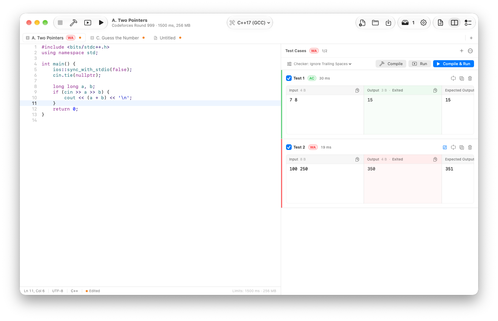
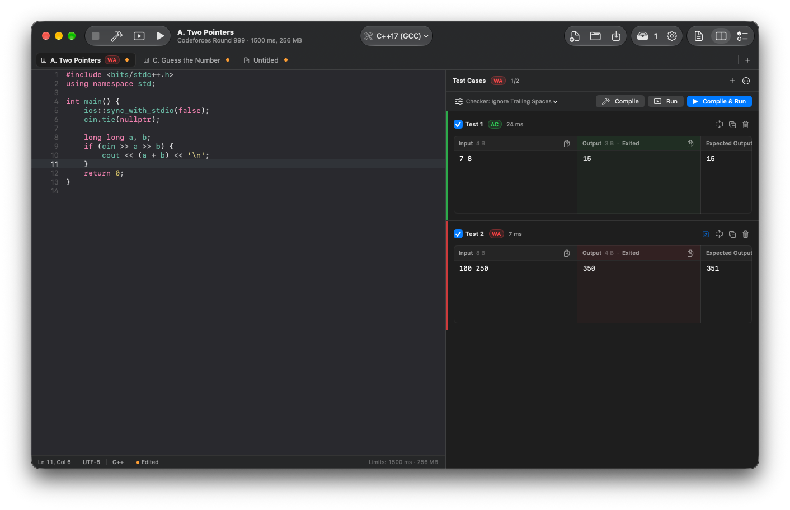
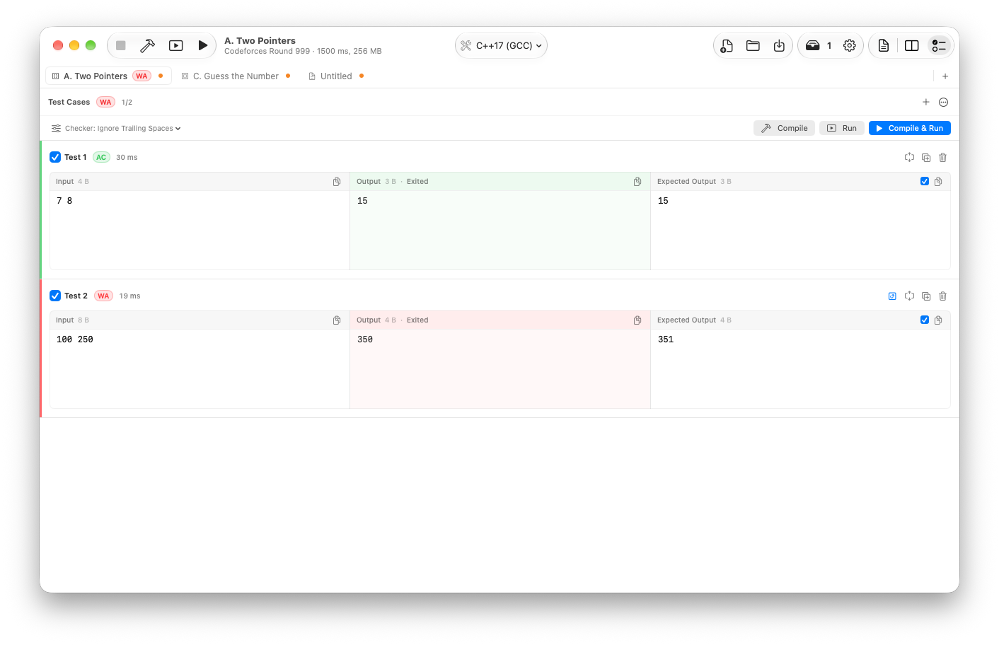
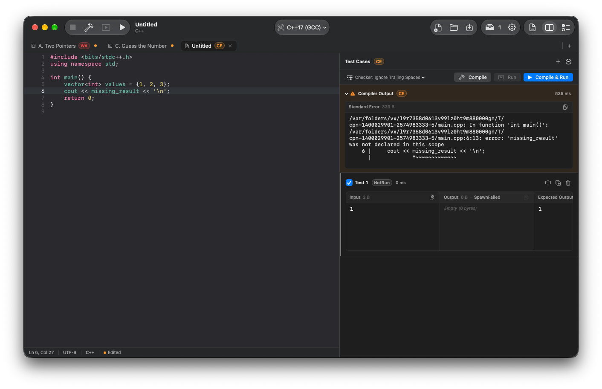
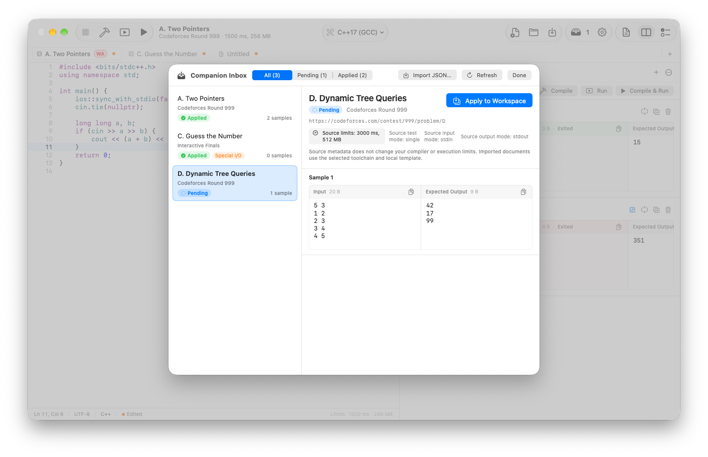
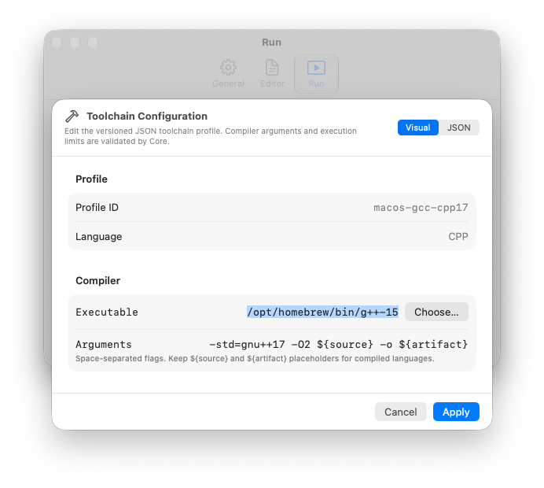
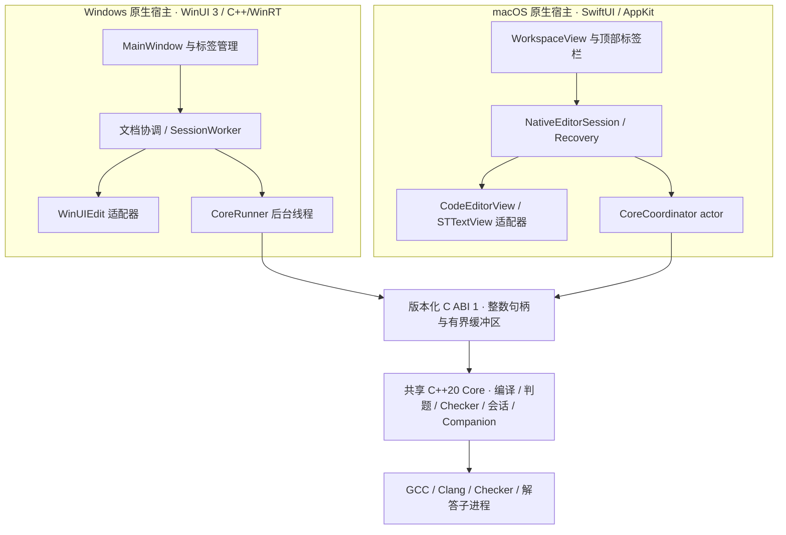

# CPEditor-Native

[](https://github.com/A-BenLi06/CPeditor-Native/releases/tag/v0.1.0)
[](LICENSE)
[](https://github.com/A-BenLi06/CPeditor-Native/actions/workflows/macos.yml)
[](https://github.com/A-BenLi06/CPeditor-Native/actions/workflows/windows.yml)

**面向算法竞赛的原生桌面编辑器：** Windows 采用 **WinUI 3 + C++/WinRT**，macOS 采用 **SwiftUI + AppKit**，两端共享**不依赖 Qt 的 C++20 竞赛引擎（Core）**，通过版本化稳定 C ABI 协调编译、运行、判题、会话恢复与 Competitive Companion 导入。

> **当前发布**：[`v0.1.0` Pre-release](https://github.com/A-BenLi06/CPeditor-Native/releases/tag/v0.1.0) 已提供 **macOS Apple Silicon（arm64）** 预览应用压缩包与校验文件；Windows 版本源码已在仓库及标签内，目前通过 Windows Server 2022 构建与桥接 CI，Windows 10 真机桌面验收尚未完成，暂不提供 Windows 安装包。

---

## 真机与运行截图

以下截图均在 **macOS 27.0.1（Apple Silicon arm64）** 真机上运行解压后的 `v0.1.0` Release `CPEditorNative.app` 实拍采集，编译器为真机安装的 **Homebrew GNU G++ 15**（`/opt/homebrew/bin/g++-15`），运行源码真实包含 `#include <bits/stdc++.h>`：

### 主工作区（浅色 & 深色模式 · 真实 GNU G++ 运行对比）

| 浅色模式分栏工作台（`AC` / `WA` 实测） | 深色模式分栏工作台（会话恢复后复跑） |
| :---: | :---: |
|  |  |

### 多视图排版、编译诊断、Companion 收件箱与设置

| 仅测试与输出视图（`⌃⌘3` 三栏完整展开） | 深色模式编译错误诊断（GNU G++ `CE` 输出） |
| :---: | :---: |
|  |  |

| Competitive Companion 文件收件箱 | 原生设置与 Visual／JSON 工具链配置 |
| :---: | :---: |
|  |  |

---

## 核心特性（v0.1.0 预览版）

- **仿上游竞赛工作台与三视图布局**：顶部文档标签栏配合左编右测分栏，支持在 **Editor Only**（`⌃⌘1`）、**Split**（`⌃⌘2`）与 **Tests and Output Only**（`⌃⌘3`）之间无损切换，底层编辑器实例与原生 `UndoManager` 撤销栈始终保留。
- **编译与运行分离 + 过期结果追踪**：支持独立 **Compile**（`⌘B`）、**Run Without Compiling**（`⌃⌘R`，仅增改样例时复用已编译产物）与 **Compile & Run**（`⌘R`）；任何源码、样例或运行配置修改都会自动将旧结果标为 **Outdated**。
- **默认 GNU G++ 与 `bits/stdc++.h` 支持**：自动发现 Homebrew、MacPorts 及 `PATH` 中带版本号的 GNU `g++`，提供 `C++17 (GCC)` 与 `C++20 (GCC)` 配置档；缺少 GNU G++ 时明确提示安装，不将 Apple 的 `/usr/bin/g++`（Clang 别名）静默替代为 GNU 编译器，Clang 配置保留供显式选择。
- **Output 先行的横向对照测试区**：在首次运行前即常显 **Input**、**Output** 与 **Expected Output**，按 `Input → Output → Expected Output` 顺序等高对照，窄分栏支持至少 `220 pt` 列宽横向滚动，仅 IO 宽视图下自动三栏铺满；取消期望输出校验时仍保留编辑框。
- **内置比较策略与外部 Checker**：支持 `Ignore Trailing Spaces`、`CP Editor Strict`、`Exact Bytes` 三种内置比较策略，也可启用自定义外部 Checker（独立进程诊断、自定义退出码映射、二进制 hex 有界预览）。
- **低干扰竞赛编辑辅助**：支持 `()`/`[]`/`{}`/引号即时配对、选区包裹、匹配上下文闭合字符跳过、相邻空对删除、大括号内回车缩进与 `Tab`/`Shift-Tab` 行缩进；保留原生输入法（IME）组合输入边界与系统撤销／重做。
- **原子会话恢复与文件保护**：源码正文、未保存修改、光标选区、样例原始字节与工具链选择在重启后恢复；使用协同文件摘要校验防止静默覆盖磁盘外部修改，支持 `Save Recovery As…` 与上一份备份恢复。
- **Competitive Companion 文件收件箱（macOS）**：支持导入 Companion JSON 题面载荷，展示 Pending / Applied 状态与来源限制说明，对交互题或非 stdio 模式标识 `Special I/O` 并在确认应用后写入带防重放回执的会话记录。

---

## 下载与安装（macOS v0.1.0 Pre-release）

1. 前往 [Releases v0.1.0](https://github.com/A-BenLi06/CPeditor-Native/releases/tag/v0.1.0) 下载 `CPEditor-Native-v0.1.0-macos-arm64.zip` 与 `SHA256SUMS.txt`。
2. 校验压缩包完整性并解压：

```sh
shasum -a 256 -c SHA256SUMS.txt
ditto -x -k CPEditor-Native-v0.1.0-macos-arm64.zip ./CPEditor-Native-v0.1.0
```

3. 安装真正的 GNU GCC（用于默认 C++ 编译与 `bits/stdc++.h`），然后启动应用：

```sh
brew install gcc
```

4. **首次打开说明**：当前预览版使用 ad-hoc 临时签名，**尚未经过 Developer ID 签名与 Apple 公证**。若系统提示“无法验证开发者”或“已损坏”，请通过右键 **打开** 或在确认来源可信后于“系统设置 → 隐私与安全性”中允许运行，切勿在未核对 `SHA256SUMS.txt` 前放行。

> **系统要求与已知边界**：macOS 包为 **Apple Silicon（arm64）** 构建，清单声明最低系统为 **macOS 26.0**，当前实机与 CI 验证环境为 **macOS 27.0.1 arm64**；macOS 26 最低系统与 Intel Mac 尚未实测。C++ 语义补全（clangd/LSP）、正式发布签名及完整性能基线仍在后续计划中。

---

## 平台状态与系统架构

| 组件 / 平台 | 当前状态 | 说明与已验证证据 |
| --- | --- | --- |
| **共享 C++20 Core** | 已可独立构建并测试 | 不依赖 Qt 与 UI 框架；涵盖领域模型、文本比较、POSIX/Win32 子进程、外部 Checker、会话恢复、Companion 收件箱／回环 HTTP 与有界 C ABI 1；Release CTest **17/17** 通过 |
| **macOS 原生应用** | **v0.1.0 预览可用** | SwiftUI + AppKit 双编辑器适配器；macOS 27.0.1 arm64 Release 测试 **18 套件 111/111** 通过（含 `bits/stdc++.h` 真实 G++ 编译运行）、严格签名通过、6 场景实机截图核验；macOS 26 / Intel / 系统中文 IME 候选窗待验 |
| **Windows 原生应用** | 源码已接入，待真机验收 | **主要目标平台为 Windows 10 22H2 专业工作站版**（WinUI 3 + C++/WinRT + WinUIEdit）；Windows Server 2022 x64 Debug/Release CI 通过 Core、桥接测试与完整宿主构建；Windows 10 真机 UI、IME、DPI 与 UU 远程实测待执行，本轮不提供安装包 |



---

## 常用快捷键（macOS）

与 [`EditorCommands.swift`](apps/macos/Sources/CPEditorNative/App/EditorCommands.swift) 保持一致：

| 快捷键 | 功能 | 快捷键 | 功能 |
| --- | --- | --- | --- |
| `⌘N` | 新建文档 | `⌘R` | 编译并运行（Compile & Run） |
| `⌘O` | 打开源文件 | `⌘B` | 仅编译（Compile） |
| `⌘S` / `⇧⌘S` / `⌥⌘S` | 保存 / 另存为 / 全部保存 | `⌃⌘R` | 跳过编译直接运行（Run Without Compiling） |
| `⌘W` / `⌥⌘W` | 关闭标签 / 关闭已保存标签 | `⌘.` | 停止当前运行 |
| `⌃⌘1` / `⌃⌘2` / `⌃⌘3` | 仅编辑器 / 分栏 / 仅测试与输出 | `⇧⌘T` | 新增测试样例 |
| `⇧⌘Y` | 显示／隐藏测试与运行面板 | `⇧⌘I` | 打开 Companion 收件箱 |
| `⌥⌘L` | 切换自动换行 | `⌘,` | 打开原生设置（外观 / 编辑器 / 工具链） |

---

## 从源码构建

### 1. 检出仓库与固定子模块

> `references/cpeditor` 是上游参考源码子模块，**仅用于源码对照研究**，不参与原生应用构建依赖；请勿使用 `git submodule update --remote` 浮动更新参考源码。

```sh
git clone --recurse-submodules https://github.com/A-BenLi06/CPeditor-Native.git
cd CPeditor-Native
```

### 2. 构建并测试共享 Core（CMake + C++20）

在仓库根目录执行（兼容 macOS 与 Windows PowerShell 7）：

```powershell
cmake --preset dev
cmake --build --preset dev
ctest --preset dev
```

无界面命令行工具位于 `out/core/dev/cpn-cli`（可执行 `out/core/dev/cpn-cli --help` 查看语言／工具链配置，定义文件位于 `resources/profiles`）。

### 3. 构建与运行 macOS 原生应用

前提：macOS Xcode 命令行工具／Xcode 27（SDK 27.2）、Ninja、Homebrew `gcc`（若运行 `CPN_REQUIRE_GNU_CPP=1` 测试）。详见 [macOS 原生说明](apps/macos/README.md)。

```sh
./script/test_macos.sh
./script/build_and_run.sh --verify
```

### 4. 构建与验证 Windows 原生应用（需在真实 Windows 主机执行）

前提：Windows 10/11、PowerShell 7、Visual Studio 2022（v143 C++/WinRT）、Windows SDK 与 MSIX 工具。详见 [Windows 原生说明](apps/windows/README.md)。

```powershell
pwsh -File ./tools/windows/verify.ps1 -Configuration Debug -Platform x64 -Deploy -Launch
```

---

## 版本迭代规则

本项目版本自 `v0.1.0` 起按 **`0.1.x` 补丁号持续递增**（`v0.1.0` → `v0.1.1` → `v0.1.2`…）。除非用户明确要求提升前两位版本号，否则所有修复、功能增量与发布迭代均在 `0.1.x` 系列内顺序推进。

---

## 仓库文档入口

| 文档 | 内容 |
| --- | --- |
| [v0.1.0 发布说明](docs/releases/v0.1.0.md) | `v0.1.0` 预览版构建、测试、实机截图、校验值与已知边界 |
| [实施状态与证据](docs/status.md) | 各阶段最新完成进度、CI 链接、实机测试证据与剩余工作 |
| [v0.1.0 发布后回归](docs/regressions/macos-post-v0.1.0.md) | 选区缩进、括号/引号配对、换行保留与 G++ 升级路径恢复回归记录 |
| [总体架构](docs/architecture.md) | 组件边界、平台集成、依赖方向和仓库布局 |
| [当前 Core API](docs/core-api.md) | 已实现的 C/C++ 接口、请求格式、任务与缓冲区限额 |
| [Core 契约](docs/core-contracts.md) | 源码快照、任务生命周期、进程限制、判题结果与持久化契约 |
| [外部 Checker](docs/external-checker.md) | testlib 二元退出协议、原始字节、限额与诊断配置 |
| [Companion 解码与导入](docs/companion.md) | 已实现的解码器、持久去重收件箱、原子会话回执与来源门禁 |
| [Companion 回环 HTTP](docs/companion-http.md) | 共享回环 HTTP 服务与监听生命周期 C ABI |
| [会话恢复](docs/session.md) | 工作区格式、原生偏好、保存点与并发恢复文件事务 |
| [上游源码审查](docs/upstream-audit.md) | 基于 CP Editor 7.0.2 / 7.3.0 的迁移清单与兼容性差异 |
| [编辑器评估](docs/editor-evaluation.md) | 依赖许可证、编辑器候选对比与原型验收条件 |
| [实施计划](docs/implementation-plan.md) | 分阶段里程碑（M0–M6）、验证矩阵与发布规则 |
| [任务认领登记](docs/claims.md) | 协作成员工作边界与状态登记 |
| [改动记录](walkthrough.md) | 带机器生成 ISO 8601 时间戳的开发、验证与发布记录 |

---

## 上游参考与许可

- 本项目受 [CP Editor](https://github.com/cpeditor/cpeditor) 启发并以其 7.0.2 / 7.3.0 源码（固定于 `references/cpeditor`）作为行为兼容研究基线，原生 UI 与不依赖 Qt 的共享 Core 为重新独立实现。
- 自有源码按 **GNU General Public License v3.0 or later（`GPL-3.0-or-later`）** 发布，完整许可正文见 [LICENSE](LICENSE)。
- 第三方依赖与固定版本清单见 [THIRD_PARTY_NOTICES.md](THIRD_PARTY_NOTICES.md) 及 `apps/macos/Package.resolved`。
