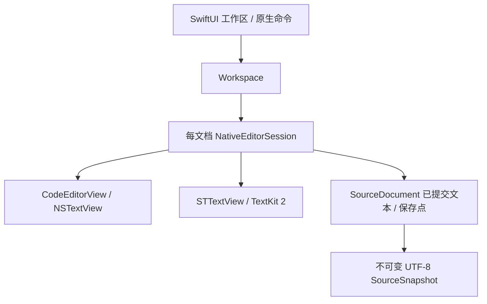

# macOS 原生编辑器原型

验证记录时间：2026-11-16T23:06:43+08:00。

本目录实现 SwiftUI 窗口、菜单和文档侧栏，以及两个真实 AppKit 编辑器适配器。当前为 M0 编辑器对照阶段，组件集成不代表已选择生产编辑器。主项目仍以 Windows 10 22H2 为第一目标。

## 构建和启动

已验证主机：macOS 27.0.1（26A434）、Apple Silicon arm64、Xcode 27.2、Swift 6.4.2。`Package.swift` 和应用元数据声明 macOS 14.0 为部署下限；尚未在 macOS 14 实机运行，不能把当前主机的通过结果视为最低系统验证。

从仓库根目录执行：

```sh
swift package resolve --package-path apps/macos
swift test --package-path apps/macos
./script/build_and_run.sh --verify --editor codeeditorview "$PWD/tests/fixtures/editor/unicode.cpp"
```

改为 `--editor sttextview` 可在同一文件上启动另一组件。应用的 **Editor → Open Copy in Other Editor** 将当前已提交文本复制到独立文档。两个编辑器各自拥有编辑缓冲区和撤销历史；复制的文档没有磁盘路径，不会自动覆盖来源文件。

启动脚本为 [script/build_and_run.sh](../../script/build_and_run.sh)，产物为仓库内 `out/macos/CPEditorNative.app`。脚本从 `AppMetadata.plist` 读取应用标识和可执行文件名，构建、复制 SwiftPM 资源、临时签名，然后使用 `open -n` 启动真实应用 bundle。资源位于 `Contents/Resources`，已按当前工具链生成的 `Bundle.module` accessor 验证。Codex 的 Run 按钮配置位于 `.codex/environments/environment.toml`。

可选模式：

| 参数 | 行为 |
| --- | --- |
| `--build-only` | 构建并生成 `.app`，不启动 |
| `--verify` | 启动并确认 LaunchServices 已登记指定 bundle 的存活进程；不是完整 UI 验收 |
| `--debug` | 从 bundle 内可执行文件进入 LLDB |
| `--logs` | 启动并查看该进程的统一日志 |
| `--telemetry` | 启动并按应用 subsystem 过滤统一日志 |

脚本只向与本仓库产物绝对路径一致的旧实例请求退出，不按进程名终止其他程序。如果应用仍有保存提示或拒绝退出，脚本终止本次重新启动。打包采用本地临时签名；发布签名、Hardened Runtime 和公证不在此原型范围内。

## 模块边界



- `NativeEditorModel`：稳定 UUID、单调 revision、不可变快照、保存点、严格 UTF-8 文件往返、UTF-16 到 UTF-8 的标量边界转换，以及拒绝拆分字素簇的编辑范围校验。`replacing` 只计算经过版本检查的替换结果，不直接重设原生文本。
- `NativeEditorSession`：独占原生容器、编辑器和 UndoManager。文档通过 NativeEditorDeck 持续挂载在同一窗口中，切换只修改原生 isHidden；不会根据 SwiftUI 刷新全量覆盖字符存储。文档关闭时取消待处理捕获并释放代理／通知注册。
- `CodeEditorState`：供组件显示的原始 Binding，与共享模型中的已提交文本区分。AppKit 在 `setMarkedText` 的内部替换步骤可能先发送通知、后建立 marked range；通知因此安排当前原生调用结束后的主线程任务捕获。此处没有定时器、输入屏蔽或强制 `unmarkText`。保存、复制等命令同步捕获当前原生状态，组合输入未结束时拒绝捕获为可保存快照。
- STTextView 的代理同步检查 `hasMarkedText()`；高亮使用非持久的 rendering attributes，不改字符内容、不加入撤销历史。两个组件使用相同的 C++ 配置数据；STTextView 目前为全文件词法高亮，尚无增量性能结论。
- `Workspace`：打开、另存为、保存、关闭文档和未保存确认；窗口代理转发已有 SwiftUI 代理，退出时检查全部存活工作区。

`SourceDocument.snapshot()` 返回已提交内容。调用后续编译／判题接口之前必须先对对应 `NativeEditorSession` 调用 `capture()` 并检查 `isComposing`；仅从显示用 Binding 取字符串不能保证 IME 事务已经完成。异步结果还需由共享 Core 检查 documentID 和 revision。

## 配置和本地化

应用默认语言为英文，产品文案放在 `Resources/en.lproj/Localizable.strings`，由 `Bundle.module` 加载。开发要求留在仓库文档，不作为产品提示。

`Resources/workspace.json` 定义带版本的默认编辑器和语言集合；`NativeEditorModel/Resources/cpp.json` 定义 C++ 文件扩展名、建议文件名、关键字和词法规则。当前只提供 C++ 配置；未知扩展名使用配置中的默认语言。该高亮层不是完整 C++ 解析器，目前未实现 raw string、预处理器全部语义或 clangd/LSP。

## 自动验证证据

当前 `swift test --package-path apps/macos` 通过 9 项测试（5 项模型测试、4 项原生组件测试）。原生测试创建真实 `NSWindow` 和编辑器视图，不用空白占位控件替代组件。

| 检查 | 当前证据 |
| --- | --- |
| UUID、revision、保存点 | 同内容不增版本；保存旧快照期间的新编辑仍为未保存；撤销到保存内容恢复保存状态 |
| Unicode 和版本范围 | CJK、emoji、组合字符、UTF-16/UTF-8 映射；拒绝代理对／字素簇拆分和过期版本 |
| 文件保存 | 中文和 emoji 文件名，UTF-8、CRLF/LF、制表符、组合字符精确往返；拒绝无效 UTF-8 |
| C++ 高亮 | 两组件创建实际 C++ 配置；词法测试验证注释、字符串、预处理器及数值不会相互错误着色 |
| CodeEditorView | 真实 `NSTextView.setMarkedText`／`insertText` 回归测试；preedit 不进入 revision；提交后只有一次内容版本；原生撤销／重做，移出再装回同一容器后历史保留 |
| STTextView | 真实组合文本暂存、中文／emoji 提交、原生撤销／重做和独立 UndoManager |
| 原生缓冲区 | 两组件加载 CJK、代理对、组合字符、制表符、CRLF/LF 后字符内容与输入文件一致 |
| 原生撤销命令链 | 真 WorkspaceView、原生 paste、firstResponder/nextResponder 接收者解析、NSMenu 验证与 tryToPerform；Undo/Redo 和切换 ST 后返回 CEV 的 Undo 通过；内部可编辑 NSTextView 身份保持不变 |
| `.app` 启动／资源 | `--verify` 已找到指定 bundle 进程；通过统一日志读到 Documents 和 Lifecycle 的打开／窗口／启动事件 |

真实 CUA 首轮验收发现 CEV 粘贴后 Edit 菜单 Undo/Redo 禁用：每文档 UndoManager 虽有历史，容器未实现标准 undo:/redo: 命令接收者，默认窗口无法操作这份历史。EditorContainer 现提供这两个原生动作和 NSMenuItemValidation。新增工作区层级回归还发现卸载 NSHostingView 会重建内部 NSTextView，因此改为 NativeEditorDeck 持续挂载；这项回归不能仅靠直接 history.undo() 验证。测试宿主不是前台应用，菜单接收者按公开 responder 链解析；根 agent 已在重新打包后的真实前台应用中通过 CUA 复验：粘贴中文／emoji 后 Undo 菜单启用，点击后恢复原始源码及保存状态。快捷键、多轮焦点与系统输入法仍保留在目标机矩阵中。

这些程序化输入调用验证编辑器事务边界，不能代替系统中文输入法的候选窗口、转换、取消、菜单、Spaces、全屏、多显示器或辅助功能测试。实际 UI 验收由主项目记录。尚未获得冷／热启动、输入延迟、长行、大文件和内存基线；也没有验证 macOS 14、Intel、发布签名或已解决 Qt 的 Windows 卡顿。

## 固定依赖和许可

直接依赖固定到不可变提交，传递依赖记录在 `Package.resolved`。本原型沿用主仓库 GPLv3 路径使用 STTextView，不使用其商业许可路径；后续发布必须保留适用许可和对应源码。

| 依赖 | 固定版本 | 许可 |
| --- | --- | --- |
| CodeEditorView | `2394a48f919d6570cfbfbd53d047a3eaeb95b59e` | Apache-2.0 |
| STTextView | `c7d519318b06ebb7a99a641e4aa8831105d3b7d4` | GPLv3／商业许可；本原型采用 GPLv3 |
| Rearrange | 1.8.1 / `5ff7f3363f7a08f77e0d761e38e6add31c2136e1` | BSD-3-Clause |
| STTextKitPlus | 0.3.1 / `8117f3b6a20633e4ce92df102dd260b808ffc9bd` | BSD-3-Clause |
| CoreTextSwift | 0.2.0 / `833177201d6421e6322296f39fce6ff6ae52618a` | MIT |

上游原始许可文本保留在 `Sources/CPEditorNative/Resources/ThirdPartyLicenses` 并随应用资源一起打包。本目录仅通过公开 API 集成组件，没有修改 `.build/checkouts` 中的参考代码。
