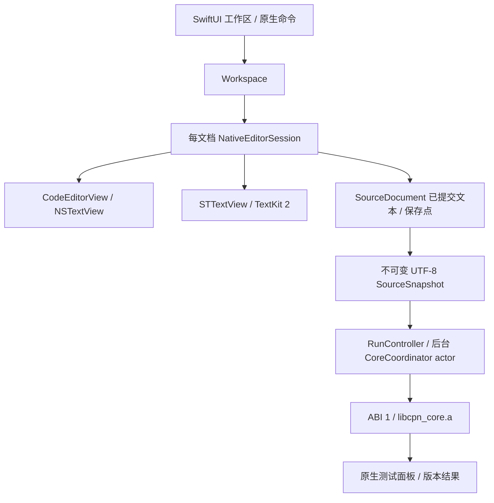
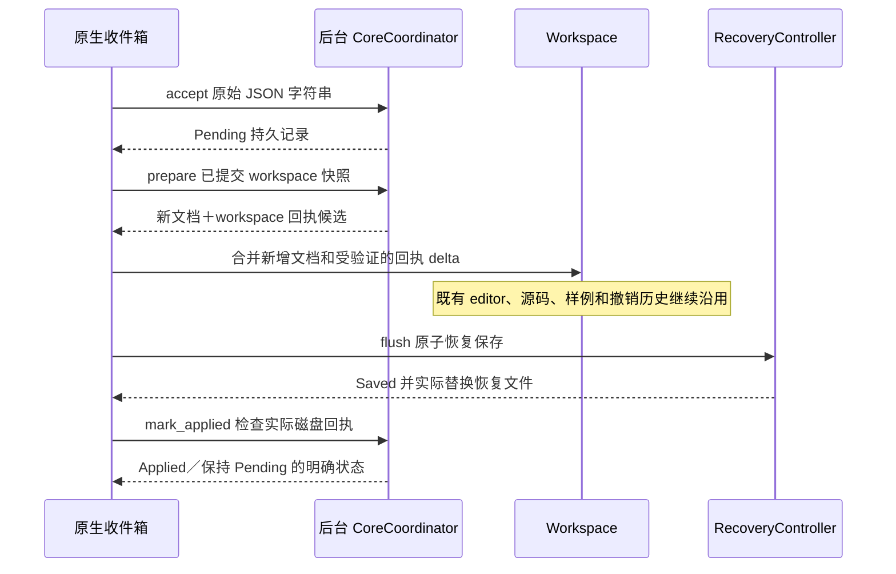

# macOS 原生编辑器原型

验证记录时间：2026-11-18T14:51:32+08:00（左编右测布局重构、产品化去内部实现命名、Visual＋JSON 双模配置表与双编辑器深浅色外观修复）。

本目录实现 SwiftUI 顶部标签栏、左编右测分栏窗口、原生菜单，以及两个真实 AppKit 编辑器适配器（用户可见界面统一以编辑器能力呈现，不暴露内部组件类名）。当前已完成双编辑器适配器、共享 Core 的样例运行、会话恢复、外部 checker、Companion 文件收件箱接入及产品化 UI/UX 重构，组件集成不代表已选择生产编辑器，也不代表后续完整里程碑已验收。主项目仍以 Windows 10 22H2 为第一目标。

## 构建和启动

已验证主机：macOS 27.0.1（26A434）、Apple Silicon arm64、Xcode 27.2、Swift 6.4.2。`Package.swift` 和 `AppMetadata.plist` 统一声明 macOS 26.0 为部署下限；`script/macos_toolchain.sh` 固定使用 Xcode 27 默认工具链与 SwiftPM `native` 构建后端，`script/verify_macos_build.py` 在构建和测试前后核对共享 Core 归档与最终可执行文件的 Mach-O `LC_BUILD_VERSION`（`minos 26.0`、当前 SDK `27.2`）。尚未在 macOS 26 实机或 Intel 机器运行，不能把当前主机的通过结果视为最低系统验证。

从仓库根目录执行：

```sh
./script/test_macos.sh
./script/build_and_run.sh --verify --editor codeeditorview "$PWD/tests/fixtures/editor/unicode.cpp"
```

改为 `--editor sttextview` 可在同一文件上通过命令行参数切换至备选编辑器适配器以供开发评估；用户可见菜单与窗口界面不再暴露内部编辑器组件名称或原型调试菜单（Workspace Recovery 已收拢至 **File → Workspace Recovery** 子菜单）。

启动脚本为 [script/build_and_run.sh](../../script/build_and_run.sh)，产物为仓库内 `out/macos/CPEditorNative.app`。脚本先用 CMake 构建聚合静态库 `out/core/dev/libcpn_core.a`，然后从 `AppMetadata.plist` 读取应用标识和可执行文件名，构建 Swift 应用、复制 SwiftPM 资源、临时签名，然后使用 `open -n` 启动真实应用 bundle。资源位于 `Contents/Resources`，已按当前工具链生成的 `Bundle.module` accessor 验证。Codex 的 Run 按钮配置位于 `.codex/environments/environment.toml`。

可选模式：

| 参数 | 行为 |
| --- | --- |
| `--build-only` | 构建并生成 `.app`，不启动 |
| `--verify` | 启动并确认 LaunchServices 已登记指定 bundle 的存活进程；不是完整 UI 验收 |
| `--debug` | 从 bundle 内可执行文件进入 LLDB |
| `--logs` | 启动并查看该进程的统一日志 |
| `--telemetry` | 启动并按应用 subsystem 过滤统一日志 |

脚本只向与本仓库产物绝对路径一致的旧实例请求退出，不按进程名终止其他程序。如果应用仍有保存提示或拒绝退出，脚本终止本次重新启动。打包采用本地临时签名；发布签名、Hardened Runtime 和公证不在此原型范围内。

## 模块边界



- `NativeEditorModel`：按 UTF-8 字节比较的不透明身份、单调 revision、不可变快照、保存点、严格 UTF-8 文件往返、UTF-16 到 UTF-8 的标量边界转换、拒绝拆分字素簇的编辑范围校验，以及按已提交版本缓存的 `TextLineIndex` 稀疏 64 单元位集行列索引（状态栏查询不再逐次全量扫描文本；局部基准入口见 `tools/macos/cursor_position_benchmark.sh`）。`replacing` 只计算经过版本检查的替换结果，不直接重设原生文本。
- `NativeEditorSession`：独占原生容器、编辑器和 UndoManager。文档通过 NativeEditorDeck 持续挂载在同一窗口中，切换标签或折叠底部测试面板只调整布局而不卸载原生视图；不会根据 SwiftUI 刷新全量覆盖字符存储。`EditorContainer` 监听有效外观变化并在当前绘制外观下刷新 `STTextView` 的语义背景色、文本色和词法高亮，保证浅色／深色模式切换清晰可读。文档关闭时取消待处理捕获并释放代理／通知注册。
- `CodeEditorState`：供组件显示的原始 Binding，与共享模型中的已提交文本区分。AppKit 在 `setMarkedText` 的内部替换步骤可能先发送通知、后建立 marked range；通知因此安排当前原生调用结束后的主线程任务捕获。此处没有定时器、输入屏蔽或强制 `unmarkText`。保存、复制等命令同步捕获当前原生状态，组合输入未结束时拒绝捕获为可保存快照。
- STTextView 的代理同步检查 `hasMarkedText()`；高亮使用非持久的 rendering attributes，不改字符内容、不加入撤销历史。两个组件使用相同的 C++ 配置数据；STTextView 目前为全文件词法高亮，尚无增量性能结论。
- `Workspace`：协调打开、另存为、保存和关闭文档；每个源文件保存点记录已保存逻辑文本和磁盘字节的独立 SHA-256。窗口代理转发已有 SwiftUI 代理。本轮使用单一 `Window` 场景，避免多个工作区竞争默认恢复文件；尚未实现多窗口。最后窗口关闭后应用退出。

`RunController.runAll` 在取 `SourceDocument.snapshot()` 前调用对应 `NativeEditorSession.capture()` 并检查 `isComposing`；仅从显示用 Binding 取字符串不能保证 IME 事务已经完成。提交时复制测试用例和工具链配置，后台 actor 用 C ABI 创建并提交任务，不通过 CLI 子进程中转。返回结果保留 documentID/revision，面板明确标示源码是否已经改变。

## 配置和本地化

通过应用菜单的 Settings、`⌘,` 或工具栏齿轮打开原生设置窗口：

- **General**：System、Light、Dark 立即应用到设置和工作区，并保存在应用偏好中；Layout 只切换当前窗口布局。
- **Editor**：Wrap Lines 和 Show Minimap 使用现有工作区恢复文件；缩略图仅对支持此能力的编辑器生效。
- **Run**：为当前标签选择工具链、导入 JSON 配置、编辑编译参数，以及管理输出比较与外部 checker。工具栏和 Run 菜单可直达同一配置表。保存 checker 配置不会打开开关；首次从开关进入配置时，只有确认应用才启用。

设置复用当前工作区，无须打开第二份恢复文件。冻结工作区仍能调整非持久布局和应用外观，但不能改写持久工作区设置。

应用默认语言为英文，产品文案放在 `Resources/en.lproj/Localizable.strings`，由 `Bundle.module` 加载。开发要求留在仓库文档，不作为产品提示。

`Resources/workspace.json` 定义带版本的默认编辑器和语言集合；`NativeEditorModel/Resources/cpp.json` 定义 C++ 文件扩展名、建议文件名、关键字和词法规则。当前只提供 C++ 配置；未知扩展名使用配置中的默认语言。该高亮层不是完整 C++ 解析器，目前未实现 raw string、预处理器全部语义或 clangd/LSP。

## 自动验证证据

当前 `./script/test_macos.sh` 通过 80 项测试（12 项模型与稀疏行列索引测试、53 项原生编辑器／面板／恢复／checker／Companion／revision／结果归属／光标位置／工作区 UI/UX 测试、15 项 C ABI 桥接测试）；双编辑器恢复、满额偏好恢复、原生光标／组合输入位置和最后文档关闭回滚分别执行两个参数化实例，配置呈现执行 checker／toolchain × 默认／已配置的四个实例。原生测试创建真实 `NSWindow` 和编辑器视图，不用空白占位控件替代组件。

| 检查 | 当前证据 |
| --- | --- |
| 不透明身份、revision、保存点 | 同内容不增版本；保存旧快照期间的新编辑仍为未保存；撤销到保存内容恢复保存状态 |
| Unicode 和版本范围 | CJK、emoji、组合字符、UTF-16/UTF-8 映射；拒绝代理对／字素簇拆分和过期版本 |
| 文件保存 | 中文和 emoji 文件名，BOM、NUL、UTF-8、CRLF/LF、制表符、组合字符精确往返；有界循环读取，拒绝无效 UTF-8和超限来源 |
| C++ 高亮 | 两组件创建实际 C++ 配置；词法测试验证注释、字符串、预处理器及数值不会相互错误着色 |
| CodeEditorView | 真实 `NSTextView.setMarkedText`／`insertText` 回归测试；preedit 不进入 revision；提交后只有一次内容版本；原生撤销／重做，移出再装回同一容器后历史保留 |
| STTextView | 真实组合文本暂存、中文／emoji 提交、原生撤销／重做和独立 UndoManager |
| 原生缓冲区 | 两组件加载 CJK、代理对、组合字符、制表符、CRLF/LF 后字符内容与输入文件一致 |
| 原生撤销命令链 | 真 WorkspaceView、原生 paste、firstResponder/nextResponder 接收者解析、NSMenu 验证与 tryToPerform；Undo/Redo 和切换 ST 后返回 CEV 的 Undo 通过；内部可编辑 NSTextView 身份保持不变 |
| Core 实际编译／运行 | 未保存 C++ 源码通过原生缓冲区快照编译，样例输出 `3\n` 判为 AC；运行期间修改原生缓冲区后，返回结果识别为旧源码版本，编辑内容仍在且未保存 |
| 取消和资源配额 | Running 期间取消得到终态，再提交任务成功；在 max_jobs=1/max_buffers=1 下重复运行和取消后运行通过，验证终态 job 和每次 drain 的 buffer 均释放 |
| 契约字节 | 缺少 expected 与空 expected 区分；binary/base64 往返、非规范 padding 拒绝、工具链未知字段保留并交给 Core 校验 |
| `.app` 启动／资源 | `--verify` 已找到指定 bundle 进程；通过统一日志读到 Documents 和 Lifecycle 的打开／窗口／启动事件 |

真实 CUA 首轮验收发现 CEV 粘贴后 Edit 菜单 Undo/Redo 禁用：每文档 UndoManager 虽有历史，容器未实现标准 undo:/redo: 命令接收者，默认窗口无法操作这份历史。EditorContainer 现提供这两个原生动作和 NSMenuItemValidation。新增工作区层级回归还发现卸载 NSHostingView 会重建内部 NSTextView，因此改为 NativeEditorDeck 持续挂载；这项回归不能仅靠直接 history.undo() 验证。测试宿主不是前台应用，菜单接收者按公开 responder 链解析；根 agent 已在重新打包后的真实前台应用中通过 CUA 复验：粘贴中文／emoji 后 Undo 菜单启用，点击后恢复原始源码及保存状态。快捷键、多轮焦点与系统输入法仍保留在目标机矩阵中。

这些程序化输入调用验证编辑器事务边界，不能代替系统中文输入法的候选窗口、转换、取消、菜单、Spaces、全屏、多显示器或辅助功能测试。实际 UI 验收由主项目记录。尚未获得冷／热启动、输入延迟、长行、大文件和内存基线；也没有验证 macOS 14、Intel、发布签名或已解决 Qt 的 Windows 卡顿。

## 共享 Core 测试面板

每个原生文档会话保留自己的测试用例，支持添加、删除、启用、原生 Input/Expected Output 编辑，以及导入现有 `samples.json` 形式的测试数组。缺少 expected 表示不比较；空字符串 expected 表示比较空输出。base64 二进制测试数据原样保留，用户编辑文本字段时才替换为输入的 UTF-8 文本。

默认工具链定义在 `Resources/Toolchains/macos-clang.json`，支持选择、加载和编辑同一版本化 Core profile。该配置调用 `/usr/bin/clang++`，编译限制为 30 秒、运行限制为 2 秒，参数数组和限制均位于数据文件。`Resources/running.json` 选择默认 profile、比较方式、导入容量、测试数量和后台轮询配置；C ABI 自身仍执行权威校验。工具链未知字段不会在 Swift 解码时被静默丢弃。

`NativeCoreBridge` 的 C shim 只转引根目录 `core/include/cpn/api.h`，不复制函数声明；SwiftPM 只链接聚合静态库 `cpn_core` 与系统 `c++`。契约映射集中在 `WireModels.swift`，不在视图中重复 JSON 字段。默认库目录为 `out/core/dev`，可用绝对路径 `CPN_CORE_LIBRARY_DIR` 覆盖。`CPN_CORE_PREBUILT=1 ./script/build_and_run.sh --verify` 跳过 CMake 构建，适用于已有稳定库或协调并行构建。

`CoreCoordinator` 串行拥有引擎和任务句柄。每次 drain 先复制返回字节，再在 decode 成功或失败时都释放 buffer；终态事件已由 Core 确认后释放 job。协议消费失败时销毁引擎，保证任务、native buffers 和 worker 仍有界。ABI 1 暂无等待事件接口，因此仅在后台 actor 中按配置轮询，不在 MainActor 等待进程。取消按钮调用 Core cancel，继续 drain 到终态。关闭单个文档会取消该文档的运行。关闭窗口／退出应用先捕获全部已提交文本并保存恢复会话，再异步取消并 join 两个独立 Core 引擎，完成后才继续关闭；恢复保存失败提供单独导出或取消关闭。

当前面板覆盖编译、普通样例执行、内置比较和外部 checker 二元判题；尚未实现 clangd、checker 编译、完整评分、交互题、压力测试或完整竞赛导入工作流。旧源码标记只说明 source revision 关系；展示的是 Last Run 的不可变结果，不会把后来编辑的测试用例重新判为旧任务输入。

## 会话恢复与文件保存

`RecoveryController` 使用独立的后台 `CoreCoordinator` 调用带版本的 `cpn_engine_session_load`／`cpn_engine_session_save_json`。字段映射集中在 `NativeCoreBridge/SessionModels.swift`；权威契约和存储边界见根目录 [docs/session.md](../../docs/session.md)。恢复包含稳定的文档／工作区身份、revision、已提交 UTF-8 正文、原始路径、保存点、样例字节、工具链配置／引用、选中标签和原生选区。撤销历史、preedit、任务句柄和运行输出不写入恢复文件。

恢复先验证全部文档和原生组件真实 buffer，再一次性替换工作区；任意候选失败都保留当前工作区。恢复不会读原始源文件覆盖未保存正文。Core 返回 `Invalid`、`UnsupportedSchema` 或 I/O 失败时，原恢复文件保留并阻止自动覆盖；原生不支持的 revision 极值同样拒绝应用。通过 Recovery 菜单可查看原文件、恢复上一份备份、重试或另存恢复。备份加载前后都重新捕获并拒绝未完成的输入法组合，内存中未存下的新修改也必须先保留。

未知命名空间／版本的 `object_json` 原始字符串保持字节不变。遇到本应用自己的未来偏好版本时，保留这份偏好，使用当前默认设置，并显示该版本无法存储这些设置更改的提示；不会再追加同命名空间的旧版本。源码和样例仍可继续编辑、恢复和保存。`RawIdentifier` 的相等和哈希基于 UTF-8 字节；Swift 的规范等价字符串（如 `é` 与 `e + combining acute`）不会合并身份，源码字节改变也会增加 revision。版本耗尽时禁止后续原生编辑；若 Undo 或程序化操作改变 live buffer，则报告捕获失败，可将实际 buffer 复制到新文档，旧快照不会被误当成新内容。

默认恢复位置由 `Resources/recovery.json` 定义，位于 Application Support 的 `CPEditor-Native/Recovery/workspace.json`，备份和锁文件使用同一配置派生。另存恢复只接受独立且不存在的新位置，由 Core 校验原件与磁盘摘要，拒绝覆盖旧恢复、备份、锁文件及它们的别名；生产模式将成功的新位置写入带版本的本机偏好，后续启动继续使用。`--recovery-file` 可显式指定独立恢复文件，适合分别验证两种编辑器：

```sh
CPN_CORE_PREBUILT=1 ./script/build_and_run.sh --verify \
  --recovery-file "$PWD/out/macos/verification/workspace.json" \
  --editor codeeditorview "$PWD/tests/fixtures/editor/unicode.cpp"
```

原生变更通过 Observation 在当前输入事务完成后合并到后台保存；没有用计时延迟掩盖输入问题。保存使用 Core 的磁盘摘要 token 和持久锁路径，只有 `recovery_replaced` 为真才推进 token。`DurabilityUnknown` 明确报告已经替换但无法确认持久性；取消锁等待会关闭该恢复引擎，先于引擎创建的取消也会保留请求并阻止写入；重试创建新引擎。源码运行使用另一引擎，因此不会被恢复 I/O 的等待阻塞。

源文件操作在后台使用 `NSFileCoordinator`。写入先在协调区域验证原磁盘摘要，再原子写入精确 UTF-8 字节；冲突保留编辑内容，并要求选择另一位置另存。BOM 保留为原始 U+FEFF 正文，CRLF 和 NUL 也不做转换。保存旧快照时的新编辑保持 dirty。关闭单个文档期间冻结该文档的编辑和原生 Undo／Redo；保存完成再次检查新版本，不能据旧快照成功删除新编辑。关闭目标先从逻辑文档列表移除，其原生容器继续隐藏挂载；恢复保存成功后才销毁容器，替换前失败则把同一文档插回原位置并恢复选中项和撤销历史。打开、测试导入和恢复导出／备份加载均跟踪生命周期，进行中拒绝关闭；`flush` 和 shutdown 等待已有恢复任务。

`NSFileCoordinator` 及 Core 锁仅协调遵守协议的 writer，摘要检测属于乐观校验，不能宣称阻止绕过协调的外部程序在最终替换时竞争。这轮已验证源文件冲突、受控协调 writer 阻塞期间的新编辑、恢复导出持锁时关闭拒绝和 flush 等待，以及真实 I/O 失败返回；尚未做断电／磁盘设备故障验证。两个原生组件的恢复均验证 BOM、CRLF、NUL、CJK、emoji 和选区精确往返；真实系统输入法与最低系统仍需目标机矩阵。


## 外部 checker 原生面板

测试面板提供 **External Checker** 开关和 **Configure Checker…** JSON 编辑器。默认关闭且没有配置，启用时先要求应用有效配置；应用配置后启用 checker，关闭开关仍保留配置。编辑器内显示校验错误，不改变已经应用的有效配置。内置 Comparison 选择在外部 checker 启用时禁用。版本 1 草稿位于 `Resources/checker.json`，用户需选择现有可执行程序及参数数组；应用不会编译 checker。

checker 和 toolchain 配置统一使用带身份、类型和完整 JSON 的 `ConfigurationJSONDraft` 通过 `sheet(item:)` 呈现，`ConfigurationJSONSheet` 在创建时初始化自己拥有的文本及错误状态。首次前台 CUA 曾发现旧的布尔呈现状态与独立文本状态导致首次打开空白；当前数据流把呈现和载荷作为同一次状态更新，不用延时或 `onAppear` 再灌入文本。取消丢弃未应用草稿，再次打开重新读取已应用配置；Apply 校验失败保留文本并在 sheet 内显示错误，成功才关闭。Escape 和 Return 使用原生取消／默认动作快捷键。

`NativeCoreBridge/CheckerConfiguration.swift` 按 [外部 checker 契约](../../docs/external-checker.md) 校验配置。专用有界 JSON 解析器保留整数类型并拒绝重复字段；配置／命令／limits／environment 各层拒绝未知字段，检查版本、整数范围、参数数量、命令／环境字节预算、互斥退出码映射、环境名 ASCII 大小写去重、NUL、占位符及平台时钟范围。`memory_bytes` 等未实现字段拒绝。配置中的 ASCII 分隔符按 UTF-8 字节扫描，避免 `= + combining acute` 或 `} + combining acute` 的字素簇影响契约。提交使用结构化 executable／arguments，不拼接 shell；Core 仍执行权威校验。

每个 Run All 复制源码、测试和 checker 配置。只有解答正常退出 0 且 Expected Output 存在时才运行 checker；没有 Expected 表示 Unchecked，空 Expected 仍实际调用 checker。测试结论 AC／WA 与 checker 自己的 `Accepted`／`WrongAnswer` 分开建模；默认退出码 0 接受、1／2 拒绝，未映射码（包括默认评分码 7）为 CheckerError。checker 的超时、异常、创建失败和输出超限均显示独立 CheckerError，解答原来的 TLE／RE 不会被替换；取消显示 Cancelled。stdout 分数文本不会被猜测为二元结论。

结果面板分开显示 **Solution status** 和 **Checker Diagnostics**。checker 诊断读取契约中的 verdict、process_attempted、termination、exit_code、signal、native_error、elapsed_ms、stdout／stderr 总采集字节与截断标记；未尝试进程时不把默认进程状态当成真实退出。正常 UTF-8 输出按文本显示；包含 NUL、其他非文本控制字节或无效 UTF-8 时使用有界 hex 预览，并说明显示字节数与原始输出的区别。原始 `Data` 保留，Input／Expected 编辑绑定原有 `.text` 语义不变。预览默认 256 字节，配置位于 `Resources/running.json` 的 `binary_preview_bytes`。

checker 偏好使用独立命名空间 `org.cpeditor.native.macos.checker`、版本 1，保存 enabled 与 `configuration_json` 原始字符串，不更改已有 workspace 偏好版本。原始 JSON 格式和已禁用配置随会话往返。遇到该命名空间未来版本时，所有版本（包括共存的 v1）都作为不透明原件保留，不解释 v1，也不追加重复旧版本；当前应用关闭 checker 并禁用配置入口，源码和样例仍可保存。当前版本偏好中的无效配置整体拒绝恢复候选，保留既有工作区。

未启用且无配置的 checker 不写空偏好。Core 每 owner 最多 16 条偏好；未知原件占满容量时不强加 workspace／document 默认条目，显示设置容量提示，继续保存源码和测试。新增 checker 没有可用槽位时在 Apply 之前拒绝，保持原状态；已有 checker 保留其存储槽位。`Resources/recovery.json` 定义本机 owner 上限，`running.json` 定义单 checker 偏好上限。虽然 Core checker JSON 最多 1 MiB，原生持久化还受单偏好 64 KiB 限制，因此 Apply 和恢复均校验完整偏好编码大小，包含更长的 disabled 状态，避免应用成功后阻断恢复保存。

本轮通过真实 Core 和原生测试验证：AC／WA、无答案跳过、空输出／空答案调用、checker 超时／信号／输出超限、默认退出 7、解答 RE／TLE 跳过 checker、Checking 期间取消、原始 NUL／0xFF 诊断与总数、配置开关重启恢复、未来 v1＋99 共存、无 workspace 偏好＋foreign16、foreign15＋workspace1，以及拒绝新增无容量配置后的源码／样例保存。语法回归覆盖重复／浮点／未知字段、范围、模板组合字符和环境名边界。当前 AppKit 测试真实挂载 RunPanelView；根 agent 已在独立恢复文件中完成前台 CUA 验收，没有操作用户默认恢复文件或既有验收数据。

新增配置呈现回归在后台测试窗口中实际创建附属 sheet，读取原生 `NSTextView` 的首次内容，输入未应用草稿并通过 Escape 取消、再次呈现后验证内容恢复；同时通过 Return 触发真实 Apply，验证无效版本保持配置和草稿、有效替换才启用 checker 并关闭。宿主提供标准 SwiftUI item 呈现环境，验证独立编辑器 sheet 的原生生命周期；RunPanelView 的实际配置按钮入口、修复后的前台首次正文和重启后运行也已由根 agent 复验通过。

## Companion 文件收件箱

本轮自动验证时间：2026-11-17T02:56:56+08:00，实际执行主机为 macOS arm64。工具栏和 **Companion Inbox** 菜单提供独立收件箱 sheet；**Import JSON…** 使用 `NSOpenPanel` 选择原始 Competitive Companion JSON 文件。当前原生链路为文件导入，不在本应用中启动 HTTP listener；浏览器 POST、Windows、最低 macOS 和真实系统 IME 尚未由这一轮验证。

`CompanionController` 管理读取、分页和显式应用，`NativeCoreBridge/CompanionModels.swift` 集中定义 C ABI v1 的字段、请求和响应；`CoreCoordinator` 在后台 actor 调用四个真实 C ABI，并在返回后释放 Core buffer。文件通过既有 `CoordinatedSourceFile` 有界循环读取，UTF-8 校验后按原始字节构造文本，不能用 Foundation BOM 清除或 JSON DOM 重序列化改变原件。来源 URL、filename、Java 类名和限制均只作为来源元数据；导入使用本机已选工具链和本地模板，不自动打开 URL／源路径、不自动编译。

`Resources/companion.json` 定义收件箱路径模板、存储 owner、锁超时、原件大小、分页和预览预算、初始源码模板及状态文案映射。默认每页最多 8 条／64 MiB，实际页预算由 Core 计算；从 0 刷新能读到不增加 sequence 的 Applied 变化。继续翻页时检查 Inbox 身份、revision 和摘要，历史变化则重新读取第一页，不能将两个版本混在一份列表里。样例预览有界，含 NUL／非文本控制字节时显示 hex，完整 Input／Expected 原件仍在收件箱及应用后的样例中；空输出保留为存在的空 Expected。



Core 的完整候选以原先的 committed 快照为基础。`Workspace.appendCompanionCandidate` 验证既有文档前缀和非回执偏好没有变化，只创建新增文档的真实编辑器，再替换回执 owner；不会用旧候选重建既有 editor。当前源码、样例、选区和 UndoManager 在 prepare／保存期间继续沿用。`RecoveryController.flush` 串行保存包含新文档和回执的实际恢复记录，保存期间的新编辑由后续快照写入；只有保存成功后才调用 `mark_applied`。保存失败保留内存内容、回执和 Pending，用户可先另存恢复文件，再次 Apply 通过已有回执确认；`DurabilityUnknown` 重新读取状态，不盲重发载荷。

第一次实际接纳前，将 Inbox 绝对路径和 workspace 身份保存到独立 owner `org.cpeditor.native.macos.companion.storage` v1，先完成恢复保存再 accept。普通启动不为未使用的 Inbox 强占偏好槽位。恢复 **Save As** 沿用已绑定 Inbox 位置，重启后仍可看到旧 Pending／Applied 与去重历史；备份若引入、改变或省略当前 binding，操作拒绝替换工作区并保留原件。已有 binding 时还要求候选 workspace、候选 binding、当前 workspace 和当前 binding 身份一致，且存储路径与实际运行时 Inbox 一致，拒绝 workspace Y 携带旧 binding X 的合法 Core 记录。两端均无 binding 时仍可从损坏恢复文件加载旧备份。恢复、Inbox、备份、锁及已打开源文件路径通过标准化／符号链接／inode 别名检查保护，恢复另存不能覆盖源码，源码保存不能覆盖任何已知 workspace 存储文件。

`CompanionProvenance` 复用桥接层的严格有界 JSON 解析器读取 `cpeditor.native.companion.document` 和 `cpeditor.native.companion.receipts` v1，拒绝未知／重复字段、无效身份、非 boolean 能力与未来自身版本（包括 v1＋future 共存）。新文档携带 Core 的普通 stdio 能力，Run All 的 UI 和协调器均在实际提交前检查；不兼容来源和不可验证的未来来源在重启恢复后仍禁用普通运行。缺少 provenance 的手建文档按既有 stdio 规则运行。所有不透明偏好原文保留，满容量时拒绝新 binding／导入，不删除已有 owner 腾空间。

更新载荷创建独立文档和样例，保留旧导入文档的源码与用户新增样例；相同载荷重复接纳不创建副本。workspace 回执在文档被删除后仍保存，重启再 Apply 不重建已删除文档。

本轮完整 70 项 Swift 测试通过，其中 Companion 测试覆盖真实四 ABI／buffer 配额往返、原文大整数与 NUL／CRLF／空 Expected、尚未保存回执不能确认 Applied、过期 prepare 候选后的新编辑合并、恢复锁阻塞期间新源码／样例与 Undo 保留、实际保存失败仍 Pending 后另存恢复确认、重复与更新、完整分页、稳定 Inbox 另存／重启、删除防重放、源码／Inbox 别名拒绝、满额与未来存储 owner 原件保存，以及来源能力未来版本的重启门禁。原生测试构造真实 AppKit 编辑器和窗口；根 agent 已补齐前台文件导入、Applied 回执、来源门禁与重启验收，证据见本文末尾。HTTP／浏览器扩展端到端仍未验收。

可复现的独立前台检查入口（创建自己的恢复目录后执行）：

```sh
./script/build_and_run.sh --verify --editor sttextview --recovery-file "$PWD/out/macos/companion-verification/workspace.json"
```

在 **Companion Inbox → Import JSON…** 中选择 `contracts/fixtures/companion/basic.json`，检查 Pending、样例和来源元数据，再点击 **Apply to Workspace**。以 `unsupported.json` 检查来源说明与 Run All 禁用。前台操作及重启证据应由验收者另行记录，不修改参考 fixture 或用户默认恢复文件。

## revision 耗尽与最后一次持久提交

修复验证时间：2026-11-17T03:34:27+08:00。独立审查发现旧的 MAX-1 工作区可保存最后修改为 MAX，但重启被恢复校验拒绝，随后创建空文档。当前允许 MAX 工作区和 MAX 文档恢复：MAX 工作区保留完整 `WorkspaceSessionRecord` 原件和实际磁盘摘要；MAX 文档保留完整 `SessionDocumentRecord` 原件。来源正文、ID、revision、保存点、测试字节、工具链身份和不透明偏好都不通过重新生成默认值替换。没有文档的 MAX 记录也不自动创建新文档。

`PersistenceGate` 是 MainActor 上的持久化能力门禁。打开、源保存、关闭、测试／工具链导入、恢复副本／备份及 Companion 文档应用在异步边界持有唯一 operation token；token 使用单调身份，不饱和、不复用。最后提交要求没有其他持久操作。恢复控制器在同一个 MainActor 段捕获真实 native buffer、检查未结束的组合输入并冻结 source／tests／metadata 和原生 Undo 命令，再创建不可变候选；捕获和冻结之间没有 await。不强制提交 marked text，也不靠延时规避并发。

写入前失败且恢复文件没有替换时解除临时冻结，用户仍能编辑并保存 C；一旦 MAX 记录实际替换，保持只读，即使响应是未知持久性也不能接受无法再保存的新修改。最后快照会等待已经在写入的源文件操作完成：源文件可保存旧快照 B，恢复记录则保存随后提交的 C 和 B 的保存点。直接从外部改变 committed 模型而让 native buffer 保留旧正文时，最后捕获明确拒绝不一致状态，保留两边，不能用旧 buffer 静默覆盖新 committed 数据。

只读状态同时由 `SourceDocument`、`NativeEditorSession`、Workspace 和 RunController 的能力门禁及原生控件状态约束；源码、样例、工具链／checker 配置、工作区设置和保存点不能在预算耗尽后继续变化。用户仍可查看和选择文本，查看位置只作为临时 UI 状态，不重写冻结记录中的选区／选中文档。MAX 文档的 source 和完整文档记录保持只读，其他仍有 workspace 预算的文档可以正常使用。

未改变的 MAX 工作区通过 Core 重新读取实际恢复文件，比较完整记录和 `disk_digest` token 后允许关闭；不递增、不再次替换文件。外部改过记录或 token 时保留外部文件并拒绝确认。恢复另存若内容改变必须申请 next revision；未改变的副本沿用相同 revision。MAX-1 的 changed copy 仅能把自己独占的 operation 原子升级为最后提交，不能用旧 workspace revision 保存新 C 来绕过预算。

Companion 的同步 delta 合并完成后显式结束持久 operation，再在 `isOperating` 仍保护的串行链路中执行最后 flush 和 mark。MAX 已保存而 Inbox 仍 Pending 时，只允许 `prepare` 返回 AlreadyApplied 的实际回执确认重试，不能追加新文档。首次 Inbox binding 如果仅剩一次 workspace revision，在安装 binding 或 accept 写盘前明确拒绝；绑定保存和文档应用需要足够预算。

首轮新增 9 项自动回归覆盖两组件的 MAX 工作区精确恢复和无额外 revision 关闭、MAX 文档完整原件与 source／tests／metadata／Undo 门禁、最后替换前失败解冻后 C 的另存恢复、真实 `NSFileCoordinator` 源写入 B 期间提交 C、组合输入未结束时拒绝最后提交、MAX 实际文件／token 外部冲突、备份引入不同 Inbox binding 的拒绝与 Pending 原件保留，以及真实 Core 的 MAX-1 导入→MAX→Applied 和只读已保存回执确认。

关闭事务补充验证时间：2026-11-17T03:57:35+08:00。MAX-1 关闭最后一个干净文档时，先同步移除逻辑模型并释放关闭操作的 token，再在关闭状态仍保护的链路中完成最后 flush；原容器通过 `editorDeckSessions` 保持隐藏挂载，避免 SwiftUI 卸载时重建内部文本视图。替换前失败只回滚关闭目标，保留同一 native buffer、Redo 历史、原位置与选中项；已经替换为 MAX 时沿用精确的空记录并销毁目标，不插回无法再持久化的幽灵标签。关闭尚未完成时，目标源文件仍参与恢复路径别名保护。

补充 3 项注册测试覆盖两组件的最后空文档关闭→MAX 空记录→重启无幽灵、真实 `NSHostingView`／`NSWindow` 挂载下的原生插入→Undo→恢复锁冲突失败→同一 buffer／Redo 回滚，以及候选 workspace 身份与已有 Inbox owner 不匹配时保留 live editor、Inbox 原始文件和 Pending。此轮历史测试日志为本机 `/tmp/cpn-macos-close-rootcore-test.log`；后续跨标签结果与源写入完成回执回归纳入当前 70 项，最终证据位于 `out/macos/session-resume-verification`。Windows CI 和前台 CUA 分别取证，不混用平台结论。

## 运行结果归属与源写入完成回执

RunController 按原始字节 document ID 保存独立结果、状态与不可复用的运行对象身份。切换标签只查询当前文档记录；异步事件仅能写回仍持有同一运行身份的记录。关闭失败保留已有结果，实际移除／恢复替换后释放记录并取消旧任务，晚到终态不能重建已删除结果；同 ID 的新会话也不能继承旧会话结果。结果保留在内存，不作为恢复会话持久内容。

源文件写入在仍有文档预算时为当前 exact 快照领取唯一 `SourceSaveLease`。写入 B 期间最后原生编辑 C 达到文档 MAX，已开始的写入仍可按同一凭证单次确认 B 的实际保存点及另存路径；C 保持未保存并恢复为完整 MAX 文档。失败撤销凭证，不更新保存点；跨文档、重复或已取消凭证均拒绝。新的保存命令在原生捕获后再次检查预算，CodeEditor 的延后捕获若推进到 MAX，不会开始新 I/O。workspace 最后提交仍等待已有持久操作结束。

新增回归覆盖两文档分别运行／取消、关闭后的晚事件、同 ID 恢复替换、关闭失败结果保留，以及真实 `NSFileCoordinator` 阻塞下的 B／C 文档 MAX 竞态（同路径及 Save As）、失败重试、CodeEditor 最后捕获和凭证单次消费。独立原失败探针修复复验保留于 `out/macos/session-resume-review/verification.json`；跨标签独立真实 Core 探针位于 `out/macos/run-results-review/verification.json`。

## 固定依赖和许可

直接依赖固定到不可变提交，传递依赖记录在 `Package.resolved`。本原型沿用主仓库 GPLv3 路径使用 STTextView，不使用其商业许可路径；后续发布必须保留适用许可和对应源码。

| 依赖 | 固定版本 | 许可 |
| --- | --- | --- |
| CodeEditorView | `2394a48f919d6570cfbfbd53d047a3eaeb95b59e` | Apache-2.0 |
| STTextView | `c7d519318b06ebb7a99a641e4aa8831105d3b7d4` | GPLv3／商业许可；本原型采用 GPLv3 |
| Rearrange | 1.8.1 / `5ff7f3363f7a08f77e0d761e38e6add31c2136e1` | BSD-3-Clause |
| STTextKitPlus | 0.3.1 / `8117f3b6a20633e4ce92df102dd260b808ffc9bd` | BSD-3-Clause |
| CoreTextSwift | 0.2.0 / `833177201d6421e6322296f39fce6ff6ae52618a` | MIT |

上游原始许可文本保留在 `Sources/CPEditorNative/Resources/ThirdPartyLicenses` 并随应用资源一起打包。本目录仅通过公开 API 集成组件，没有修改 `.build/checkouts` 中的参考代码。

根 agent 在 2026-11-16T23:40:39+08:00 的真实 CUA 验收中，通过系统文件选择器导入 `tests/fixtures/editor/samples.json`，点击 Run All 后三个稳定测试 ID（sample-1、sample-2、empty-stdin）均显示 AC，原始样例输出对应 3、92、空输出，面板确认 Source matches this run。此证据覆盖当前 macOS 主机的原生界面到共享 Core 链路，尚不包含最低系统、完整系统输入法、会话及发布验收。

根 agent 在 2026-11-17T00:44:44+08:00 完成独立恢复文件的真实 CUA 验收：原生缓冲区追加中文／emoji／组合字符，设置7+8样例并判为AC；正常退出后重启，未保存正文、选区和样例恢复。随后注入外部源文件修改，Save明确拒绝覆盖，Save As将缓冲区保存到新文件，原文件保留外部修改。磁盘核对恢复正文／摘要／保存点、文档ID／revision、样例原始字节以及另存结果完全一致；恢复后的原生Run All再次AC。该验收使用out/macos/verification的独立测试数据，不修改参考fixture或用户默认恢复文件。

根 agent 在 2026-11-17T01:46:38+08:00 完成独立 checker 夹具的真实 CUA 验收：verify 模式判为 AC，checker stdout 25 字节、stderr 12 字节（含 NUL／0xFF）与解答 8 字节均显示对应 hex；compare 模式判为 WA、exit 7 为独立 CheckerError 并保留 0.5 输出，无答案为 Unchecked。非法浮点版本显示校验错误。退出重启后开关关闭且 JSON 原件完整恢复；修复后的首次 checker 和首次 toolchain 配置窗口均显示当前正文，Escape 取消保留配置，重新启用后再次运行得到相同 checker 错误语义。磁盘核对配置原始 JSON、单一文档 ID／revision、源码 SHA-256 和 raw 样例全部一致，41 项 Swift 测试、脚本打包启动及严格 codesign 验证通过。精简证据在本机 `out/macos/checker-verification/20261117T012243+0800/verification.json`；未把此局部能力当作最低系统、系统 IME 或完整产品验收。


根 agent 在 2026-11-17T12:37:34+08:00 完成独立目录 `out/macos/session-resume-verification` 的收件箱前台 CUA：通过系统文件选择器接纳 basic.json，先显示 Pending，Apply 在恢复回执保存后显示 Applied；原生粘贴未保存解答，导入的 `7 8\n`／`15\n` 得到 AC。unsupported.json 的交互、未知测试及非 stdio 模式完整显示为来源说明，应用后 Run All 禁用。退出重启恢复源码、样例、选区与两个 Applied 项，再次 Apply 明确 AlreadyApplied，磁盘仍为原三个文档且无新增副本。原始载荷逐字节等于固定 fixture，workspace 含两份对应回执；截图、AX 与磁盘核对汇总在 `verification.json`。随后源写入 lease 修复通过最终 70 项测试、重新打包启动和严格 codesign 检查；未重复前台收件箱流程，也未声称浏览器 HTTP、最低系统或系统 IME 验收。

2026-11-18T02:39:54+08:00 完成 Xcode 27／macOS 26.0 构建核验、状态栏 `TextLineIndex` 稀疏位集索引与 SwiftUI 工作区 UI/UX 优化：
- 侧栏与标题栏从已加载 Companion 收件箱缓存中按文档身份解析题目标题与比赛分组（不消耗额外持久化偏好槽位），对多个空白未命名文档自动编号，补充每文档判题汇总胶囊、悬停关闭、右键菜单与底部新建／打开操作栏。
- 工具栏与菜单栏补齐 `Run` 菜单及快捷键（`⌘R` 运行、`⌘.` 取消、`⌘⇧T` 添加样例、`⌘⇧Y` 折叠／展开底部测试面板、`⌘⇧I` 打开收件箱、`⌘⌥L` 自动换行、`⌘⇧M` Minimap），折叠测试面板时保持 `NativeEditorDeck` 内部 `NSTextView` 与撤销栈不变。
- 测试与运行面板消除工具链齿轮菜单横向拉伸及空样例顶部留白，采用自适应双栏 `Input`／`Expected Output` 编辑器卡片（字节计数、一键复制、复制样例）与语义化判题徽章、汇总横幅；Companion 收件箱支持状态筛选并将 `Apply to Workspace` 固定在题目信息头部；`STTextView` 补齐浅色／深色外观动态重绘。
- 验证：工具链环境 17/17 Core CTest、80 项 Swift 测试、状态栏局部基准 `out/macos/cursor-position-perf/benchmark.json`、真实渲染快照 `out/macos/layout-audit/`、`build_and_run.sh --verify`、Mach-O 回执 `out/macos/build-verification.json`、严格 `codesign` 与正常退出全部通过。

2026-11-18T14:51:32+08:00 完成面向产品化与原生 macOS 体验的全面 UX/UI 重构：
- 仿照上游 CP Editor 竞赛工作台结构，将底部运行面板移至**右侧**并配合**顶部标签栏**（`DocumentTabBar`）：通过 `WorkspaceSplitContainer` 在 `Editor Only`（`⌃⌘1`）、`Split`（`⌃⌘2`）与 `Tests & Output Only`（`⌃⌘3`）及 `⌘⇧Y` 之间切换时，始终挂载并复用同一个 `NativeEditorDeck`（保持 `NSTextView`／`STTextView` 实例与 `UndoManager` 撤销栈），消除面板互相挤压与切换重置问题。
- 彻底去除用户界面中暴露的 M0 内部实现词汇（`New Document with STTextView`／`CodeEditorView`、状态栏与副标题中的组件名、顶层 `Recovery` 与 `Editor` 菜单）；`File → Workspace Recovery` 收拢恢复功能，新增 `Save All`（`⌘⌥S`）、`Close Saved Tabs`（`⌘⌥W`）及仅关闭其它已保存／干净标签页。
- 右侧面板整合按需折叠的 `CompilerOutputBanner`、单一工具链显示名选择器（内置 `macos-clang-cpp17` `C++17 (Clang)` 与 `macos-clang-cpp20` `C++20 (Clang)`）、统一 `TestCaseCardView`（并排或紧凑堆叠的 `Input`／`Expected Output`、内联 `Output`／stderr／checker 诊断、`Use Output as Expected`）与 `More` 批量操作菜单。
- `ConfigurationSheet` 提供 `Visual` 分组表单与 `JSON` 双模式编辑并无损保留未知协议字段；`CompanionInboxView` 改用原生卡片选区避免非焦点系统列表黑底高对比；修复 `CodeEditorSurface` 深色模式白底与 `NSHostingView` 安全区边距问题及 `STTextView` 自动滚动内边距偏移。
- 验证：工具链环境 17/17 Core CTest、81 项 Swift 测试（15 套件）、`out/macos/layout-audit/` 9 组浅色／深色／紧凑窗口与配置弹窗真实渲染快照、`./script/build_and_run.sh --verify` 启动及 `codesign --verify --strict` 全部通过（macOS 27.0.1 arm64 主机验证，不代表 Windows 或 macOS 26 实机验证）。
