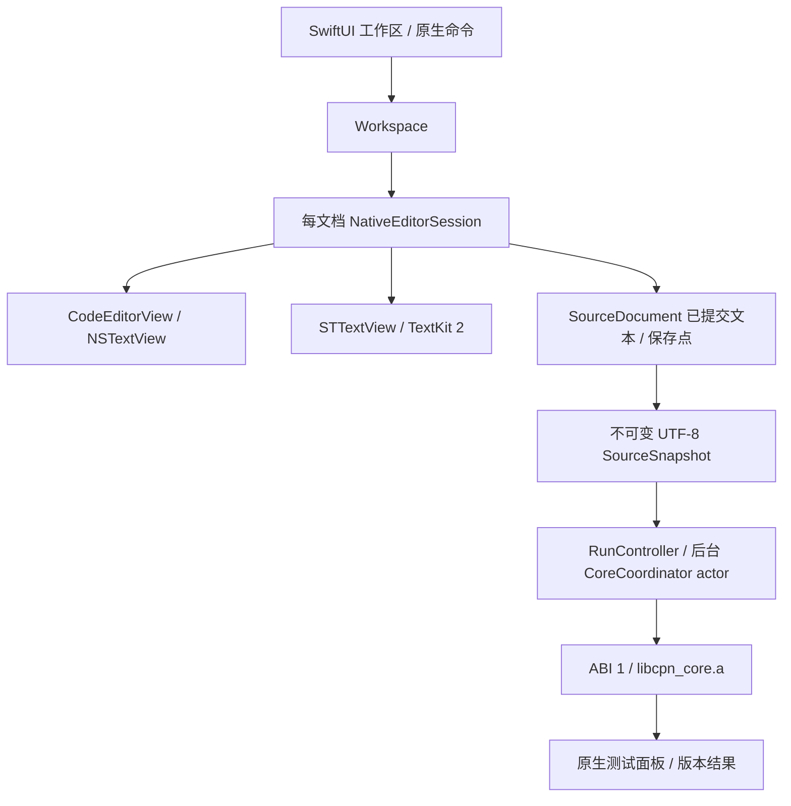

# macOS 原生编辑器原型

验证记录时间：2026-11-17T01:46:38+08:00。

本目录实现 SwiftUI 窗口、菜单和文档侧栏，以及两个真实 AppKit 编辑器适配器。当前已完成 M0 双编辑器原型、共享 Core 的样例运行、会话恢复及外部 checker 接入，组件集成不代表已选择生产编辑器，也不代表后续完整里程碑已验收。主项目仍以 Windows 10 22H2 为第一目标。

## 构建和启动

已验证主机：macOS 27.0.1（26A434）、Apple Silicon arm64、Xcode 27.2、Swift 6.4.2。`Package.swift` 和应用元数据声明 macOS 14.0 为部署下限；尚未在 macOS 14 实机运行，不能把当前主机的通过结果视为最低系统验证。

从仓库根目录执行：

```sh
cmake --preset dev
cmake --build --preset dev --target cpn_core
swift package resolve --package-path apps/macos
swift test --package-path apps/macos
./script/build_and_run.sh --verify --editor codeeditorview "$PWD/tests/fixtures/editor/unicode.cpp"
```

改为 `--editor sttextview` 可在同一文件上启动另一组件。应用的 **Editor → Open Copy in Other Editor** 将当前已提交文本复制到独立文档。两个编辑器各自拥有编辑缓冲区和撤销历史；复制的文档没有磁盘路径，不会自动覆盖来源文件。

启动脚本为 [script/build_and_run.sh](../../script/build_and_run.sh)，产物为仓库内 `out/macos/CPEditorNative.app`。脚本先用 CMake 构建聚合静态库 `out/core/dev/libcpn_core.a`，然后从 `AppMetadata.plist` 读取应用标识和可执行文件名，构建 Swift 应用、复制 SwiftPM 资源、临时签名，然后使用 `open -n` 启动真实应用 bundle。资源位于 `Contents/Resources`，已按当前工具链生成的 `Bundle.module` accessor 验证。Codex 的 Run 按钮配置位于 `.codex/environments/environment.toml`。

可选模式：

| 参数 | 行为 |
| --- | --- |
| `--build-only` | 构建并生成 `.app`，不启动 |
| `--verify` | 启动并确认 LaunchServices 已登记指定 bundle 的存活进程；不是完整 UI 验收 |
| `--debug` | 从 bundle 内可执行文件进入 LLDB |
| `--logs` | 启动并查看该进程的统一日志 |
| `--telemetry` | 启动并按应用 subsystem 过滤统一日志 |

脚本只向与本仓库产物绝对路径一致的旧实例请求退出，不按进程名终止其他程序。如果应用仍有保存提示或拒绝退出，脚本终止本次重新启动。打包采用本地临时签名；发布签名、Hardened Runtime 和公证不在此原型范围内。

## 模块边界



- `NativeEditorModel`：按 UTF-8 字节比较的不透明身份、单调 revision、不可变快照、保存点、严格 UTF-8 文件往返、UTF-16 到 UTF-8 的标量边界转换，以及拒绝拆分字素簇的编辑范围校验。`replacing` 只计算经过版本检查的替换结果，不直接重设原生文本。
- `NativeEditorSession`：独占原生容器、编辑器和 UndoManager。文档通过 NativeEditorDeck 持续挂载在同一窗口中，切换只修改原生 isHidden；不会根据 SwiftUI 刷新全量覆盖字符存储。文档关闭时取消待处理捕获并释放代理／通知注册。
- `CodeEditorState`：供组件显示的原始 Binding，与共享模型中的已提交文本区分。AppKit 在 `setMarkedText` 的内部替换步骤可能先发送通知、后建立 marked range；通知因此安排当前原生调用结束后的主线程任务捕获。此处没有定时器、输入屏蔽或强制 `unmarkText`。保存、复制等命令同步捕获当前原生状态，组合输入未结束时拒绝捕获为可保存快照。
- STTextView 的代理同步检查 `hasMarkedText()`；高亮使用非持久的 rendering attributes，不改字符内容、不加入撤销历史。两个组件使用相同的 C++ 配置数据；STTextView 目前为全文件词法高亮，尚无增量性能结论。
- `Workspace`：协调打开、另存为、保存和关闭文档；每个源文件保存点记录已保存逻辑文本和磁盘字节的独立 SHA-256。窗口代理转发已有 SwiftUI 代理。本轮使用单一 `Window` 场景，避免多个工作区竞争默认恢复文件；尚未实现多窗口。最后窗口关闭后应用退出。

`RunController.runAll` 在取 `SourceDocument.snapshot()` 前调用对应 `NativeEditorSession.capture()` 并检查 `isComposing`；仅从显示用 Binding 取字符串不能保证 IME 事务已经完成。提交时复制测试用例和工具链配置，后台 actor 用 C ABI 创建并提交任务，不通过 CLI 子进程中转。返回结果保留 documentID/revision，面板明确标示源码是否已经改变。

## 配置和本地化

应用默认语言为英文，产品文案放在 `Resources/en.lproj/Localizable.strings`，由 `Bundle.module` 加载。开发要求留在仓库文档，不作为产品提示。

`Resources/workspace.json` 定义带版本的默认编辑器和语言集合；`NativeEditorModel/Resources/cpp.json` 定义 C++ 文件扩展名、建议文件名、关键字和词法规则。当前只提供 C++ 配置；未知扩展名使用配置中的默认语言。该高亮层不是完整 C++ 解析器，目前未实现 raw string、预处理器全部语义或 clangd/LSP。

## 自动验证证据

当前 `swift test --package-path apps/macos` 通过 41 项测试（7 项模型测试、21 项原生编辑器／面板／恢复／checker 测试、13 项 C ABI 桥接测试）；双编辑器恢复和满额偏好恢复分别执行两个参数化实例，配置呈现执行 checker／toolchain × 默认／已配置的四个实例。原生测试创建真实 `NSWindow` 和编辑器视图，不用空白占位控件替代组件。

| 检查 | 当前证据 |
| --- | --- |
| 不透明身份、revision、保存点 | 同内容不增版本；保存旧快照期间的新编辑仍为未保存；撤销到保存内容恢复保存状态 |
| Unicode 和版本范围 | CJK、emoji、组合字符、UTF-16/UTF-8 映射；拒绝代理对／字素簇拆分和过期版本 |
| 文件保存 | 中文和 emoji 文件名，BOM、NUL、UTF-8、CRLF/LF、制表符、组合字符精确往返；有界循环读取，拒绝无效 UTF-8和超限来源 |
| C++ 高亮 | 两组件创建实际 C++ 配置；词法测试验证注释、字符串、预处理器及数值不会相互错误着色 |
| CodeEditorView | 真实 `NSTextView.setMarkedText`／`insertText` 回归测试；preedit 不进入 revision；提交后只有一次内容版本；原生撤销／重做，移出再装回同一容器后历史保留 |
| STTextView | 真实组合文本暂存、中文／emoji 提交、原生撤销／重做和独立 UndoManager |
| 原生缓冲区 | 两组件加载 CJK、代理对、组合字符、制表符、CRLF/LF 后字符内容与输入文件一致 |
| 原生撤销命令链 | 真 WorkspaceView、原生 paste、firstResponder/nextResponder 接收者解析、NSMenu 验证与 tryToPerform；Undo/Redo 和切换 ST 后返回 CEV 的 Undo 通过；内部可编辑 NSTextView 身份保持不变 |
| Core 实际编译／运行 | 未保存 C++ 源码通过原生缓冲区快照编译，样例输出 `3\n` 判为 AC；运行期间修改原生缓冲区后，返回结果识别为旧源码版本，编辑内容仍在且未保存 |
| 取消和资源配额 | Running 期间取消得到终态，再提交任务成功；在 max_jobs=1/max_buffers=1 下重复运行和取消后运行通过，验证终态 job 和每次 drain 的 buffer 均释放 |
| 契约字节 | 缺少 expected 与空 expected 区分；binary/base64 往返、非规范 padding 拒绝、工具链未知字段保留并交给 Core 校验 |
| `.app` 启动／资源 | `--verify` 已找到指定 bundle 进程；通过统一日志读到 Documents 和 Lifecycle 的打开／窗口／启动事件 |

真实 CUA 首轮验收发现 CEV 粘贴后 Edit 菜单 Undo/Redo 禁用：每文档 UndoManager 虽有历史，容器未实现标准 undo:/redo: 命令接收者，默认窗口无法操作这份历史。EditorContainer 现提供这两个原生动作和 NSMenuItemValidation。新增工作区层级回归还发现卸载 NSHostingView 会重建内部 NSTextView，因此改为 NativeEditorDeck 持续挂载；这项回归不能仅靠直接 history.undo() 验证。测试宿主不是前台应用，菜单接收者按公开 responder 链解析；根 agent 已在重新打包后的真实前台应用中通过 CUA 复验：粘贴中文／emoji 后 Undo 菜单启用，点击后恢复原始源码及保存状态。快捷键、多轮焦点与系统输入法仍保留在目标机矩阵中。

这些程序化输入调用验证编辑器事务边界，不能代替系统中文输入法的候选窗口、转换、取消、菜单、Spaces、全屏、多显示器或辅助功能测试。实际 UI 验收由主项目记录。尚未获得冷／热启动、输入延迟、长行、大文件和内存基线；也没有验证 macOS 14、Intel、发布签名或已解决 Qt 的 Windows 卡顿。

## 共享 Core 测试面板

每个原生文档会话保留自己的测试用例，支持添加、删除、启用、原生 Input/Expected Output 编辑，以及导入现有 `samples.json` 形式的测试数组。缺少 expected 表示不比较；空字符串 expected 表示比较空输出。base64 二进制测试数据原样保留，用户编辑文本字段时才替换为输入的 UTF-8 文本。

默认工具链定义在 `Resources/Toolchains/macos-clang.json`，支持选择、加载和编辑同一版本化 Core profile。该配置调用 `/usr/bin/clang++`，编译限制为 30 秒、运行限制为 2 秒，参数数组和限制均位于数据文件。`Resources/running.json` 选择默认 profile、比较方式、导入容量、测试数量和后台轮询配置；C ABI 自身仍执行权威校验。工具链未知字段不会在 Swift 解码时被静默丢弃。

`NativeCoreBridge` 的 C shim 只转引根目录 `core/include/cpn/api.h`，不复制函数声明；SwiftPM 只链接聚合静态库 `cpn_core` 与系统 `c++`。契约映射集中在 `WireModels.swift`，不在视图中重复 JSON 字段。默认库目录为 `out/core/dev`，可用绝对路径 `CPN_CORE_LIBRARY_DIR` 覆盖。`CPN_CORE_PREBUILT=1 ./script/build_and_run.sh --verify` 跳过 CMake 构建，适用于已有稳定库或协调并行构建。

`CoreCoordinator` 串行拥有引擎和任务句柄。每次 drain 先复制返回字节，再在 decode 成功或失败时都释放 buffer；终态事件已由 Core 确认后释放 job。协议消费失败时销毁引擎，保证任务、native buffers 和 worker 仍有界。ABI 1 暂无等待事件接口，因此仅在后台 actor 中按配置轮询，不在 MainActor 等待进程。取消按钮调用 Core cancel，继续 drain 到终态。关闭单个文档会取消该文档的运行。关闭窗口／退出应用先捕获全部已提交文本并保存恢复会话，再异步取消并 join 两个独立 Core 引擎，完成后才继续关闭；恢复保存失败提供单独导出或取消关闭。

当前面板覆盖编译、普通样例执行、内置比较和外部 checker 二元判题；尚未实现 clangd、checker 编译、完整评分、交互题、压力测试或完整竞赛导入工作流。旧源码标记只说明 source revision 关系；展示的是 Last Run 的不可变结果，不会把后来编辑的测试用例重新判为旧任务输入。

## 会话恢复与文件保存

`RecoveryController` 使用独立的后台 `CoreCoordinator` 调用带版本的 `cpn_engine_session_load`／`cpn_engine_session_save_json`。字段映射集中在 `NativeCoreBridge/SessionModels.swift`；权威契约和存储边界见根目录 [docs/session.md](../../docs/session.md)。恢复包含稳定的文档／工作区身份、revision、已提交 UTF-8 正文、原始路径、保存点、样例字节、工具链配置／引用、选中标签和原生选区。撤销历史、preedit、任务句柄和运行输出不写入恢复文件。

恢复先验证全部文档和原生组件真实 buffer，再一次性替换工作区；任意候选失败都保留当前工作区。恢复不会读原始源文件覆盖未保存正文。Core 返回 `Invalid`、`UnsupportedSchema` 或 I/O 失败时，原恢复文件保留并阻止自动覆盖；原生不支持的 revision 极值同样拒绝应用。通过 Recovery 菜单可查看原文件、恢复上一份备份、重试或另存恢复。备份加载前后都重新捕获并拒绝未完成的输入法组合，内存中未存下的新修改也必须先保留。

未知命名空间／版本的 `object_json` 原始字符串保持字节不变。遇到本应用自己的未来偏好版本时，保留这份偏好，使用当前默认设置，并显示该版本无法存储这些设置更改的提示；不会再追加同命名空间的旧版本。源码和样例仍可继续编辑、恢复和保存。`RawIdentifier` 的相等和哈希基于 UTF-8 字节；Swift 的规范等价字符串（如 `é` 与 `e + combining acute`）不会合并身份，源码字节改变也会增加 revision。版本耗尽时禁止后续原生编辑；若 Undo 或程序化操作改变 live buffer，则报告捕获失败，可将实际 buffer 复制到新文档，旧快照不会被误当成新内容。

默认恢复位置由 `Resources/recovery.json` 定义，位于 Application Support 的 `CPEditor-Native/Recovery/workspace.json`，备份和锁文件使用同一配置派生。另存恢复只接受独立且不存在的新位置，由 Core 校验原件与磁盘摘要，拒绝覆盖旧恢复、备份、锁文件及它们的别名；生产模式将成功的新位置写入带版本的本机偏好，后续启动继续使用。`--recovery-file` 可显式指定独立恢复文件，适合分别验证两种编辑器：

```sh
CPN_CORE_PREBUILT=1 ./script/build_and_run.sh --verify \
  --recovery-file "$PWD/out/macos/verification/workspace.json" \
  --editor codeeditorview "$PWD/tests/fixtures/editor/unicode.cpp"
```

原生变更通过 Observation 在当前输入事务完成后合并到后台保存；没有用计时延迟掩盖输入问题。保存使用 Core 的磁盘摘要 token 和持久锁路径，只有 `recovery_replaced` 为真才推进 token。`DurabilityUnknown` 明确报告已经替换但无法确认持久性；取消锁等待会关闭该恢复引擎，先于引擎创建的取消也会保留请求并阻止写入；重试创建新引擎。源码运行使用另一引擎，因此不会被恢复 I/O 的等待阻塞。

源文件操作在后台使用 `NSFileCoordinator`。写入先在协调区域验证原磁盘摘要，再原子写入精确 UTF-8 字节；冲突保留编辑内容，并要求选择另一位置另存。BOM 保留为原始 U+FEFF 正文，CRLF 和 NUL 也不做转换。保存旧快照时的新编辑保持 dirty。关闭单个文档期间冻结该文档的编辑和原生 Undo／Redo；保存完成再次检查新版本，不能据旧快照成功删除新编辑。恢复保存成功后才移除关闭文档；失败时保留原容器和撤销历史。打开、测试导入和恢复导出／备份加载均跟踪生命周期，进行中拒绝关闭；`flush` 和 shutdown 等待已有恢复任务。

`NSFileCoordinator` 及 Core 锁仅协调遵守协议的 writer，摘要检测属于乐观校验，不能宣称阻止绕过协调的外部程序在最终替换时竞争。这轮已验证源文件冲突、受控协调 writer 阻塞期间的新编辑、恢复导出持锁时关闭拒绝和 flush 等待，以及真实 I/O 失败返回；尚未做断电／磁盘设备故障验证。两个原生组件的恢复均验证 BOM、CRLF、NUL、CJK、emoji 和选区精确往返；真实系统输入法与最低系统仍需目标机矩阵。


## 外部 checker 原生面板

测试面板提供 **External Checker** 开关和 **Configure Checker…** JSON 编辑器。默认关闭且没有配置，启用时先要求应用有效配置；应用配置后启用 checker，关闭开关仍保留配置。编辑器内显示校验错误，不改变已经应用的有效配置。内置 Comparison 选择在外部 checker 启用时禁用。版本 1 草稿位于 `Resources/checker.json`，用户需选择现有可执行程序及参数数组；应用不会编译 checker。

checker 和 toolchain 配置统一使用带身份、类型和完整 JSON 的 `ConfigurationJSONDraft` 通过 `sheet(item:)` 呈现，`ConfigurationJSONSheet` 在创建时初始化自己拥有的文本及错误状态。首次前台 CUA 曾发现旧的布尔呈现状态与独立文本状态导致首次打开空白；当前数据流把呈现和载荷作为同一次状态更新，不用延时或 `onAppear` 再灌入文本。取消丢弃未应用草稿，再次打开重新读取已应用配置；Apply 校验失败保留文本并在 sheet 内显示错误，成功才关闭。Escape 和 Return 使用原生取消／默认动作快捷键。

`NativeCoreBridge/CheckerConfiguration.swift` 按 [外部 checker 契约](../../docs/external-checker.md) 校验配置。专用有界 JSON 解析器保留整数类型并拒绝重复字段；配置／命令／limits／environment 各层拒绝未知字段，检查版本、整数范围、参数数量、命令／环境字节预算、互斥退出码映射、环境名 ASCII 大小写去重、NUL、占位符及平台时钟范围。`memory_bytes` 等未实现字段拒绝。配置中的 ASCII 分隔符按 UTF-8 字节扫描，避免 `= + combining acute` 或 `} + combining acute` 的字素簇影响契约。提交使用结构化 executable／arguments，不拼接 shell；Core 仍执行权威校验。

每个 Run All 复制源码、测试和 checker 配置。只有解答正常退出 0 且 Expected Output 存在时才运行 checker；没有 Expected 表示 Unchecked，空 Expected 仍实际调用 checker。测试结论 AC／WA 与 checker 自己的 `Accepted`／`WrongAnswer` 分开建模；默认退出码 0 接受、1／2 拒绝，未映射码（包括默认评分码 7）为 CheckerError。checker 的超时、异常、创建失败和输出超限均显示独立 CheckerError，解答原来的 TLE／RE 不会被替换；取消显示 Cancelled。stdout 分数文本不会被猜测为二元结论。

结果面板分开显示 **Solution status** 和 **Checker Diagnostics**。checker 诊断读取契约中的 verdict、process_attempted、termination、exit_code、signal、native_error、elapsed_ms、stdout／stderr 总采集字节与截断标记；未尝试进程时不把默认进程状态当成真实退出。正常 UTF-8 输出按文本显示；包含 NUL、其他非文本控制字节或无效 UTF-8 时使用有界 hex 预览，并说明显示字节数与原始输出的区别。原始 `Data` 保留，Input／Expected 编辑绑定原有 `.text` 语义不变。预览默认 256 字节，配置位于 `Resources/running.json` 的 `binary_preview_bytes`。

checker 偏好使用独立命名空间 `org.cpeditor.native.macos.checker`、版本 1，保存 enabled 与 `configuration_json` 原始字符串，不更改已有 workspace 偏好版本。原始 JSON 格式和已禁用配置随会话往返。遇到该命名空间未来版本时，所有版本（包括共存的 v1）都作为不透明原件保留，不解释 v1，也不追加重复旧版本；当前应用关闭 checker 并禁用配置入口，源码和样例仍可保存。当前版本偏好中的无效配置整体拒绝恢复候选，保留既有工作区。

未启用且无配置的 checker 不写空偏好。Core 每 owner 最多 16 条偏好；未知原件占满容量时不强加 workspace／document 默认条目，显示设置容量提示，继续保存源码和测试。新增 checker 没有可用槽位时在 Apply 之前拒绝，保持原状态；已有 checker 保留其存储槽位。`Resources/recovery.json` 定义本机 owner 上限，`running.json` 定义单 checker 偏好上限。虽然 Core checker JSON 最多 1 MiB，原生持久化还受单偏好 64 KiB 限制，因此 Apply 和恢复均校验完整偏好编码大小，包含更长的 disabled 状态，避免应用成功后阻断恢复保存。

本轮通过真实 Core 和原生测试验证：AC／WA、无答案跳过、空输出／空答案调用、checker 超时／信号／输出超限、默认退出 7、解答 RE／TLE 跳过 checker、Checking 期间取消、原始 NUL／0xFF 诊断与总数、配置开关重启恢复、未来 v1＋99 共存、无 workspace 偏好＋foreign16、foreign15＋workspace1，以及拒绝新增无容量配置后的源码／样例保存。语法回归覆盖重复／浮点／未知字段、范围、模板组合字符和环境名边界。当前 AppKit 测试真实挂载 RunPanelView；根 agent 已在独立恢复文件中完成前台 CUA 验收，没有操作用户默认恢复文件或既有验收数据。

新增配置呈现回归在后台测试窗口中实际创建附属 sheet，读取原生 `NSTextView` 的首次内容，输入未应用草稿并通过 Escape 取消、再次呈现后验证内容恢复；同时通过 Return 触发真实 Apply，验证无效版本保持配置和草稿、有效替换才启用 checker 并关闭。宿主提供标准 SwiftUI item 呈现环境，验证独立编辑器 sheet 的原生生命周期；RunPanelView 的实际配置按钮入口、修复后的前台首次正文和重启后运行也已由根 agent 复验通过。

## 固定依赖和许可

直接依赖固定到不可变提交，传递依赖记录在 `Package.resolved`。本原型沿用主仓库 GPLv3 路径使用 STTextView，不使用其商业许可路径；后续发布必须保留适用许可和对应源码。

| 依赖 | 固定版本 | 许可 |
| --- | --- | --- |
| CodeEditorView | `2394a48f919d6570cfbfbd53d047a3eaeb95b59e` | Apache-2.0 |
| STTextView | `c7d519318b06ebb7a99a641e4aa8831105d3b7d4` | GPLv3／商业许可；本原型采用 GPLv3 |
| Rearrange | 1.8.1 / `5ff7f3363f7a08f77e0d761e38e6add31c2136e1` | BSD-3-Clause |
| STTextKitPlus | 0.3.1 / `8117f3b6a20633e4ce92df102dd260b808ffc9bd` | BSD-3-Clause |
| CoreTextSwift | 0.2.0 / `833177201d6421e6322296f39fce6ff6ae52618a` | MIT |

上游原始许可文本保留在 `Sources/CPEditorNative/Resources/ThirdPartyLicenses` 并随应用资源一起打包。本目录仅通过公开 API 集成组件，没有修改 `.build/checkouts` 中的参考代码。

根 agent 在 2026-11-16T23:40:39+08:00 的真实 CUA 验收中，通过系统文件选择器导入 `tests/fixtures/editor/samples.json`，点击 Run All 后三个稳定测试 ID（sample-1、sample-2、empty-stdin）均显示 AC，原始样例输出对应 3、92、空输出，面板确认 Source matches this run。此证据覆盖当前 macOS 主机的原生界面到共享 Core 链路，尚不包含最低系统、完整系统输入法、会话及发布验收。

根 agent 在 2026-11-17T00:44:44+08:00 完成独立恢复文件的真实 CUA 验收：原生缓冲区追加中文／emoji／组合字符，设置7+8样例并判为AC；正常退出后重启，未保存正文、选区和样例恢复。随后注入外部源文件修改，Save明确拒绝覆盖，Save As将缓冲区保存到新文件，原文件保留外部修改。磁盘核对恢复正文／摘要／保存点、文档ID／revision、样例原始字节以及另存结果完全一致；恢复后的原生Run All再次AC。该验收使用out/macos/verification的独立测试数据，不修改参考fixture或用户默认恢复文件。

根 agent 在 2026-11-17T01:46:38+08:00 完成独立 checker 夹具的真实 CUA 验收：verify 模式判为 AC，checker stdout 25 字节、stderr 12 字节（含 NUL／0xFF）与解答 8 字节均显示对应 hex；compare 模式判为 WA、exit 7 为独立 CheckerError 并保留 0.5 输出，无答案为 Unchecked。非法浮点版本显示校验错误。退出重启后开关关闭且 JSON 原件完整恢复；修复后的首次 checker 和首次 toolchain 配置窗口均显示当前正文，Escape 取消保留配置，重新启用后再次运行得到相同 checker 错误语义。磁盘核对配置原始 JSON、单一文档 ID／revision、源码 SHA-256 和 raw 样例全部一致，41 项 Swift 测试、脚本打包启动及严格 codesign 验证通过。精简证据在本机 `out/macos/checker-verification/20261117T012243+0800/verification.json`；未把此局部能力当作最低系统、系统 IME 或完整产品验收。
