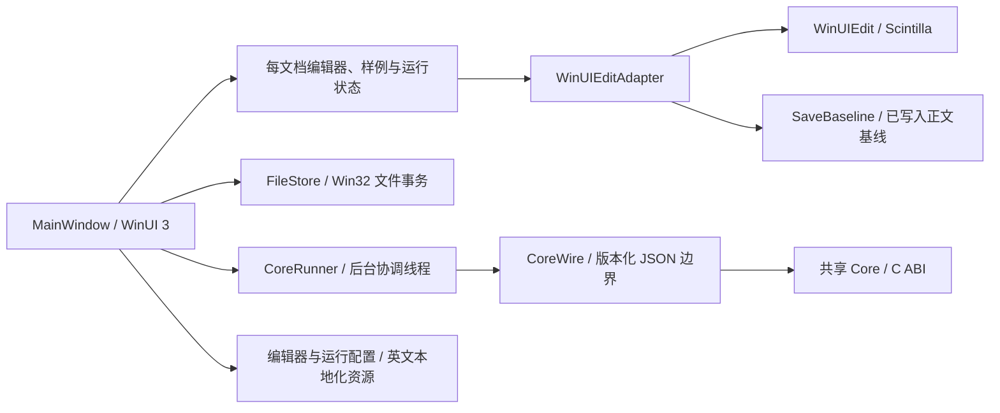

# Windows 原生应用与共享 Core 接入

这是 WinUI 3 + C++/WinRT + WinUIEdit 的原生应用工程。当前源码已编写多标签、每文档独立编辑器、committed 快照、文件事务、样例编辑、工具链选择、Run All / Cancel 和共享 C ABI 协调。便携桥接测试已在 macOS 执行；Windows 工程尚未编译、部署或运行，因此本文描述的原生行为仍需目标机验证。

主要目标是 Windows 10 22H2 专业工作站版。实际开发与本轮便携验证主机为 macOS ARM64，不能将其结果记为 Windows、WinUI、输入法、DPI 或 UU 远程验证通过。

## 组成与边界



`TabView` 管理标签头；每个文档持有自己的 `CodeEditorControl`、adapter、撤销栈、测试面板和运行身份。控件持续挂载，切换标签仅改变可见性。关闭文档会撤销订阅、取消运行，并忽略该文档已排队的通知。该行为尚需 Windows 测试确认。

`WinUIEditAdapter` 封装原生对象。Core 只接收独立的 UTF-8 正文和身份，不接收 WinUI、Scintilla 或活动文本控件。正常编辑期间不复制全文；保存、快照导出、实际提交运行，以及并发保存造成的保存点失效比较才读取 committed 正文。

## 已提交正文与运行意图

WinUIEdit 从固定源码提交 `d9f60dbca65c2af54ced590d873d9438de32ce77` 构建，构建副本应用仓库内的 [committed snapshot 补丁](../../patches/winuiedit/README.md)。源码、补丁及 overlay 身份由 `patches/winuiedit/source-lock.json` 校验，不修改 `third_party/WinUIEdit` 研究子模块。

应用 adapter 已使用补丁提供的 `IsCompositionActive`、`IsCommittedSnapshotAvailable`、`IsCommittedSnapshotTrackingAvailable`、`CommittedRevision`、`CommittedSnapshotAvailabilityChanged` 和 `ReadCommittedText`。读取正文、revision、caret 与 anchor 在同一次 guarded 捕获中完成，没有原始缓冲区回退。文档加载生成新 ID，文档 revision 从 1 开始，由控件 committed revision 相对加载基线推导；光标、滚动、样式等通知不自行推进版本。

原生事件只调度 DispatcherQueue 更新，不在 TSF 回调中同步读取正文。组合输入、edit lock 或原生通知期间暂不可捕获时，读取返回 `E_PENDING`；tracking 永久故障或控件结束时返回 `E_FAIL`。永久故障显示错误，不能保留为无限等待。补丁状态模型的便携测试不等同于真实 Windows TSF 验证。

点击 Run All 先复制该文档的样例、工具链与比较策略，并创建唯一运行 token。若正文暂时不可捕获，保留可取消的 pending intent；committed availability 通知到达后，再捕获正文并提交 Core。取消尚未提交的意图不会产生 Core job；已提交的运行按 token 取消。输入法提交或取消交给原生控件处理，没有延时猜测、强制取消组合或屏蔽编辑。

结果按运行 token、文档 ID 和源 revision 匹配。源文本、样例、工具链或比较策略发生变化时，旧结果标记过期。样例通过独立开关区分“无期望输出”和“期望输出为空字符串”，禁用样例不执行。字节字段通过 base64 契约传递，Core 桥接测试覆盖 NUL；原生 TextBox、文件和中文输入的往返仍需目标机验证。

## 后台协调与关闭

`CoreRunner` 在单独的 C++ 协调线程执行 C ABI 的 create、submit、cancel、drain、release 和 close / destroy。事件 buffer 用 RAII 释放；terminal 完整解码并校验源身份后释放 job handle。命令队列有配置上限；取消集合按 token 去重；C ABI 接受任务前预分配本地追踪节点，避免接受后分配失败丢失 job。

runner 回调在协调线程调用。接收者必须将 owned packet 派发到 UI，不能在回调内销毁 runner；回调内调用阻塞 `close()` 会在改变关闭状态之前明确抛出 `logic_error`。外部并发 close 由 join mutex 串行化，窗口在后台 apartment 等待结束。该线程行为由正式便携测试覆盖。

事件交付抛异常会设置可观察的 `delivery_failed` 状态并关闭协调器；窗口下一次 UI 更新会终止待运行状态、显示错误并禁用新运行。文档编辑和保存仍可继续。窗口关闭期间先取消并在后台 join Core，再复查源版本；若出现新编辑，保留窗口并建立新 runner。generation 可过滤旧 runner 已排队的 UI 消息。窗口与 DispatcherQueue 的实际生命周期仍需 Windows 验证。

## 数据与文件策略

应用默认语言为英文，正常界面文本来自 `Strings/en-US/Resources.resw`。项目文档使用中文。`editor-profiles.json` 提供语言、扩展名、默认与未知扩展 profile、tab width 及打开大小上限；当前包含 C++、Python 与纯文本。Python 当前使用纯文本 lexer，不能声明已具备 Python 语法高亮。

`runner-settings.json` 提供文档 / 样例 / 队列 / 输出显示限制、Core 选项、工具链目录、默认工具链、比较策略和状态资源映射。MSVC profile 由 Windows 构建脚本生成，包含发现的编译器绝对路径及对应环境；另有 Clang、GCC 和 Python profile。协议字符串键集中在带版本的解析与序列化边界，不分散到窗口逻辑。

打开文件仅接受严格 UTF-8，保留 BOM 标志及换行字节；默认打开上限为 32 MiB，由配置决定。这个配置上限不是已验证的编辑器性能承诺。

文件 I/O 在后台线程执行。保存使用同目录 UUID 临时文件、完整写入、flush、关闭及 `ReplaceFileW`；新文件使用不覆盖竞态中新建文件的 `MoveFileExW`。编辑器在保存期间可继续编辑。保存失败不更新正文基线；组合输入或 tracking 故障时保存明确失败，不读取 preedit。

成功写入 snapshot B 时，adapter 总会记录 B 为磁盘正文基线。若当前仍是捕获的 revision，则设置原生保存点。若已经编辑到 C，旧原生保存点可能仍在 A，此时脏状态按 committed 正文与 B 比较，并按 revision 缓存比较结果；撤销回 A 仍为 dirty，回 B 才为 clean，并重新设置原生保存点恢复快速路径。该异常路径每个新的 committed revision 可能需要一次全文捕获与比较，其真实大文件代价需要 Windows 测量。

快照导出格式为 `cpn.editor-snapshot` / `schemaVersion: 1` / `snapshotKind: committed`。正文为 UTF-8 JSON 文本，revision、byteLength、caretByte 和 anchorByte 使用十进制字符串，位置编码为 UTF-8 字节。它是诊断导出；实际运行经 `CoreWire` 使用共享 Core JSON 契约。

目前尚未接入会话持久化、样例文件保存和外部文件冲突检测；样例与运行设置仍为内存中的每文档状态。Competitive Companion、SPJ、交互题及压力测试的 Windows 界面也属于后续阶段。

## Windows 构建与验证入口

| 依赖 | 固定版本或身份 | 用途 |
| --- | --- | --- |
| WinUIEdit | 固定源码提交与 source-lock | Scintilla / Lexilla 原生控件 |
| Microsoft.WindowsAppSDK | 1.7.260224002 | WinUI 3 与桌面窗口 |
| Microsoft.Windows.CppWinRT | 2.0.240405.15 | WinRT 投影与代码生成 |
| Microsoft.Windows.SDK.BuildTools | 10.0.28000.1839 | Windows 打包工具 |
| Microsoft.Windows.ImplementationLibrary | 1.0.260126.7 | 上游控件使用的 WIL |

目标机需要 PowerShell 7、Visual Studio 2022 v143 C++、完整 Windows SDK、C++/WinRT 和单项目 MSIX / WinUI 工具。ARM64 输出需要相应 C++ 工具。框架依赖部署需要匹配架构的 Windows App SDK 1.7 运行时及本地开发注册权限。

项目根目录执行：

```powershell
pwsh -File ./tools/windows/verify.ps1 -Configuration Debug -Platform x64 -Deploy -Launch
```

脚本先确认真实主机，再通过 vswhere 和 Windows Kits 注册项发现 Visual Studio / SDK，导入官方 Developer PowerShell 环境，构建共享 Core、列出并执行 CTest、构建和执行 committed 状态测试与正式 Core 桥接测试，再构建控件及应用。桥接测试与 Core 使用一致的 Debug / Release CRT。输出架构与主机不一致时仅记录构建，不将交叉编译声明为运行验证。

支持 `-MSBuildPath`、`-CMakePath`、`-NinjaPath`、`-WindowsSdkVersion` 与 `-Parallelism`。发现 Ninja 时使用单配置生成器，否则使用 Visual Studio 2022。工程默认 SDK 为 10.0.22621.0，脚本选用实际安装版本；最低 OS 为 10.0.17763.0，目标验收为 10.0.19045 / SKU 161。

输出位于 `out/windows/<Platform>/<Configuration>/`，包含各阶段退出码与日志、Core 测试名称、归档及控件 SHA256、MSBuild binlog、MSIX layout、`build-result.json`、`verification-report.json` 和中文 `measurement-template.md`。非 Windows 主机执行会以失败退出并生成失败报告，全部 Windows 构建、执行和人工验收标记保持未执行。

`-Deploy` 注册 AppxManifest，`-Launch` 请求部署与启动。PowerShell 7 使用 Windows PowerShell 兼容宿主调用 Appx。工程用正常 WinMD 项目引用注册组件。`activationRequested` 仅代表启动请求；`uiValidationCompleted` 保持 false，10 个人工场景默认 `not_run` / `passed: null`。只有完成目标机操作并提供证据后才可填写通过。

## 验证范围与后续验收

正式 [Core 桥接测试](tests/README.md) 在 macOS 对真实 Core 归档运行，普通、ASan/UBSan 与 TSan 均通过，覆盖保存基线、文档身份、大整数 revision、NUL、空期望输出、禁用样例、任务释放、编译及运行失败、取消、回调异常、回调内 close 拒绝和外部并发 close。ASan 的 LeakSanitizer 在当前主机不受支持，没有执行泄漏检测。

另已执行 JSON / XML、项目文件引用、XAML 事件 / 资源键、PowerShell 语法和真实非 Windows guard 检查。便携检查无法证明 MIDL、XAML、C++/WinRT、MSVC、NuGet、MSIX 或原生控件运行正确。

| Windows 待验证场景 | 应保留的证据 |
| --- | --- |
| Debug / Release 构建、部署与启动 | OS、SKU、架构、SDK、MSBuild、NuGet、binlog、依赖注册与真实窗口 |
| 多标签与独立撤销 | 不同文本、光标、undo / redo，切换和关闭后状态 |
| 中文输入法与 committed 快照 | 候选选择、Esc 取消、重转换、组合中 Run / Cancel / Save、tracking 失败 |
| Run All / Cancel | 空期望与 Unchecked、AC / WA / TLE / RE、多个文档、重复取消、关闭运行中子进程 |
| 并发保存与 UTF-8 往返 | B 保存中编辑 C，undo A / B；BOM、LF / CRLF、emoji、NUL、失败保存 |
| 文档身份与过期结果 | 编辑、样例和工具链变化后的 revision / token，关闭后旧事件不影响新标签 |
| 文件事务与异常 | Save As 取消、未保存关闭、文件占用、磁盘空间、打开失败 |
| 大文件与远程响应 | 1 / 10 / 20 MiB，输入、选择、滚动、缩放及异常保存点比较 |
| DPI、虚拟桌面与 UU | 100% / 150% / 200%、跨屏、睡眠唤醒、同机同网络 CP Editor 对照 |

性能数据必须附文件内容、测量方法、首次 / 后续启动、工作集与采样时间。当前没有 Windows 性能验收结论。
