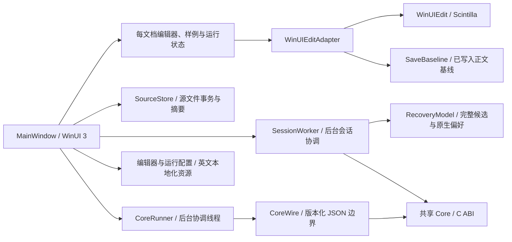

# Windows 原生应用与共享 Core 接入

这是 WinUI 3 + C++/WinRT + WinUIEdit 的原生应用工程。当前已完成与 macOS `v0.1.0` 对齐的核心工作台体验：**MenuBar + 紧凑 Fluent 工具栏**、**左编右测可拖拽分栏与三视图模式**（Editor Only `Ctrl+Shift+1` / Split `Ctrl+Shift+2` / Tests Only `Ctrl+Shift+3`）、**Compile / Run Without Compiling / Compile & Run 分离与编译产物复用**、**Output 先行（`Input → Output → Expected Output`）三栏对照测试区与独立编译错误横幅**、**外部 Checker 配置与诊断**（Visual + JSON）、**运行时工具链自动发现**（MSVC / GCC / Clang / Python，自动跳过 0 字节 `WindowsApps` 占位）及 **Visual/JSON 配置表**、**原生 Settings 对话框**（Light/Dark/System 主题、自动换行、括号/引号配对、Tab 宽度）、**低干扰竞赛编辑辅助**（`EditorAssist` + 受 IME 门控的 WinUIEdit 按键/字符挂钩）与升级后的 **Companion 收件箱筛选/分页面板**。

主要目标平台为 **Windows 10 22H2 专业工作站版（19045 / SKU 161 x64）**。本轮已在该目标机使用 VS 2026 Build Tools（v145 / SDK `10.0.26100.0`）与 PowerShell 7.7.0 实机通过 Debug x64 全套自动测试、MSIX layout 部署与激活启动（0 警告 0 错误，加载 `WinUIEditor.dll`/`WinUIEdit.dll`/`Microsoft.UI.Xaml.dll` 并实测写入包含已发现工具链的 `LocalState\Recovery\workspace.json`）以及 Release x64 全量构建测试（`automatedPassed: true`）。由于代理执行沙箱位于独立桌面 `WinSta0\exebox-*`，无法跨桌面截取交互桌面 `WinSta0\Default` 的窗口画面，交互界面视觉、系统中文输入法、高 DPI、大文件及远程桌面行为仍须在交互桌面手工复核（不自动勾选未执行的 `manualScenarios`）。

## 组成与边界



`TabView` 管理标签头；每个文档持有自己的 `CodeEditorControl`、adapter、撤销栈、测试面板和运行身份。控件持续挂载，切换标签仅改变可见性。关闭文档会撤销订阅、取消运行，并忽略该文档已排队的通知。该行为尚需 Windows 测试确认。

`WinUIEditAdapter` 封装原生对象。Core 只接收独立的 UTF-8 正文和身份，不接收 WinUI、Scintilla 或活动文本控件。原生每键通知不读取全文；保存、快照导出、运行和合并后的自动恢复捕获读取 committed 正文。并发保存或恢复保存点只有摘要时的 dirty 比较按 committed revision 缓存。自动保存间隔只合并写入工作，不用于推断 IME 已结束。

## 已提交正文与运行意图

WinUIEdit 从固定源码提交 `d9f60dbca65c2af54ced590d873d9438de32ce77` 构建，构建副本应用仓库内的 [committed snapshot 补丁](../../patches/winuiedit/README.md)。源码、补丁及 overlay 身份由 `patches/winuiedit/source-lock.json` 校验，不修改 `third_party/WinUIEdit` 研究子模块。

应用 adapter 已使用补丁提供的 `IsCompositionActive`、`IsCommittedSnapshotAvailable`、`IsCommittedSnapshotTrackingAvailable`、`CommittedRevision`、`CommittedSnapshotAvailabilityChanged` 和 `ReadCommittedText`。读取正文、revision、caret 与 anchor 在同一次 guarded 捕获中完成，没有原始缓冲区回退。新文档生成稳定 ID，初始 revision 从 1 开始；恢复文档保留原始 ID/revision，由控件 committed revision 相对恢复基线推导后续变化；光标、滚动、样式等通知不自行推进版本。`UINT64_MAX` 是合法可恢复的最终版本；adapter 在 committed availability 回调中同步将达到文档上限的 Scintilla 设为只读，仍允许选择、复制和导出。后续 native revision 超预算明确拒绝捕获，不饱和复用原 revision。

原生事件只调度 DispatcherQueue 更新，不在 TSF 回调中同步读取正文。组合输入、edit lock 或原生通知期间暂不可捕获时，读取返回 `E_PENDING`；tracking 永久故障或控件结束时返回 `E_FAIL`。永久故障显示错误，不能保留为无限等待。补丁状态模型的便携测试不等同于真实 Windows TSF 验证。

点击 Run All 先复制该文档的样例、工具链与比较策略，并创建唯一运行 token。若正文暂时不可捕获，保留可取消的 pending intent；committed availability 通知到达后，再捕获正文并提交 Core。取消尚未提交的意图不会产生 Core job；已提交的运行按 token 取消。输入法提交或取消交给原生控件处理，没有延时猜测、强制取消组合或屏蔽编辑。

结果按运行 token、文档 ID 和源 revision 匹配。源文本、样例、工具链或比较策略发生变化时，旧结果标记过期。样例通过独立开关区分“无期望输出”和“期望输出为空字符串”，禁用样例不执行。测试保留 authoritative 原始字节，非 UTF-8 或含 NUL 的样例显示有界只读十六进制视图，运行和持久化使用原始字节，不从显示文本反解。字节字段通过 base64 契约传递；原生 TextBox 和中文输入的往返仍需目标机验证。

## 后台协调与关闭

`CoreRunner` 在单独的 C++ 协调线程执行 C ABI 的 create、submit、cancel、drain、release 和 close / destroy。事件 buffer 用 RAII 释放；terminal 完整解码并校验源身份后释放 job handle。命令队列有配置上限；取消集合按 token 去重；C ABI 接受任务前预分配本地追踪节点，避免接受后分配失败丢失 job。

runner 回调在协调线程调用。接收者必须将 owned packet 派发到 UI，不能在回调内销毁 runner；回调内调用阻塞 `close()` 会在改变关闭状态之前明确抛出 `logic_error`。外部并发 close 由 join mutex 串行化，窗口在后台 apartment 等待结束。该线程行为由正式便携测试覆盖。

事件交付抛异常会设置可观察的 `delivery_failed` 状态并关闭协调器；窗口下一次 UI 更新会终止待运行状态、显示错误并禁用新运行。文档编辑和保存仍可继续。窗口关闭通过 `FlushRecovery` 保存完整草稿，不要求用户先保存每份源文件；标签关闭仍提供 Save / Discard / Cancel。关闭请求不越过正在进行的源文件操作，随后捕获完整 committed 会话并等待恢复写入，等待运行协调器关闭后重新加载恢复文件并核对磁盘摘要，关闭会话协调器，再次比较完整会话，包括源码、样例、设置和保存点。晚完成操作、晚编辑或 preedit 保留窗口；恢复失败保持窗口，工具栏提供重试和恢复另存入口。generation 过滤旧 runner 已排队的 UI 消息。窗口与 DispatcherQueue 的实际生命周期仍需 Windows 验证。

## 数据与文件策略

应用默认语言为英文，正常界面文本来自 `Strings/en-US/Resources.resw`。项目文档使用中文。`editor-profiles.json` 提供语言、扩展名、默认与未知扩展 profile、tab width 及打开大小上限；当前包含 C++、Python 与纯文本。Python 当前使用纯文本 lexer，不能声明已具备 Python 语法高亮。

`runner-settings.json` 提供文档 / 样例 / 队列 / 输出显示限制、Core 选项、工具链目录、默认工具链、比较策略和状态资源映射。MSVC profile 由 Windows 构建脚本生成，包含发现的编译器绝对路径及对应环境；另有 Clang、GCC 和 Python profile。协议字符串键集中在带版本的解析与序列化边界，不分散到窗口逻辑。

打开文件仅接受严格 UTF-8，保留 BOM 标志、CRLF 和 NUL 字节。打开上限由配置决定，并须受共享 Session 的单源码 16 MiB 预算约束；它不是已验证的编辑器性能承诺。

`SourceStore` 在后台通过共享 FileStore 执行源文件 I/O。打开记录含 BOM 的原始磁盘摘要；普通 Save 使用这个摘要和合作锁拒绝外部变化，Save As 使用用户选定目标的已观察摘要。既有文件执行同目录原子替换，新文件提交不覆盖竞态中新建目标。该策略是乐观摘要校验与合作锁，非合作写入仍可能竞争最后替换，不能声称 OS CAS。编辑器在保存期间可继续编辑；提交前失败不推进保存点，真正替换后持久化未知则记录替换结果并报告。组合输入或 tracking 故障不读取 preedit。

成功写入 snapshot B 时，adapter 总会记录 B 为磁盘正文基线。若当前仍是捕获的 revision，则设置原生保存点。若已经编辑到 C，旧原生保存点可能仍在 A，此时脏状态按 committed 正文与 B 比较，并按 revision 缓存比较结果；撤销回 A 仍为 dirty，回 B 才为 clean，并重新设置原生保存点恢复快速路径。该异常路径每个新的 committed revision 可能需要一次全文捕获与比较，其真实大文件代价需要 Windows 测量。

源文件、快照导出及新恢复事务的路径都拒绝活动恢复文件、备份、锁、位置偏好和整个 SourceLocks 目录；对已有别名使用文件身份校验，Windows 路径比较忽略大小写。Save / Save As 和快照导出先经过 committed 屏障，再打开原生保存对话框；不借对话框转移焦点来获取未提交文本。

快照导出格式为 `cpn.editor-snapshot` / `schemaVersion: 1` / `snapshotKind: committed`。正文为 UTF-8 JSON 文本，revision、byteLength、caretByte 和 anchorByte 使用十进制字符串，位置编码为 UTF-8 字节。它是诊断导出；实际运行经 `CoreWire` 使用共享 Core JSON 契约。

单独样例文件导入导出、Competitive Companion、SPJ、交互题及压力测试的 Windows 界面属于后续阶段。

## 会话恢复边界

`SessionWorker` 在独立线程创建、使用并销毁专用 C ABI engine，通过 owned JSON 返回 load/save 结果，缓冲区用 RAII 释放。队列有配置上限；关闭先取消 Core 中的锁等待，再 join，排队 promise 必须有可观察结果。它与运行协调器分离，恢复 I/O 不进入控件线程。

`RecoveryModel` 先使用共享 Session 严格解析器验证完整候选，再验证本机 profile、工具链身份、UTF-8 字节选区、比较策略和版本预算。整个候选通过后才应用；未初始化的不可编辑标签保留不可变初始记录，不能用未初始化控件替代真实编辑状态。恢复保留稳定文档和样例 ID/revision、源码、保存点、BOM、语言、测试开关、选区、比较策略和完整工具链 catalog。文档、样例和 workspace 的最大 revision 均可往返恢复；到达样例上限后，相关文本框只读而仍可复制，开关、删除、语言、工具链及比较策略在修改前停止接受变更，事件处理不抛出未捕获的溢出。

恢复位置和限制来自 `recovery-settings.json`，文件放在用户应用数据位置，与源文件及编译工作区隔离；路径关系和文件内容由共享 Session 服务校验。位置偏好也是严格版本化契约，拒绝重复字段、未知字段和相对路径；恢复另存的新文件与位置偏好均确认持久化后才接受新位置。位置写入失败保留当前活跃路径、阻止关闭并显示新副本位置，不能通过普通重试忽略该错误。

自动恢复通过配置间隔合并触发，仅捕获 committed 状态。保存成功或返回 `recovery_replaced=true` 才推进磁盘摘要；冲突、损坏、未来整体版本和不可确认持久化均保留原件并显示原因，暂时错误允许使用旧摘要重试；启动时未通过完整本机候选校验或发现损坏原件时禁止普通重试，必须另存到缺失恢复路径，不能把有效但不兼容的原件替换成空工作区。逻辑内容相同也会重新 load 并校验磁盘摘要，不能以缓存认为已持久化。恢复加载不读取、验证或覆盖记录中的源文件。Core 会保存上一份有效恢复作为备份；当前没有在 Windows 界面实现备份浏览和选择。如需手工恢复，应先另外备份损坏原件和有效备份，完全退出应用后将有效备份复制到当前恢复路径；重启时仍会执行完整候选验证。该手工流程不等同于自动从备份恢复。

本机偏好命名空间使用版本 1。未知命名空间保持原样；同一命名空间存在未来版本时，整个命名空间均原样保留，不解码、不追加降级版本。偏好槽位耗尽时保留已有内容，提示本机设置无法持久化，不能删掉外部偏好为自身腾空间。完整共享契约和预算见 [会话恢复说明](../../docs/session.md)。

## Windows 构建与验证入口

| 依赖 | 固定版本或身份 | 用途 |
| --- | --- | --- |
| WinUIEdit | 固定源码提交与 source-lock | Scintilla / Lexilla 原生控件 |
| Microsoft.WindowsAppSDK | 1.7.260224002 | WinUI 3 与桌面窗口 |
| Microsoft.Windows.CppWinRT | 2.0.240405.15 | WinRT 投影与代码生成 |
| Microsoft.Windows.SDK.BuildTools | 10.0.28000.1839 | Windows 打包工具 |
| Microsoft.Web.WebView2 | 1.0.4022.49 | WinUI XAML 元数据引用的 WinRT SDK |
| Microsoft.Windows.ImplementationLibrary | 1.0.260126.7 | 上游控件使用的 WIL |

目标机需要 PowerShell 7、Visual Studio 2022（17.8+，v143）或 VS 2026（v145）的 C++ 工具链、完整 Windows SDK、C++/WinRT 和单项目 MSIX / WinUI 工具。ARM64 输出需要相应 C++ 工具。框架依赖部署需要匹配架构的 Windows App SDK 1.7 运行时及本地开发注册权限。

在 Build Tools 版 Installer 中选择 WinUI 应用开发构建工具（`Microsoft.VisualStudio.Workload.UniversalBuildTools`）及可选的 C++ WinUI 组件（`Microsoft.VisualStudio.ComponentGroup.WindowsAppDevelopment.VC.BuildTools`）。本机仅安装桌面 C++ 时，Core 能构建，但控件的 `TargetPath` 只解析成目录；此时应检查 Windows Store 10.0 的 C++ MSBuild 目标。组件名称见 [微软 Build Tools 组件表](https://learn.microsoft.com/en-us/visualstudio/install/workload-component-id-vs-build-tools?view=vs-2026)。

项目根目录执行：

```powershell
git submodule update --init -- third_party/json third_party/WinUIEdit
pwsh -File ./tools/windows/verify.ps1 -Configuration Debug -Platform x64 -Deploy -Launch
```

脚本先确认真实主机，再通过 vswhere 和 Windows Kits 注册项发现 Visual Studio / SDK，导入官方 Developer PowerShell 环境，构建共享 Core、列出并执行 CTest、构建和执行 committed 状态测试、正式运行桥接测试与会话桥接/持久化测试，再构建控件及应用。桥接测试与 Core 使用一致的 Debug / Release CRT。输出架构与主机不一致时仅记录构建，不将交叉编译声明为运行验证。

支持 `-MSBuildPath`、`-CMakePath`、`-NinjaPath`、`-WindowsSdkVersion` 与 `-Parallelism`。发现 Ninja 时使用单配置生成器，否则使用所选实例对应的 Visual Studio 生成器（VS 2026 需要支持该生成器的 CMake）。工程默认 SDK 为 10.0.22621.0，脚本选用实际安装版本；最低 OS 为 10.0.17763.0，目标验收为 10.0.19045 / SKU 161。

输出位于 `out/windows/<Platform>/<Configuration>/`，包含各阶段退出码与日志、Core 测试名称、归档及控件 SHA256、MSBuild binlog、MSIX layout、`build-result.json`、`verification-report.json` 和中文 `measurement-template.md`。非 Windows 主机执行会以失败退出并生成失败报告，全部 Windows 构建、执行和人工验收标记保持未执行。

`-Deploy` 根据 `CPEditorNativeWindows.build.appxrecipe` 将完整载荷（含 JSON 配置、`Licenses\`、`Toolchains\*.json` 与 WinUIEdit/WebView2 运行时组件）物化到 `out/windows/<Platform>/<Configuration>/layout/`，自动检查并安装匹配的缺失 SDK 框架依赖（如 Debug 下的 `Microsoft.VCLibs.140.00.Debug` 与 `Debug.UWPDesktop`），再注册 `AppxManifest.xml`；`-Launch` 通过 `explorer.exe shell:AppsFolder\...` 请求激活。PowerShell 7 使用 Windows PowerShell 兼容宿主调用 Appx。工程用正常 WinMD 项目引用注册组件，所有 JSON 配置文件在 `.vcxproj` 中通过 `<None><DeploymentContent>true</DeploymentContent></None>` 声明部署内容。`activationRequested` 仅代表启动请求；`uiValidationCompleted` 保持 false，人工场景默认 `not_run` / `passed: null`。只有完成目标机操作并提供证据后才可填写通过。

## 验证范围与后续验收

正式 [Core 桥接测试](tests/README.md) 在 macOS 对真实 Core 归档运行，普通、ASan/UBSan 与 TSan 均通过，覆盖保存基线、文档身份、大整数 revision、NUL、空期望输出、禁用样例、任务释放、编译及运行失败、取消、回调异常、回调内 close 拒绝和外部并发 close。ASan 的 LeakSanitizer 在当前主机不受支持，没有执行泄漏检测。

另已执行 JSON / XML、项目文件引用、XAML 事件 / 资源键、PowerShell 语法和真实非 Windows guard 检查。便携检查无法证明 MIDL、XAML、C++/WinRT、MSVC、NuGet、MSIX 或原生控件运行正确。

| Windows 待验证场景 | 应保留的证据 |
| --- | --- |
| Debug / Release 构建、部署与启动 | OS、SKU、架构、SDK、MSBuild、NuGet、binlog、依赖注册与真实窗口 |
| 多标签与独立撤销 | 不同文本、光标、undo / redo，切换和关闭后状态 |
| 中文输入法与 committed 快照 | 候选选择、Esc 取消、重转换、组合中 Run / Cancel / Save、tracking 失败 |
| Run All / Cancel | 空期望与 Unchecked、AC / WA / TLE / RE、多个文档、重复取消、关闭运行中子进程 |
| 并发保存与 UTF-8 往返 | B 保存中编辑 C，undo A / B；BOM、LF / CRLF、emoji、NUL、失败保存 |
| 文档身份与过期结果 | 编辑、样例和工具链变化后的 revision / token，关闭后旧事件不影响新标签 |
| 文件事务与异常 | Save As 取消、未保存关闭、文件占用、磁盘空间、打开失败 |
| 会话恢复与损坏保留 | 完整会话重启对照、未知偏好、损坏/未来版本原件、重试与另存 |
| 外部文件冲突与关闭屏障 | 原始摘要、B/C/undo、源文件与恢复的晚完成操作、IME 与晚设置变化 |
| 大文件与远程响应 | 配置和 Session 预算以内的 1 / 10 / 16 MiB，输入、选择、滚动和恢复写入，超限诊断 |
| DPI、虚拟桌面与 UU | 100% / 150% / 200%、跨屏、睡眠唤醒、同机同网络 CP Editor 对照 |

性能数据必须附文件内容、测量方法、首次 / 后续启动、工作集与采样时间。当前没有 Windows 性能验收结论。

## 版本耗尽的持久化策略

捕获 workspace 与分配新的持久化 revision 分开执行。只有内容改变的候选才消耗 successor；未改变的最大版本会话重新通过真实 C ABI load 校验磁盘摘要后仍可关闭。workspace 达到最大值时全部持久数据进入只读，最后已持久化的标签选择与选区成为恢复基线，后续导航只影响当前窗口，不能使窗口永远无法关闭。Run / Cancel、选择、复制和导出不消耗该版本。

最大 workspace 保留原始已持久会话，重试和恢复另存的相同逻辑副本使用原身份、原版本及原 opaque 偏好，不用重置 ID 或饱和计数掩盖耗尽。最后一次提交前，`PersistenceGate` 等待已有 Open / Source Save scope 和非关闭流程的 busy 命令完成，再在同一 UI 执行段冻结持久数据能力并捕获候选。保存点和已发生的源码、样例变化均先进入该候选；只允许临时导航，提交前失败解除冻结，真正替换为 MAX 后保持只读。普通版本保存不使用该冻结。Open / Source Save 的完成还须通过 admission generation 校验；异常过期的实际磁盘写入结果保留并报告，不丢弃保存点或假装成功。此处只读控件和原生输入行为尚待 Windows 验证，便携回归验证的是实际使用的版本策略和真实 Core 往返。

恢复另存若 MAX 副本已真正写入而位置偏好失败，旧活跃路径与旧磁盘 token 保留，关闭保持阻止；workspace 最后预算已消费，完整 MAX 副本和选区基线保留并维持只读。用户可继续将这个相同版本副本另存到新位置完成位置记录，不能重新开放编辑制造无法持久化的 C。

样例文本在 WinUI `TextChanging` 同步事件中记录当前字节和 checked successor，异步 `TextChanged` 不再承担数据写入。该处理只修改模型并排队刷新，不更新 visual tree。`BeforeTextChanging` 在文本变更之前检查最终事务、版本与二进制只读能力；共享预算刚到 MAX 时，下一次输入无需等待只读控件刷新就会被拒绝。同步追踪异常会显式阻止运行和恢复，保留记录中的字节，不持久化旧值充当新输入。该事件语义依据 [Microsoft TextChanging 文档](https://learn.microsoft.com/en-us/windows/windows-app-sdk/api/winrt/microsoft.ui.xaml.controls.textbox.textchanging?view=windows-app-sdk-1.7)，真实 TextBox 输入路径仍需 Windows 验证。

最终事务由 `FinalPersistenceLease` 在取得 gate 的同一调用内登记所有权，然后才刷新界面；界面更新或后续捕获抛异常时，RAII 解除尚未提交的 gate。正常完成先释放 lease 再更新控件，失败的第二个 lease 不能解除第一个 lease。

控件和应用构建显式设置 MSBuild 标准属性 `GenerateProjectSpecificOutputFolder=false`，应用的项目引用保持同一属性和控件输出目录。Restore 后用独立 `/getProperty` 阶段记录并核对 `OutDir`、`TargetDir`、`TargetPath`，应用另核对 `AppxLayoutDir`；DLL、WinMD、PRI 和应用 EXE 均按明确路径校验，不能递归选择旧产物。该属性查询需要 MSBuild 17.8 或更新版本。真实 CI 曾显示控件输出被追加 `WinUIEditor` 子目录；本次修复已通过 PowerShell 属性/路径回归与语法校验，重新执行 Windows CI 后才能确认实际布局。

## Companion 持久 Inbox 与显式监听

本次加入 Windows 原生 `Companion Inbox` 标签页：读取本地 JSON、刷新、加载下一页、应用到工作区，以及手动开启／停止 Competitive Companion 的本机 HTTP 监听器。应用默认英文；按钮、状态、模式解释及预览格式均位于 `Strings/en-US/Resources.resw`。`companion-settings.json` 集中定义存储命名空间、文件后缀、源码模板、容量、分页、预览与监听配置。启动不会自动开启监听。

`CompanionWorker` 使用专用、有界后台队列与 C ABI engine，承担分页、accept、prepare、mark_applied、listener start/stop/info。JSON 解析、载荷验证及 I/O 在后台执行；UI 更新回到 DispatcherQueue。窗口关闭取消并 join 该 engine 的监听器与命令，不让存储等待阻塞主线程。正式 Windows 项目链接 `Ws2_32.lib`／`Mswsock.lib`。

第一次接收载荷或启动监听前，完整恢复文件必须实际保存稳定的 Inbox 三路径 owner。之后验证真实磁盘 token 与保存的 owner，不为尚未保存的用户编辑提前消费工作区 revision。`Save Recovery As…` 保留这个 owner，因此恢复位置改变不会生成另一套 Inbox 或遗失 Pending。源文件打开、保存、快照导出与新恢复事务均拒绝 Inbox 正文、备份或锁文件的路径别名；校验包含 Windows 大小写、符号链接解析和已有硬链接。

导入采用两段持久事务：先把原始载荷写入 Inbox，再把新文档及 receipt 一起写入完整工作区恢复文件，最后从真实已保存文件验证 receipt 并标记 Applied。prepare 的候选在后台完整验证；安装时仅追加新文档与 receipt，保留现有编辑控件、Undo、活跃运行及 await 期间的最新编辑。挂载失败会回滚新增文档。恢复冲突、等待输入法提交或 mark 失败时保持 Pending；再次应用已有 receipt 只确认标记，关闭过的文档不会被重建。

MAX-1 最后一次追加使用现有 `PersistenceGate`：先结束自身 apply scope，最终保存仍等待全部其他 Open／Save 操作。新文档和等待期间的修改使用一次合法 successor 保存到 MAX。MAX 恢复仍可读取 Inbox、预览、停止监听与确认已有的已保存 receipt；不新增工作区文档。

分页显示使用稳定 import ID、严格递增 sequence、Inbox revision 与磁盘摘要；加载下一页发现快照变化会从零刷新，而不会混合两次快照。预览按配置限制样例数及每字段字节数，UTF-8 截断不拆分标量，NUL／非法 UTF-8 使用十六进制展示，原始载荷和空期望输出的字节仍完整保存。来源限制是元数据，不直接成为本机运行限额。

来源 Run 门禁与共享 Core 的 `read_companion_document_provenance()` 一致：交互、非普通 testType、文件／其他 I/O 模式以及未来或无法解读的来源版本均保留在文档中，并显示普通 Run 不可用的原因；这些题目仍能导入、编辑、恢复和导出。

目前已在 **macOS ARM64** 严格编译并实际运行应用共用模型／worker及完整 Core，普通、ASan/UBSan、TSan 六组回归均退出 0。XAML／project XML、事件处理函数及资源引用完成静态检查。**本次新增 WinUI 面板尚未在 Windows 编译和运行；控件派发、原生窗口关闭、IME、DPI、UU 与多虚拟桌面行为仍须目标机验证。** 具体命令、原始日志和覆盖边界见 `tests/README.md`；这些证据不把原生界面验收标为通过。

恢复启动以加载时、原生 prepare 之前的实际磁盘逻辑内容建立基线。未修改的 Loaded／MAX-1／MAX 不为启动本身递增；真正补齐本机偏好等归一化变化仍需合法 successor。新 Inbox owner 若尚未实际持久且只剩最终 revision 或已耗尽，会在 owner 安装、载荷接收或监听启动之前明确拒绝，保留工作区和 Inbox；已有持久 owner 仍允许 MAX-1 的最后一次合法题目应用。首次绑定在等待中的恢复保存结束后重新检查实际剩余预算，不使用延时或关闭自动保存来回避边界。


本机实测（Windows 10 22H2 专业工作站版 19045 / SKU 161 x64，PowerShell 7.7.0，VS 2026 Build Tools v145）已通过 Debug/Release x64 全量 Core 17/17、`committed-text-tests`、`core-adapter-tests`、`session-tests`、`companion-tests`、WinUIEdit 与应用宿主编译（0 警告 0 错误），并完成 Debug MSIX layout 生成、VCLibs Debug 依赖自动安装、包注册与无崩溃进程启动（验证 `WinUIEditor.dll`/`WinUIEdit.dll` 加载及 `LocalState\Recovery\workspace.json` 工具链自动发现持久化）。交互式窗口 UI、系统中文 IME 候选、高 DPI 与整应用性能仍待交互桌面人工验收。

`CoreWire` 现支持 `compile_only` / `run_only` / `compile_and_run` 运行模式与产物路径复用、外部 Checker 配置下发与独立诊断字段；`CheckerModel`（`checker-settings.json`）、`ToolchainDiscovery`（`toolchain-discovery.json`，支持 MSVC / GCC / Clang / Python 运行时扫描并过滤 `WindowsApps` 0 字节存根）与 `EditorAssist`（`editor-profiles.json`）均纳入 `core-adapter-tests` 离线严格验证。`RecoveryModel` 新增 `org.cpeditor.native.windows.workspace` v1 工作区 UI 偏好（主题、换行、自动配对、Tab 宽度、Checker 设置）持久化与向后兼容解析。
