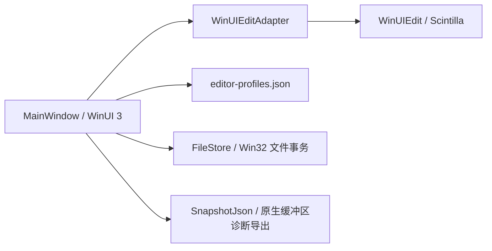

# Windows M0 原型

这是 WinUI 3 + C++/WinRT + WinUIEdit 的编辑器验证工程。当前已编写原生编辑器适配、文件事务、英文资源和构建脚本；尚未在 Windows 主机编译、部署或运行。以下行为是实现意图及待验证项，不能据此认定 M0 验收通过。

主要目标为 Windows 10 22H2 专业工作站版。当前开发主机为 macOS，Windows 构建和运行应在目标 Windows 环境完成。

## 组成与边界



`MainWindow` 负责单文档窗口、文件选择、保存提示和命令状态。`WinUIEditAdapter` 封装原生对象及事件生命周期，原生编辑控件直接处理编辑、滚动、选择、撤销和输入法。`FileStore` 在后台线程执行文件 I/O，更新 UI 前返回窗口的 apartment。

适配器不在每次按键时复制全文，只查询字节数、位置和修改状态。打开文档生成新的文档 ID，并从 revision 1 开始；实际插入或删除文本才推进 revision。语法样式、光标和滚动事件只更新状态显示。保存或导出时才读取原始 UTF-8 字节。

这里没有编译运行和判题按钮，也没有将 Scintilla 对象传给共享竞赛 Core。本原型用于先验证编辑器接入及文件事务，后续再接入 Core 的文档快照契约。

## 数据和文件策略

应用显示文本来自 `Strings/en-US/Resources.resw`；默认语言为英文。语言 profile、扩展名映射、默认和未知扩展名 profile、tab width 和打开文件大小上限由 `editor-profiles.json` 提供。当前包含 C++ 和纯文本，可修改配置而不改窗口代码。配置字段集中于解析边界，带 `schemaVersion: 1`。

打开文件仅接受严格 UTF-8，保留 BOM 信息和原有换行字节。默认打开上限为 32 MiB；此数值由配置决定，主要限制载入文件，并非已验证的编辑器容量或性能指标。原生字节 API 可表达包含 NUL 的文档；这点仍需目标机文件往返测试。

保存以同目录 UUID 临时文件、完整写入、flush、关闭和 `ReplaceFileW` 完成；新路径使用不覆盖竞态中新建文件的 `MoveFileExW`。编辑器在整个文件事务期间暂时不可编辑，使写入字节与 savepoint 对应。失败后不会设置保存点。尚未实现外部文件修改冲突检测，也尚未验证不同文件系统上的故障行为。

导出格式为 `cpn.editor-snapshot` / `schemaVersion: 1` / `snapshotKind: native-buffer`。正文为 JSON 的 UTF-8 文本，revision、byteLength、caretByte、anchorByte 使用十进制字符串，避免 JSON number 精度丢失。坐标编码明确为 UTF-8 字节。该诊断文件不等同于共享 Core 的 committed snapshot。

WinUIEdit 当前 API 没有公开输入法 composition 事务状态。原生缓冲区变更事件可能包含组合输入中的更新；本原型不通过延时、强制失焦或屏蔽输入来猜测事务是否完成。在确认中文候选选择、撤销、取消组合和焦点变化的实际行为，或补足可靠的 composition 接口前，不能声称编译使用的快照只包含已提交文本。

## 固定依赖

| 依赖 | 版本 | 用途 |
| --- | --- | --- |
| WinUIEdit | 0.0.5-prerelease | 原生编辑控件、Scintilla / Lexilla |
| Microsoft.WindowsAppSDK | 1.7.260224002 | WinUI 3 与桌面窗口 |
| Microsoft.Windows.CppWinRT | 2.0.240405.15 | WinRT 投影和代码生成 |
| Microsoft.Windows.SDK.BuildTools | 10.0.28000.1839 | Windows 打包构建工具 |

WinUIEdit 的 NuGet 包导入 `WinUIEditor.winmd`，并复制对应架构的 DLL / PRI。原型不项目引用第三方工程，不修改 `UseWinUI3.txt`，不引入 WebView2。该控件仍属 prerelease，上游明确声明不适合生产使用。

研究子模块的提交及许可证见 [NOTICE.md](NOTICE.md)。NuGet 包版本与研究源码提交分别固定；二进制包元数据没有对应提交，不能声称是由该研究提交构建。

## Windows 构建与启动

目标主机需要 PowerShell 7、Visual Studio 2022 v143 C++ 工具、Windows 10/11 SDK、C++/WinRT 与单项目 MSIX / WinUI 构建工具。ARM64 还需安装对应的 C++ ARM64 工具。框架依赖部署需要匹配架构的 Windows App SDK 1.7 运行时，以及开发人员模式所需的本地注册权限。

在项目根目录执行：

```powershell
pwsh -File ./tools/windows/build.ps1 -Configuration Debug -Platform x64
pwsh -File ./tools/windows/build.ps1 -Configuration Debug -Platform x64 -Launch
```

可使用 `-MSBuildPath` 和 `-WindowsSdkVersion` 显式指定工具。脚本默认从 vswhere 和 Windows Kits 注册项发现工具与 SDK，不假定用户安装盘符。工程默认 SDK 为 10.0.22621.0，脚本可覆盖为实际安装版本；最低 OS 版本为 10.0.17763.0，目标验收 OS 为 10.0.19045。

输出位于 `out/windows/<Platform>/<Configuration>/`，包含二进制、MSIX layout、MSBuild binlog 和 `build-result.json`。脚本先还原 `packages.config`，然后构建；原生命令失败会保留错误，不自动将其解释为成功。

`-Launch` 通过生成的 AppxManifest 注册包，再从包身份生成 AppsFolder 启动 URI。Windows 10 的 Appx 模块通过 PowerShell 7 的 Windows PowerShell 兼容宿主调用。运行时缺失由部署命令明确报错，先前生成的构建报告和 binlog 保留。`activationRequested` 仅表示启动请求，`uiValidationCompleted` 仍为 false；需要人工或目标机自动化补足运行证据。

如果构建后缺少 `out/windows/.../layout/AppxManifest.xml`，应检查 MSIX 构建工具和 binlog。项目使用正常 WinMD 引用生成组件注册；没有复制上游示例清单中的临时 ActivatableClass 绕过，实际控件激活仍需 Windows 部署验证。

## 目标机验证

| 场景 | 应记录的证据 |
| --- | --- |
| Debug / Release 构建和部署 | OS 版本、架构、SDK、MSBuild、NuGet 版本、binlog、依赖注册结果 |
| C++ 编辑和语法高亮 | 中文注释、模板、括号、缩进、复制粘贴、撤销 / 重做、语言切换 |
| UTF-8 字节往返 | 无 BOM / BOM、LF / CRLF、emoji、组合 Unicode、NUL 字节；保存前后字节比较 |
| 快照版本 | 编辑增加 revision；光标移动、滚动、语法切换不增加；caret / anchor 指向 UTF-8 边界 |
| 中文输入法 | 拼音组合、候选窗口、候选选择、Esc 取消、组合中切换焦点、撤销与快照内容 |
| 文件事务 | Save As 取消、保存失败、未保存关闭、打开失败、磁盘无空间、已有文件被占用 |
| 滚动和大文件 | 1 MiB / 10 MiB / 20 MiB 文件，持续输入、快速滚动、选择和窗口缩放 |
| 多显示器与桌面 | 100% / 150% / 200% DPI、跨屏、虚拟桌面切换、睡眠唤醒 |
| UU 远程 | 与现有 CP Editor 在同机、同网络、同文件下比较输入延迟、滚动和恢复后的状态 |

性能结果需报告测量方法、文件内容、首次 / 后续启动、工作集和采样时间。这里尚未设定或验证“稳定 60 FPS”“内存小于某值”等产品承诺。

## 当前验证范围

macOS 上只执行 XML / JSON 解析、项目静态引用检查、XAML 事件和资源键检查、源码 API 交叉核对及 `git diff --check`。这些检查不能发现全部 MIDL、XAML、C++/WinRT、NuGet 或 MSIX 运行问题。Windows 编译、UI、IME、DPI、UU 远程和性能验证尚未执行。
