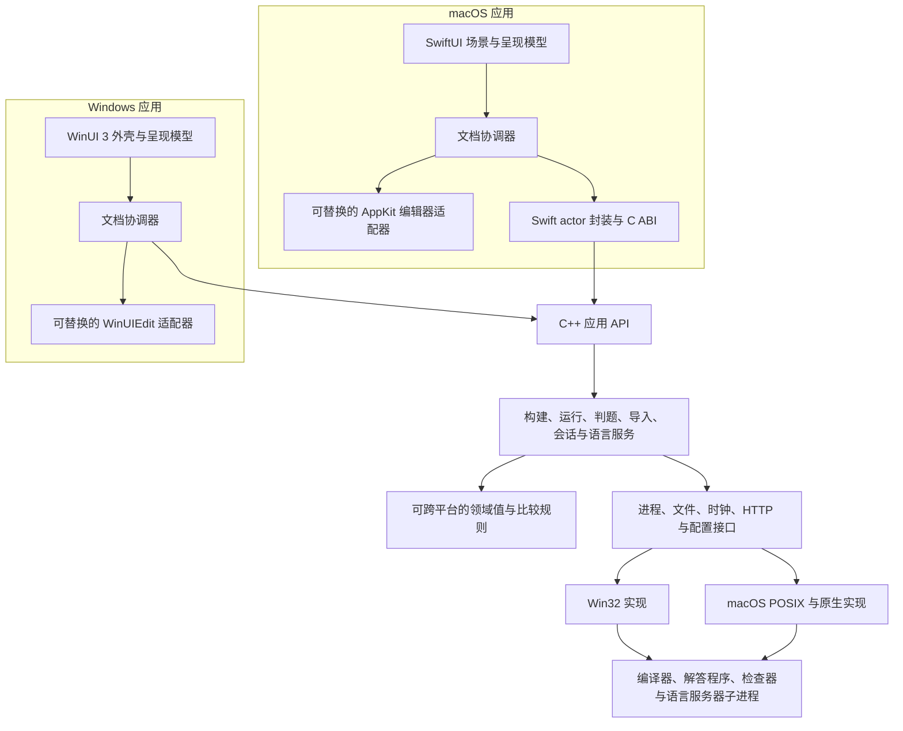

# 原生架构

状态：拟议设计，以[源码审查](upstream-audit.md)和[编辑器研究](editor-evaluation.md)为依据。本文不表示原生实现已经完成，也不表示已经取得性能测试结果。

## 架构决策与范围

以一个不依赖 Qt 的 C++20 竞赛引擎支撑两套原生应用。Windows 是首个交付目标，环境为 Windows 10 22H2 专业工作站版，采用 WinUI 3、C++/WinRT 和 PowerShell 7 开发脚本。macOS 使用 SwiftUI 管理场景和应用呈现，并接入基于 AppKit 的编辑器组件。macOS 14 暂定为编辑器对比原型的共同最低系统版本；产品最终支持的最低系统版本和构建工具链，以选定组件经过验证的要求为准。

首个实用版本支持文档和标签页、可配置编译、批量运行样例、取消任务、输出比较、会话恢复以及 Competitive Companion 导入。后续阶段增加 LSP 补全和诊断、格式化、testlib／自定义检查器、终端运行、压力测试、交互式判题和在线评测提交适配器。实施计划规定交付顺序，首个原型无需一次实现所有能力。

重新实现原生 UI 和操作系统适配器，通过明确的测试保留 CP Editor 有价值的行为规则及导入兼容性。现有 `Core` 类包含进程／事件循环、设置和 UI 依赖，无法直接链接到不依赖 Qt 的应用中。macOS 产品不直接 Fork CodeEdit，也不引入 CPH-NG 的 VS Code UI。

## 组件拓扑



图中展示运行时调用关系。源码依赖指向内部：服务依赖抽象**接口**；平台实现依赖这些接口，并由应用的组装入口注入。领域代码不依赖 UI 或操作系统框架。引擎在应用进程内运行；编译器、解答程序、检查器和语言服务器作为受管理的子进程运行。初期不要求后台守护进程或应用 RPC 层。

## 状态归属

| 所有者 | 负责维护的状态 | 边界 |
| --- | --- | --- |
| 原生编辑器适配器 | 文本缓冲区、选区、撤销／重做、IME 组合文本、渲染、折叠状态、辅助功能 | 发出已提交的编辑事件；提供与修订版本一致的快照和具有明确语义的编辑操作 |
| 原生文档协调器 | 文档 ID、URI／路径、编码／EOL 元数据、修订版本、保存点和磁盘冲突状态 | 将编辑事务与修订版本关联；生成源码快照和原生视图状态 |
| 竞赛引擎 | 题目／测试模型、构建／运行作业、检查器策略、输出产物和结果历史 | 消费不可变快照及请求数据；发出带类型的事件 |
| 语言服务 | 只读且带版本的文档镜像、服务器能力和待处理请求 | 接收已提交的修改；返回带修订版本的诊断和编辑结果 |
| 会话存储 | 可跨平台的恢复数据，以及按命名空间隔离的原生视图状态 | 保存带版本的记录；不直接调用控件或恢复窗口 |
| 原生外壳 | 窗口／场景、菜单、对话框、焦点、布局和 UI 调度 | 将引擎状态映射到界面，并在原生 UI 线程恢复视图 |

共享文档镜像为 LSP 和快照提供数据，不成为第二个可编辑缓冲区。渲染和指针移动不经过 Core 桥接。编译／运行只捕获一次当前已提交源码的修订版本；用户可以继续输入，旧结果仍关联其原始修订版本。保存点通过与已保存内容比较来判断状态，因此即使文档修订版本继续递增，撤销到已保存内容时也会清除未保存标记。

## 共享模块

| 拟议构建目标 | 职责 | 依赖 |
| --- | --- | --- |
| `cpn_domain` | ID、配置档、样例、源码修订版本、判定结果和纯比较策略 | C++ 标准库 |
| `cpn_ports` | 进程、时钟、文件／配置存储以及 HTTP 传输接口 | 领域值；不依赖具体原生 API |
| `cpn_services` | 构建计划解析、批量调度、判题、会话编解码、Companion 解析、LSP 与格式化器协调 | 领域层、接口层、选定的非 Qt 序列化／协议库 |
| `cpn_platform_windows` | 进程作业、路径转换、原子文件操作、HTTP 传输和应用路径 | 接口层、Win32／原生库 |
| `cpn_platform_macos` | 进程组、文件／监视操作、应用路径和 HTTP 传输 | 接口层、POSIX／原生库 |
| `cpn_c_api` | 带版本的不透明句柄、带长度的缓冲区、请求和事件批次 | 服务层；隐藏 C++ 内存布局和异常 |
| Windows／macOS 应用目标 | 原生编辑器、文档协调器、呈现模型、资源及组件组装 | 引擎 API／桥接、对应平台实现、选定编辑器 |

在实现时选择并固定序列化库和 HTTP 后端，每个生态使用一套依赖清单／锁定机制。领域层和服务层的公开头文件不得出现 Qt、XAML、WinRT、AppKit、SwiftUI 或编辑器库类型。通过构建目标依赖和独立 Core 构建落实此约束。具体平台实现文件可以使用原生框架类型。

## Windows 应用

使用 C++/WinRT WinUI 3。外壳负责命令、标签页、样例／结果面板、设置及恢复界面。`WinUIEditAdapter` 通过 Windows 本地的 `EditorSurface` 接口封装 `WinUIEditor::Editor` 和 Scintilla 通知。对于尚未打开或从会话恢复的后台文档，延迟创建开销较大的视图。文档一旦进入编辑状态，隐藏标签页时仍须保留其活动文本缓冲区和撤销栈；仅保存恢复数据不能替代这些状态。只有在选定组件能够保留文档和撤销状态所有权时，才可以分离／重建可视部分，否则应保留编辑器实例直到文档关闭。

首个候选是原生 WinUI Scintilla 移植版。上游记录了 IME、窗口重新激活和辅助功能方面的限制，不能直接假定其输入行为已满足生产要求。直接承载 Scintilla HWND 是单独的备选原型，需要自行验证 XAML 裁剪、弹出层、焦点、键盘、DPI 和辅助功能。Monaco／WebView2 是未来可选的权衡方案，需要另行决策，不属于首条原生编辑器路线。

使用 `DispatcherQueue` 将状态变化调度到 UI。进程 I/O、编译、检查、解析和会话写入均在 UI 线程之外执行。使用可选的 Windows 背景效果前检查系统能力；效果不可用时，Windows 10 使用普通系统背景。开发阶段先采用选定 Windows App SDK 的打包模式；初步分发方案为签名 MSIX。便携／非打包模式需要单独验证运行时部署、路径和恢复行为。

Windows 通过 `CreateProcessW` 创建进程，明确解析可执行文件，并正确编码参数向量。允许子进程执行前将其关联到 Job Objects，仅继承预期的管道句柄，并在适当情况下启用作业关闭时终止进程的机制。显式处理嵌套作业和关联失败。Shell 脚本用于开发及用户明确请求的终端命令，编译过程不隐式经由 Shell 执行。

## macOS 应用

SwiftUI 负责场景、命令、工具栏、侧边栏／面板和设置。使用选定组件的原生包装接口，按需要选择 `NSViewRepresentable` 或 `NSViewControllerRepresentable`，并保持协调器身份稳定，避免 SwiftUI 更新替换活动编辑器或重置撤销／IME 状态。

按照相同的 `EditorSurface` 能力契约制作 CodeEditorView 和 STTextView 原型。审查版本中的 CodeEditorView 需要补充 C++ 语言配置和语言服务桥接。STTextView 需要集成高亮／诊断，并记录采用 GPL 或商业许可的选择。CodeEditSourceEditor 是能力更完整的 Tree-sitter 备选方案。本文尚未选定生产编辑器。

基于 actor 的 `CoreClient` 负责 C ABI 引擎句柄、请求提交和事件消费，并将视图更新发送到 `MainActor`。具体进程实现使用 `posix_spawn`／进程组、非阻塞管道和 `waitpid`；取消先请求协作式终止，经过有上限的宽限期后升级为终止进程组。进程组覆盖仍留在组内的后代进程；已分离／逃离进程组的子进程，以及应用崩溃后的清理，需要明确验证，或在后续引入监督进程。该运行器用于本地开发，不宣称提供安全沙箱。

应用使用 Xcode 构建；Swift 模块和编辑器依赖在合适时使用 SwiftPM。共享 C++ 构建目标由 CMake 构建，通过包含头文件和 module map 的小型二进制／库目标提供 C ABI。固定兼容的编译器／SDK 版本和 `Package.resolved`。计划采用 Developer ID 签名并经公证后直接分发；沙箱／App Store 分发需要另行决策，因为执行用户任意工具链会受到额外限制。

## 原生编辑器契约

各平台用自己的语言定义接口，通过测试夹具共享行为语义，不共享视图实现：

- 打开／捕获文档，应用修订版本匹配的编辑事务，标记保存点，并执行具有明确语义的编辑命令。
- 定位到带类型的源码范围，显示带版本的诊断，管理焦点，设置由资源定义的外观，并报告能力。
- 发出已提交的文本修改、未保存状态／保存点变化及选区状态事件；以确定的顺序释放资源。

共享源码数据使用 UTF-8 字节范围，原生文本操作使用 AppKit UTF-16 范围，LSP 使用协商确定的位置单位。每个范围都附带文档 ID 和修订版本。转换索引按修订版本维护。不得混用 `String.count`、字节偏移和 UTF-16 计数。原生 IME 组合输入事务完成前，不将其计入已提交修改事件。

## 配置与扩展

语言 ID 是由注册表解析的可扩展字符串。`ToolchainProfile` 定义可执行文件、参数模板、构建要求、输出产物、运行计划、环境策略、格式化器／LSP 配置以及可选的语言专用设置。C++、Java 和 Python 可以作为随应用提供的配置档，引擎内部不按显示名称编写分支。保留源码包含目录的行为，并允许解释型语言配置跳过构建步骤。

使用一套带版本的配置 schema，为两端应用提供类型验证及生成／绑定的字段定义。UI 标签和错误文本来自 WinUI 资源及 macOS String Catalogs，产品默认语言仍为英文。领域错误携带代码和参数；编译器／检查器输出保留为原始外部数据。限制值、Companion 端口、样例文件名模式和外观策略均可配置。大文件模式依据实测工作负载预算和明确的能力定义，不直接照搬其他编辑器的字节阈值。

后续服务扩展通过注册适配器接入：格式化器、语言服务器、检查器、生成器／交互器、终端和在线评测提交。MVP 不引入动态插件框架。提交凭据保存在原生凭据存储中，不写入可跨平台的恢复数据。集成仅执行用户明确发出的命令；导入不执行代码或提交解答。

## 拟议仓库布局

当前只有文档和参考子模块。下列目录是后续实现布局，不创建空的占位构建目标：

```text
apps/
  windows/                 # WinUI 3 应用、编辑器适配器、资源
  macos/                   # SwiftUI 应用、编辑器适配器、字符串目录
core/
  include/cpn/             # 领域、服务及抽象接口契约
  src/domain/
  src/services/
  src/platform/windows/
  src/platform/macos/
  src/c_api/
contracts/                 # 带版本的配置／会话／Companion 映射及测试夹具
resources/profiles/        # 声明式语言／工具链／检查器配置档
tests/
  core/
  integration/
  editor-conformance/
tools/                     # PowerShell 7 Windows 脚本及识别平台的工具
docs/
references/cpeditor/       # 固定版本的研究源码；不参与应用构建
```

## 决策与备选方案

| 决策 | 原因 | 重新评估条件 |
| --- | --- | --- |
| C++20 共享服务与两套原生外壳 | 共享竞赛语义，同时由各平台独立管理输入和布局 | 独立 Core 无法保持不依赖 Qt |
| 集成编辑器组件 | 限制 IDE 维护范围，并允许根据验证结果更换组件 | 所有候选均未通过原型验收 |
| Windows 使用 C++ API，macOS 使用 C ABI | Windows 直接接入；Swift 所有权规则明确，不依赖 STL ABI | 实测桥接成本足以支持内部采用已验证的 Swift-C++ 互操作 |
| 进程内引擎与受管理子进程 | 避免过早引入 RPC，用户程序在 UI 进程之外执行 | 崩溃隔离／沙箱要求足以支持受监督的服务进程 |
| 新的带版本持久化格式及旧格式导入 | 解除 Qt 持久化耦合，同时保护未保存工作 | 旧格式测试夹具发现必须支持的新格式 |
| 保持行为兼容，并明确记录改进 | 保留检查器和文件工作流，避免复现误导性的判定结果 | 已记录的兼容策略发生变化 |

详细生命周期和持久化规则见 [Core 契约](core-contracts.md)。交付验收与尚待决定的事项见[实施计划](implementation-plan.md)。
