# Native architecture

Status: proposed design, supported by the [source audit](upstream-audit.md) and [editor research](editor-evaluation.md). No native implementation or performance result is implied.

## Decision and scope

Build two native applications over one Qt-free C++20 competition engine. Windows is the first delivery target: Windows 10 22H2 Professional for Workstations, WinUI 3, C++/WinRT, and PowerShell 7 development scripts. macOS uses SwiftUI for scenes and application presentation, with an AppKit-backed editor component. macOS 14 is a provisional common floor for the comparison prototypes; production minimum OS and build toolchain follow the selected component's verified requirements.

The first useful product supports documents/tabs, configurable compilation, batch sample execution, cancellation, output comparison, session recovery, and Competitive Companion import. Later stages add LSP completion/diagnostics, formatting, testlib/custom checkers, terminal execution, stress testing, interactive judging, and judge submission adapters. The implementation plan defines delivery order; these capabilities are not all part of the first prototype.

Reimplement the native UI and operating-system adapters. Preserve CP Editor's useful behavioral rules and import compatibility with explicit tests. Existing `Core` classes cannot be linked directly into a Qt-free application: they include process/event-loop, settings, and UI dependencies. Do not fork CodeEdit as the macOS product or import CPH-NG's VS Code UI.

## Component topology

```mermaid
flowchart TB
    subgraph Windows[Windows application]
        WUI[WinUI 3 shell and presentation models]
        WDC[Document coordinator]
        WE[Replaceable WinUIEdit adapter]
        WUI --> WDC
        WDC --> WE
    end
    subgraph macOS[macOS application]
        MUI[SwiftUI scenes and presentation models]
        MDC[Document coordinator]
        ME[Replaceable AppKit editor adapter]
        MB[Swift actor wrapper and C ABI]
        MUI --> MDC
        MDC --> ME
        MDC --> MB
    end
    WDC --> API[C++ application API]
    MB --> API
    API --> Services[Build, run, judge, import, session and language services]
    Services --> Domain[Portable domain values and comparison rules]
    Services --> Ports[Process, file, clock, HTTP and configuration ports]
    Ports --> WH[Win32 implementations]
    Ports --> MH[macOS POSIX and native implementations]
    WH --> Children[Compiler, solution, checker and language-server child processes]
    MH --> Children
```



The diagram shows calls at runtime. Source dependencies point inward: services depend on port **interfaces**; platform implementations depend on those interfaces and are injected by the application composition root. Domain code never depends on UI or operating-system frameworks. The engine runs in process; compilers, solutions, checkers and language servers are managed child processes. There is no mandatory background daemon or initial application RPC layer.

## Ownership

| Owner | Authoritative state | Boundary |
| --- | --- | --- |
| Native editor adapter | Text buffer, selections, undo/redo, IME marked text, rendering, fold state, accessibility | Emits committed edits; exposes revision-consistent snapshots and semantic editor operations |
| Native document coordinator | Document ID, URI/path, encoding/EOL metadata, revision, savepoint and disk conflict state | Associates editor transactions with revisions; creates source snapshots and native view state |
| Competition engine | Problem/test models, build/run jobs, checker policy, output artifacts and result history | Consumes immutable snapshots and request data; emits typed events |
| Language service | Read-only versioned document mirror, server capabilities and pending requests | Receives committed changes; returns revision-tagged diagnostics and edits |
| Session repository | Portable recovery data and separately namespaced native view-state payloads | Stores versioned records; never calls controls or restores windows itself |
| Native shell | Windows/scenes, menus, dialogs, focus, layout and UI dispatch | Projects engine state and restores views on the native UI thread |

A shared document mirror serves LSP and snapshots, without becoming a second editable buffer. Rendering and pointer movement never cross the Core bridge. Compile/run captures the current committed source revision once. Typing can continue; old results remain associated with their original revision. The savepoint compares against saved content, so undoing to the saved state clears dirty status even though the document revision advances.

## Shared modules

| Proposed target | Responsibility | Dependencies |
| --- | --- | --- |
| `cpn_domain` | IDs, profiles, samples, source revisions, verdicts, pure comparison policies | C++ standard library |
| `cpn_ports` | Process, clock, file/config store and HTTP transport interfaces | Domain values; no concrete native API |
| `cpn_services` | Build plan resolution, batch scheduling, judging, session codecs, Companion parsing, LSP and formatter coordination | Domain, ports, selected non-Qt serialization/protocol libraries |
| `cpn_platform_windows` | Process jobs, path conversion, atomic files, HTTP transport and application paths | Ports, Win32/native libraries |
| `cpn_platform_macos` | Process groups, file/watch operations, application paths and HTTP transport | Ports, POSIX/native libraries |
| `cpn_c_api` | Versioned opaque handles, counted buffers, requests and event batches | Services; hides C++ layout and exceptions |
| Windows/macOS app targets | Native editors, document coordinator, presentation models, resources and composition | Engine API/bridge, matching platform implementation, selected editor |

Serialization libraries and HTTP backends are selected and pinned when implemented, using one dependency manifest/lock mechanism per ecosystem. No Qt, XAML, WinRT, AppKit, SwiftUI, or editor-library types may appear in public domain/service headers. Enforce this through target dependencies and standalone Core builds, rather than a documentation-only promise. Native framework types may appear in concrete platform implementation files.

## Windows application

Use C++/WinRT WinUI 3. The shell owns commands, tabs, sample/result panels, settings and recovery presentation. `WinUIEditAdapter` hides `WinUIEditor::Editor` and Scintilla notifications behind a Windows-local `EditorSurface` interface. Delay creation of expensive views for unopened/restored background documents. Once edited, each open document retains its live buffer and undo stack when its tab is hidden; recovery serialization alone cannot replace that state. Detach/recreate visual surfaces only where the selected component can preserve document and undo ownership, otherwise retain the editor instance until document close.

The first candidate is the native WinUI Scintilla port. Do not assume its input behavior is production-safe: upstream documents IME, reactivation and accessibility limitations. A direct Scintilla HWND host is a separate contingency prototype with its own XAML clipping, popup, focus, keyboard, DPI and accessibility checks. Monaco/WebView2 is an optional future tradeoff requiring a new decision; it is outside the initial native editor path.

Use `DispatcherQueue` to marshal UI projections. Process I/O, compilation, checks, parsing and session writes run off the UI thread. Capability-check optional Windows backdrops; Windows 10 uses ordinary system backgrounds when a backdrop is unavailable. Use packaged development first with the selected Windows App SDK; signed MSIX is the initial distribution plan. A portable/unpackaged mode requires separate runtime deployment and path/recovery validation.

Windows process creation uses `CreateProcessW`, explicit executable resolution and correctly encoded argument vectors. Associate children with Job Objects before allowing execution, inherit only intended pipe handles, and use kill-on-job-close where appropriate. Resolve nested-job/assignment failure explicitly. Shell scripts are for development and explicitly requested terminal commands, rather than implicit compilation execution.

## macOS application

SwiftUI owns scenes, commands, toolbars, sidebar/panels and settings. Use the selected component's native wrapper (`NSViewRepresentable` or `NSViewControllerRepresentable` as appropriate) with a stable coordinator identity so a SwiftUI update does not replace the live editor or reset undo/IME state.

Prototype CodeEditorView and STTextView under the same `EditorSurface` capability contract. CodeEditorView needs a C++ language configuration and a language-service bridge at the audited revision. STTextView needs highlighting/diagnostic integration and its GPL/commercial licensing choice recorded. CodeEditSourceEditor is the broader Tree-sitter contingency. No production editor is chosen by this document.

An actor-backed `CoreClient` owns a C ABI engine handle, request submission and event consumption. It delivers view changes to `MainActor`. Concrete process support uses `posix_spawn`/process groups, nonblocking pipes and `waitpid`; cancellation escalates from cooperative termination to group termination after a bounded grace interval. Process groups cover descendants that stay in the group; detached/escaped children and application-crash cleanup require explicit validation or a later supervisor. This is a local development runner, without a security-sandbox claim.

Build with Xcode for the app and SwiftPM where suitable for Swift modules/editor dependencies. CMake builds the shared C++ targets; a narrow binary/library target with headers and a module map presents the C ABI. Pin compatible compiler/SDK versions and `Package.resolved`. Plan Developer ID signing and notarized direct distribution; sandbox/App Store distribution is a separate decision because arbitrary user toolchain execution has additional restrictions.

## Native editor contract

Each platform defines its interface in its own language; semantic behavior is shared through fixtures rather than a cross-platform view implementation:

- Open/capture a document, apply revision-checked edit transactions, mark savepoints, and execute semantic editor commands.
- Reveal typed source ranges, display versioned diagnostics, manage focus, set resource-backed appearance, and report capabilities.
- Emit committed text changes, dirty/savepoint changes and selection status; dispose deterministically.

Use UTF-8 byte ranges for shared source data, AppKit UTF-16 ranges for native text operations, and negotiated LSP position units. Carry document ID and revision with every range. Conversion indexes are per revision. Never use `String.count`, byte offsets or UTF-16 counts interchangeably. Native IME composition is excluded from committed change events until its transaction completes.

## Configuration and extensions

Language IDs are extensible strings resolved through a registry. `ToolchainProfile` defines executable, argument templates, build requirement, output artifacts, run plan, environment policy, formatter/LSP configuration and optional language-specific settings. C++, Java and Python can be shipped profiles without branches keyed to display names inside the engine. Preserve source include-directory behavior and allow interpreted profiles to skip a build step.

Use one versioned configuration schema with typed validation and generated/bound field definitions for both applications. UI labels and errors come from WinUI resources and macOS String Catalogs, with English as the default. Domain errors carry codes/parameters; compiler/checker output remains raw external data. Limits, Companion port, sample filename patterns and appearance policies are configurable. Large-file mode uses measured workload budgets and explicit capabilities rather than copying another editor's byte thresholds.

Later service extensions use registered adapters: formatter, language server, checker, generator/interactor, terminal and judge submission. Avoid a dynamic plugin framework in the MVP. Submission credentials belong to native credential stores and are outside portable recovery data. Integrations act only on explicit user commands; import does not execute code or submit anything.

## Proposed repository layout

Only documentation and the reference submodule exist today. The following is the implementation layout, without empty placeholder targets:

```text
apps/
  windows/                 # WinUI 3 application, editor adapters, resources
  macos/                   # SwiftUI application, editor adapters, catalogs
core/
  include/cpn/             # Domain, service and port contracts
  src/domain/
  src/services/
  src/platform/windows/
  src/platform/macos/
  src/c_api/
contracts/                 # Versioned config/session/Companion mappings and fixtures
resources/profiles/        # Declarative language/toolchain/checker profiles
tests/
  core/
  integration/
  editor-conformance/
tools/                     # PowerShell 7 Windows scripts and platform-aware tooling
docs/
references/cpeditor/       # Pinned research source; excluded from app builds
```

## Decisions and alternatives

| Decision | Why | Revisit when |
| --- | --- | --- |
| C++20 shared services, two native shells | Shares competition semantics while keeping native input/layout local | Standalone Core cannot be kept Qt-free |
| Component editor integration | Limits IDE maintenance and permits replacement after evidence | All candidates fail the prototype gates |
| C++ API on Windows, C ABI on macOS | Direct Windows integration; explicit Swift ownership independent of STL ABI | Measured bridge costs justify validated Swift-C++ interop internally |
| In-process engine, managed child processes | Avoids premature RPC and keeps execution outside UI process code | Crash/sandbox requirements justify a supervised service process |
| New versioned persistence plus legacy import | Removes Qt persistence coupling while protecting unsaved work | Legacy fixtures reveal required unsupported formats |
| Behavior parity with explicit improvements | Preserves checker/file workflows without reproducing misleading verdicts | A documented compatibility policy changes |

Detailed lifecycle/persistence rules are in [Core contracts](core-contracts.md). Delivery gates and known decisions remaining are in [the implementation plan](implementation-plan.md).
