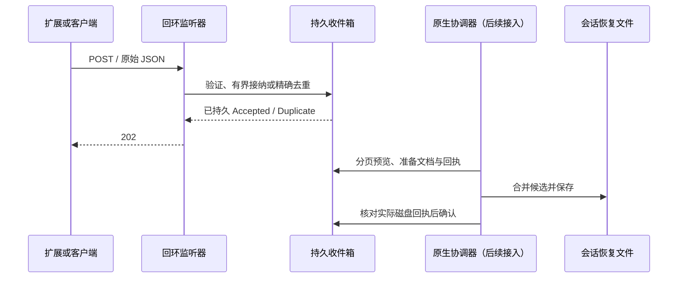

# Companion 回环 HTTP 服务

共享 `CompanionListener` 使用 Boost.Beast／Asio 解析 HTTP，在一个异步网络线程和一个有界持久接纳线程中工作。公开头为 `core/include/cpn/companion_listener.hpp`，不暴露 Boost 类型。服务和监听生命周期 C ABI 进入 CMake 服务库与单一 Core 归档；两端应用启停和实际扩展互操作的验收见 [实施状态](status.md)。

## 接纳与导入

202 只表示载荷已持久接纳或精确重复，不表示已添加编辑器文档。业务流程与原子回执见 [Companion 导入说明](companion.md)。连接关闭或客户端超时也不证明接纳失败：若磁盘替换已发生，重投同一原始字节通过收件箱去重恢复结果。停止或请求超时会取消锁等待；已经开始的原生文件 I/O 受 FileStore 契约约束，没有可抢占的硬截止保证。

## HTTP 契约

- 强制 IPv4 `127.0.0.1`，可选 IPv6 `::1` 且开启 `v6_only`；不绑定公网地址。IPv6 不可用可降为 IPv4，已有 IPv6 端口冲突明确失败。
- 仅 HTTP/1.1 `POST /`。Host 必须唯一，等于 `localhost:<实际端口>`、`127.0.0.1:<实际端口>` 或 `[::1]:<实际端口>`；端口 80 另允许省略端口。拒绝任意域名、别名、userinfo 和不匹配端口。
- Content-Type 必须唯一且为 `application/json`，可附 UTF-8 charset；压缩仅允许缺省或 `identity`。
- Beast 负责 Content-Length、chunked 和分段读取；拒绝有歧义的分帧、其他 Transfer-Encoding、Expect 以及所有 trailer，包括未在 Header 声明的 trailer。
- 每连接只处理一个请求，响应后关闭。未知题目字段及原始数值词法交给共享解码／收件箱完整保留。

成功响应包含 `schema_version: 1`、`status`、`import_id`、`disk_digest`、`inbox_replaced`、`backup_replaced` 和有界 `detail`。协议字段集中定义；detail 是诊断，不应被 UI 当作状态代码解析。传输拒绝响应包含版本、状态与 detail。

| HTTP 状态 | 含义 |
| --- | --- |
| 202 | 持久 Accepted 或精确 Duplicate |
| 400 / 404 / 405 / 415 / 417 / 431 / 505 | 请求、路径、方法、类型、期望、Header 或 HTTP 版本拒绝 |
| 409 | 收件箱身份、内部 schema、批次、历史或存储冲突 |
| 413 | 单正文超限 |
| 507 | 持久收件箱容量已满 |
| 503 | 传输／接纳容量、I/O、取消、锁等待失败或持久性未知；替换标志保留已发生的效果 |

## 容量与生命周期

`CompanionListenerOptions` 由调用者集中配置，不是分散在 UI 的阈值。下表记录当前默认值；完整支持上限在构造验证中检查，单正文还受 `CompanionInboxBounds` 限制。

| 配置 | 默认 |
| --- | --- |
| 端口 | 10045；0 显式申请临时端口 |
| 连接 / 已接纳队列（含执行项） | 16 / 4 |
| 单正文 / 合计在途正文预留 | 16 MiB / 32 MiB |
| Header 字节 / 个数 | 16384 / 64 |
| 响应字节 | 65536 |
| socket 发送缓冲提示 | 8192 字节；不是内核内存硬上限 |
| Header／正文读取 / 响应写入 | 各 5 秒 |
| 整个请求 / 合作锁等待 | 15 秒 / 5 秒 |

已知 Content-Length 预留该长度；未知 chunked 正文先预留单正文最大值。预留随读取、队列和实际接纳所有权移动，结束释放。该预算约束原始正文，不等于进程峰值内存；解析 DOM、响应、Header 与内核缓冲另有有界结构及实际成本。

整请求计时覆盖接纳等待。读取计时独立覆盖整段 Header 和整段正文，写入计时覆盖响应；没有按每个字节延长截止。`statistics()` 提供运行、关闭、失败、连接、接纳、正文预留以及拒绝／超时计数；`failure_detail()` 可观察致命网络线程失败。

在原生后台协调器调用 `start()`／`stop()`；停止取消监听、活动 socket、排队和正在等待锁的接纳，然后 join 两线程并排空取消 handler。并发外部 stop 串行完成。stop 后实例不可重启，应创建新实例。禁止从监听器自身线程调用 start／stop，检查在获取 join 锁及状态变化前拒绝重入，避免启动等待与外部停止形成死锁。停止不在 MainActor／DispatcherQueue 上等待，也不调用 UI 回调。

C ABI 为每个引擎协调最多一个实例，提供 `cpn_engine_companion_listener_start_json`、`stop_json` 和 `info_json`。启动／停止前预留响应配额；活动实例的不同配置返回 `CPN_BUSY`，同配置返回 `AlreadyStarted`。引擎关闭先取消并 join 监听器，再关闭运行任务；关闭后仍可查询状态。完整字段、限额与缓冲区所有权见 [Core API](core-api.md#companion-监听生命周期接口)。

绑定禁用地址复用，Windows 另外显式使用 `SO_EXCLUSIVEADDRUSE`，防止另一实例复用正在监听的端口。实际 HTTP 连接结束后的系统 `TIME_WAIT` 可能令同端口的新实例暂时返回 `BindFailed`；停止已 join 与“同端口立即可再绑定”是不同保证。原生客户端显示实际失败诊断，不把 `CPN_OK` 等同于 `Started`，不使用延时隐藏端口错误。真实关闭验证检查连接拒绝；未建立连接的端口另验证独占重新绑定。

## 固定依赖与验证边界

Boost 1.92.0 官方 b2-nodocs 归档的 URL／SHA-256 和 BSL-1.0 原文身份保存在 `third_party/core-dependencies.lock.json`。CMake FetchContent 下载时校验归档，排除 Boost 自身库构建，仅为内部网络实现提供 system headers；不链接动态 Boost runtime，Windows 显式链接 `ws2_32`／`mswsock`。离线可复用 FetchContent 缓存；显式 `FETCHCONTENT_SOURCE_DIR_CPN_BOOST` 是开发者提供的本地源码覆盖，只检查版本及许可身份，不能当作归档逐文件完整性证明。

`tests/core/companion_listener_tests.cpp` 使用真实 IPv4／可用 IPv6 socket 和原生 FileStore，覆盖原文、NUL／CRLF、分段／chunked／trailer、Host、预算、端口冲突、替换前后故障、锁等待、超时和并发停止。macOS ARM64 作者普通、完整 ASan／UBSan、TSan 三种模式各 7 组通过；ASan 显式关闭当前主机不支持的 LSan。慢接收探针观察到完整响应进入 TCP 缓冲，未触发阻塞写超时，不能声称已实测该分支。

`tests/abi/companion_listener_api_tests.cpp` 通过真实网络覆盖严格配置、规范化默认值、配额耗尽时没有绑定／停止副作用、HTTP 持久接纳和非消费分页、端口冲突重试、销毁后缓冲区、持锁接纳／未读完正文的关闭取消，以及并发 start／stop／close／destroy。带 Boost 类型的测试程序必须与 Core 使用一致的编译器配置及 macOS deployment target；只包含 C ABI 头的 Swift 原生桥接不暴露 Boost 类型。

普通及完整 C／C++ 严格警告 ASan／UBSan 的 Core 17/17 入口通过。独立故障注入额外通过 44 项检查，按实际发布的缓冲区、实际绑定的端口和文件 inode 替换确定故障位置，覆盖启动失败清理、停止、写响应发布、替换标记和未知持久性的诊断路径。请求 DOM 清理、POSIX parent 路径／异常消息、摘要与诊断存储在副作用前准备，替换后不以分配新响应或诊断字符串的方式吞掉已发生的效果。原始失败与修复复验保留在 `out/research/listener-abi-review`。

Windows 10、最低支持 macOS、真实 Competitive Companion 扩展和两端原生启停仍需后续验收。客户端测试命令必须在原生启停链路实现后，按真实配置端口执行；服务／ABI 验证不代表原生菜单与实际扩展验收。
