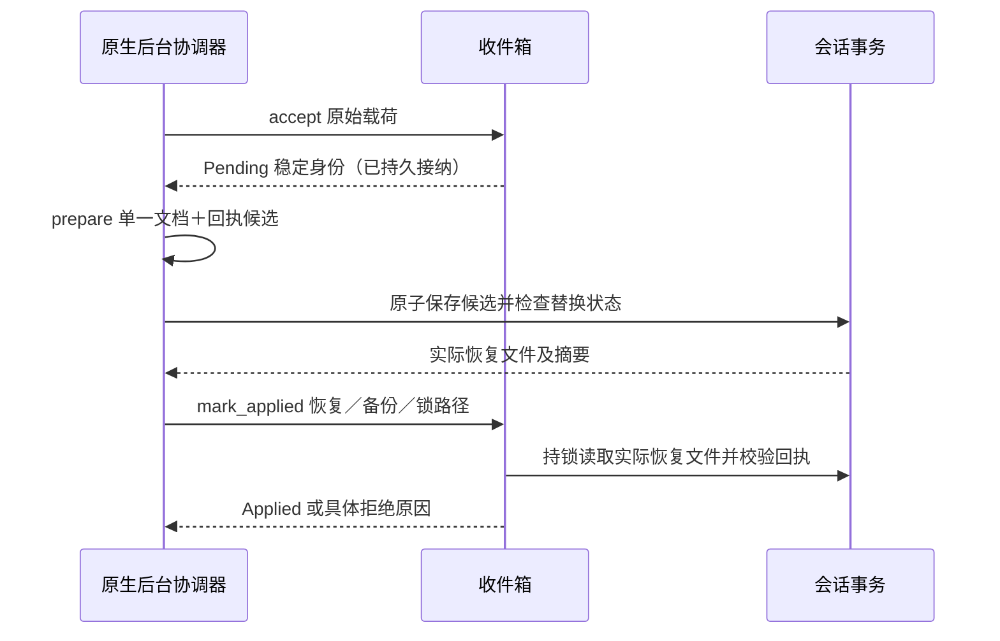

# Competitive Companion 解码与导入边界

本文记录已实现的共享 payload 解码器、有界持久收件箱、原子会话导入准备器、回环 HTTP 服务及监听生命周期 C ABI，以及后续原生启停／导入的拟议边界。解码器是无 I/O 的 C++20 服务，不监听端口、不创建文档或文件、不分配稳定 ID，也不启动编译器／解答程序。收件箱已分配稳定 ID 并持久接纳原始载荷；四个 C ABI 接口提供分页／接纳／准备／确认，三个监听接口协调启动／停止／查询；回环 HTTP 服务使用固定 Boost.Beast／Asio，Windows 原生启停及导入已接入并通过完整宿主 CI，目标机 UI 待验；macOS 文件导入／回执确认／重启已通过前台验收，尚无原生 HTTP 启停；完整互操作状态见 [实施状态](status.md)。

## 已实现的接口

`parse_companion_payload(std::string_view, CompanionBounds)` 返回 `CompanionCandidate`。公共头为 `core/include/cpn/companion.hpp`，实现为 `core/src/services/companion.cpp`。公开数据不含 Qt、原生 UI、网络库或 nlohmann 类型。

候选包含已解释的题目名称、分组、URL、来源限制、完整样例、可选交互／testType／输入／输出／Java／批次字段，以及 `original_json`。最后一项是验证后保留的**完整原始 payload 字节串**，包含未知字段、层级、空白和数值词法；不会通过 JSON DOM 重序列化而丢失未知大整数或浮点写法。它不是去重摘要，也不是带版本的原生持久格式。

所有 JSON 对象递归拒绝重复键，包括未知元数据和数组内对象；`"a"` 与 `"\u0061"` 是重复键。无效 UTF-8、孤立 surrogate、畸形 JSON 和尾部非空白内容被拒绝，不能使用替换字符掩盖错误。JSON 解析后端沿用固定的 nlohmann/json；超出其数值表示能力而无法解析的数值会报告 `invalid_json`。未知但可解析的数值仍由原始 payload 精确保留。

### 已知字段

| 字段 | 验证与解释 |
| --- | --- |
| `name`、`group` | 必须存在且为字符串；可以为空，各自应用名称字节限额，不裁剪或规范化 |
| `url` | 必须为非空、有界、无 NUL 的字符串；保留原始身份，不做 URL 规范化、下载、导航或路径转换 |
| `timeLimit`、`memoryLimit` | 必须为非负 64 位整数，分别保存为 ms、MB；零表示未提供限制，不转换为 `ProcessLimits` 或计算内存字节 |
| `tests` | 必须为有界数组，可为空；每项必须是对象，且 `input`、`output` 都必须是字符串 |
| `interactive` | 可缺失；出现时必须是 boolean，不能使用 `0`／`1`／null 表示 |
| `testType` | 可缺失；出现时必须是字符串，未知值保留并列出普通 stdio 不兼容理由 |
| `input` | 可缺失；出现时必须是对象且有非空字符串 `type`；出现的 `fileName`／`pattern` 必须为字符串；file 模式需要非空 `fileName`，regex 模式需要非空 `pattern` |
| `output` | 可缺失；出现时必须是对象且有非空字符串 `type`；出现的 `fileName` 必须为字符串；file 模式需要非空 `fileName` |
| `languages` | 可缺失；出现时必须是对象；如果含 `java`，它必须是对象并包含字符串 `mainClass`、`taskClass`，明确空字符串保留；不验证或执行 Java 类名 |
| `batch` | 可缺失；出现时必须含非空、有界、无 NUL 的字符串 `id` 和正整数 `size`，size 受单独限额约束 |

为了兼容 CP Editor 使用的旧载荷子集，现代元数据可缺失，普通样例采用旧版非交互、single、stdin／stdout 兼容语义；返回值仍保留字段缺失状态，不伪造来源字段。出现的已知字段即使当前模式不使用，也验证其类型，例如 stdin 中的 `fileName: 1` 会被拒绝。

固定 [LanguageConfiguration.ts](https://github.com/jmerle/competitive-companion/blob/df90fabb52e8f566ea3382405e22d246af5d6a69/src/models/LanguageConfiguration.ts) 声明 Java 的两个字段为必需 string，但 TaskBuilder 将 taskClass 初始化为空，build 不检查非空，因此解码器允许明确空值。它不猜测缺失字段或生成 Java 类名。

未知外部字段允许并完整保留，与内部请求／会话拒绝未知字段的策略不同。未知语言、输入模式或未来 metadata 不会变成可执行配置。批次 ID 按不透明字符串接收，不要求某一种 UUID 写法；协议发送器当前使用 UUIDv4。稳定问题／文档／测试 ID 由未来收件箱在接纳时分配，不使用 URL、数组下标或 batch ID 代替它们。

样例以解码得到的原始 UTF-8 字节保存，允许 NUL、CJK、emoji、NFD／NFC、LF／CRLF。解码器不补换行、不 trim、不拆分 multiNumber 样例。空 `output` 是明确存在的空答案，不能变成 `expected: null`；缺少 output 或 output 为 null 会被拒绝。未来转换到 `TestCase` 时应直接将 output 放入存在的 expected 值。

### 普通 stdio 能力

候选的 `ordinary_stdio_issues` 是结构化列表，代码为 `Interactive`、`TestType`、`InputMode`、`OutputMode`，value 保留对应来源值。`compatible_with_ordinary_stdio()` 仅说明这些模式没有阻止按完整样例执行普通 stdin／stdout；它不保证已有编译器、非空样例、语言支持、checker 或资源限制，也不执行任务。

- `interactive: true` 不兼容普通批量运行。
- `single`、`multiNumber` 都保留完整样例输入，可供普通批量服务使用；解码器不会生成测试计数或拆分输入。其他 testType 值不兼容。
- 固定 [TestType.ts](https://github.com/jmerle/competitive-companion/blob/df90fabb52e8f566ea3382405e22d246af5d6a69/src/models/TestType.ts) 仅包含 single／multiNumber；multiEOF 不在该协议枚举中，按未知值保留并报告不兼容，不依据其他工具的枚举暗中扩大能力。
- stdin／stdout 以外的模式均列出不兼容理由，包括已知 file／regex 和未知未来模式。
- filename／pattern 即使包含 `../` 或 shell 语法也只作为元数据保留，不读取文件、不解释正则、不生成命令。

未知模式可导入保存，但未来原生导入协调器必须将不兼容状态带入题目记录，禁止普通 Run All 把它静默作为 stdio 题目运行。原生提示按代码映射到本地化资源，不能直接把源码内部枚举当产品文案。

### 默认边界

| 边界 | 默认值 |
| --- | --- |
| 原始 JSON | 16 MiB |
| 嵌套容器深度 | 32，根容器计一层 |
| JSON 节点 | 262144，容器／基础值／对象键均计数 |
| 每个解码字符串或键 | 4 MiB，已知和未知字段均适用 |
| 所有解码字符串和键合计 | 16 MiB |
| name／group | 各 64 KiB |
| URL | 32768 字节 |
| 样例数量 | 4096 |
| 每个 input／output | 4 MiB |
| 所有样例 input／output 合计 | 16 MiB |
| batch ID | 1024 字节 |
| batch size | 4096 |

调用方可提供 `CompanionBounds`。预算累计采用剩余空间比较，避免加法溢出；原始正文、节点、字符串及样例预算一起约束解析放大。这里只记录内容边界，不声称进程峰值内存等于某个字节预算。真实监听器必须在收到完整正文之前实施传输预算，而不是仅在解码时检查。

解析失败抛出 `CompanionParseError`，其 `CompanionParseErrorCode` 为 `invalid_json`、`invalid_shape`、`invalid_field` 或 `exceeded_bounds`；资源分配异常按普通 C++ 异常传播，未来 ABI 边界负责转换。失败不返回部分候选，也没有文件或执行副作用。

## 协议与上游实证

Competitive Companion 协议基线固定为 `df90fabb52e8f566ea3382405e22d246af5d6a69`：

- [CustomHost.ts](https://github.com/jmerle/competitive-companion/blob/df90fabb52e8f566ea3382405e22d246af5d6a69/src/hosts/CustomHost.ts) 发送 HTTP POST 到 `http://localhost:<port>/`，内容类型为 `application/json`。
- [TaskBuilder.ts](https://github.com/jmerle/competitive-companion/blob/df90fabb52e8f566ea3382405e22d246af5d6a69/src/models/TaskBuilder.ts) 给出默认模式和 batch 字段；[README 格式](https://github.com/jmerle/competitive-companion/blob/df90fabb52e8f566ea3382405e22d246af5d6a69/README.md#the-format) 规定来源限额单位和样例结构。
- [hosts.ts](https://github.com/jmerle/competitive-companion/blob/df90fabb52e8f566ea3382405e22d246af5d6a69/src/hosts/hosts.ts) 使用 10045 作为 CP Editor 默认端口，并支持自定义端口。
- [Host.ts](https://github.com/jmerle/competitive-companion/blob/df90fabb52e8f566ea3382405e22d246af5d6a69/src/hosts/Host.ts) 没有检查 HTTP response.ok，并忽略网络异常；扩展发送完成不能作为导入已成功的证据。

CP Editor 固定基线为 `77e563b4719fcc9d2bde5b2f651ceb25c4a48e2c`：

- [CompanionServer.cpp:60](https://github.com/cpeditor/cpeditor/blob/77e563b4719fcc9d2bde5b2f651ceb25c4a48e2c/src/Extensions/CompanionServer.cpp#L60) 使用 qhttp 字符串端口重载；其固定子模块 `091cebdac49fefa5eca9bb5950b7df601281192e` 的 [qhttpserver.cpp:21](https://github.com/cpeditor/qhttp/blob/091cebdac49fefa5eca9bb5950b7df601281192e/src/qhttpserver.cpp#L21) 实际绑定 Any，原生监听器应显式绑定回环地址。
- [CompanionServer.cpp:67](https://github.com/cpeditor/cpeditor/blob/77e563b4719fcc9d2bde5b2f651ceb25c4a48e2c/src/Extensions/CompanionServer.cpp#L67) 收集正文，[83 行](https://github.com/cpeditor/cpeditor/blob/77e563b4719fcc9d2bde5b2f651ceb25c4a48e2c/src/Extensions/CompanionServer.cpp#L83) 在解析前返回 202；原生接纳必须先完成验证和有界持久化。
- [appwindow.cpp:1141](https://github.com/cpeditor/cpeditor/blob/77e563b4719fcc9d2bde5b2f651ceb25c4a48e2c/src/appwindow.cpp#L1141) 按 URL 找标签页，[mainwindow.cpp:680](https://github.com/cpeditor/cpeditor/blob/77e563b4719fcc9d2bde5b2f651ceb25c4a48e2c/src/mainwindow.cpp#L680) 清空现有样例。原生不能将重复接收等同于覆盖用户修改。

## 已实现的有界持久收件箱

`cpn/companion_inbox.hpp` 中的 `CompanionInboxService` 提供 `load`、`accept` 和 `mark_applied`；实现位于 `core/src/services/companion_inbox.cpp`，进入服务库和单一 Core 归档。同步文件操作必须由后台协调器调用。服务通过 `FileStore` 注入文件事务，不依赖 Qt／UI／HTTP，不读取源码或执行题目。

版本 1 收件箱绑定 `workspace_id`，使用独立 inbox／backup／lock 路径。首次接纳创建随机 inbox 身份；import、problem、document、test ID 由该身份和接纳序列的有域分隔摘要生成，接纳后稳定保存。题目按原始 URL 关联；URL 不变成文档身份或本地路径。整数序列／revision 到上限明确返回 `IdExhausted`，不能回绕。

接纳先验证完整载荷，再持合作锁重读最新主文件和备份。相同投递组（batch id 或明确缺失）与原始 URL 下，SHA-256 和最终原文逐字节都相同才是 `Duplicate`，复用既有身份；仅 JSON 空白变化也属于新的投递。相同题目但新原文生成新的 Pending import／document／test ID，保存 `previous_import_id`，不会清空旧文档或用户样例。同批次 size 变化、超过 size 的不同问题、容量耗尽均明确拒绝，不无限等待补齐批次。

每次写入先将原主文件保存为备份，再以同目录原子事务替换主文件。响应区分 `inbox_replaced`、`backup_replaced` 与 `disk_digest`；`DurabilityUnknown` 表示替换可能已发生，不能当作无副作用失败盲目重试。合作锁之外，替换前再次检查主文件摘要以发现非合作写入；这不是任意外部进程的原子 compare-and-swap 保证。

已有备份必须是主文件历史的非回退前缀：身份／原文／previous link 不得分叉，sequence／revision／next_sequence 不得领先，Applied 不得退回 Pending，已确认的会话证据不得改变。同 revision 要有相同逻辑快照。缺失 main 却存在 backup、主文件回滚或分叉都保留双方原件并拒绝写入，等待显式恢复；不能取较大的计数来覆盖唯一较新原文。`load` 只读取主文件，不自动选择或替换备份；写入时额外验证备份历史。

| 收件箱默认边界 | 值 |
| --- | --- |
| 持久 JSON 文件 | 128 MiB |
| 所有原始 payload 合计 | 64 MiB |
| 全部记录（含 Applied） | 256 |
| Pending 记录 | 128 |
| 批次 | 64 |
| 所有样例合计 | 16384 |
| JSON 深度／节点 | 48／262144 |
| 身份／路径 | 1024／32768 字节 |

原载荷仍受前文 `CompanionBounds` 限制；调用方可通过 `CompanionInboxBounds` 配置有界容量。Applied 原文、更新历史和未知原生偏好不自动淘汰，满容量返回背压。自动清理、归档及用户恢复选择尚未实现。内部 schema 严格拒绝重复／未知字段、浮点版本及不合法身份；未来版本不降级重写。

## 已实现的原子导入准备与回执

纯函数 `prepare_import_application(session, snapshot, import_id, defaults)` 返回一个同时包含新文档和 workspace 回执的候选 `WorkspaceSession`。源码初始正文、语言／工具链选择和原生偏好由 `ImportDocumentDefaults` 提供；远端 filename／Java 类名等不会成为执行配置。完整样例保留原始字节和稳定 test ID，空答案仍是存在的 expected。

文档偏好 `cpeditor.native.companion.document` 保存来源身份及普通 stdio 能力；工作区偏好 `cpeditor.native.companion.receipts` 保存导入回执。原生 Run 协调器必须读取能力并阻止不兼容模式进入普通 Run All。两端尚未接入导入 UI，不能宣称这一门禁已经完成。自身未来偏好（包括 v1 与未来版本共存）保持不透明且拒绝新导入；其他 owner 的原文不改写。偏好、文档或回执满容量不删除已有记录来腾空间。



`mark_applied` 固定按 Inbox → Session 顺序持合作锁，检查实际恢复文件中的 workspace 和完整回执；调用方仅有内存回执不能确认 Applied。恢复保存失败或回执不匹配时保留 Pending。源码与收件箱／恢复／备份／锁路径别名被拒绝，避免覆盖源码或自锁。

候选保存后、确认前崩溃：下次准备看到同一回执返回 `AlreadyApplied`，不会再添加文档，随后可继续确认。用户修改或删除已导入文档后仍由 workspace 回执防止重放创建。若收件箱已 Applied，但加载的旧会话缺回执，返回 `ReceiptMissing`，不自动重建；需要显式恢复处理。

## 回环 HTTP 服务与后续原生导入

监听器显式绑定 IPv4 127.0.0.1 和可用的 IPv6 ::1，端口由配置决定。验证 POST `/`、JSON 内容类型和 localhost Host；连接／header／body／读取／写入都有边界，停止时关闭监听并 join，不让工作线程调用 UI。Windows socket 监听不需要 HTTP.sys URL ACL。HTTP 后端已锁定 Boost 1.92.0，协议／预算／生命周期及依赖说明见 [回环 HTTP 服务](companion-http.md)。

只有验证且持久接纳成功才返回 202；扩展发送完成不能作为接纳证据。原生协调器在 MainActor／DispatcherQueue 应用候选，采用前述会话先保存再确认的流程。C ABI 分页／接纳／准备／确认及监听生命周期已实现并通过独立验收，准确请求与预算见 [当前 Core API](core-api.md)。两端原生收件箱界面仍待验收。导入不得自动打开 URL、读取远端 filename、编译或提交。

## 测试夹具与验证

`contracts/fixtures/companion/basic.json` 覆盖旧载荷子集；`full.json` 覆盖现代字段、空答案、CJK／emoji／NFD／CRLF／NUL、未知嵌套元数据和大整数词法；`unsupported.json` 覆盖交互／regex／文件／未来 testType，并保留不可信路径字符串。测试程序 `tests/core/companion_tests.cpp` 接受夹具目录参数，并覆盖严格类型、已知必需字段、全层重复键、UTF-8／surrogate、可配置边界及不兼容理由。

`builder-defaults.json` 按固定 TaskBuilder 默认状态构造，显式设置合法 URL 和稳定夹具 batch ID，覆盖空 name／group／taskClass 及空 tests。它是依据源码构造的回归夹具，不是浏览器实测导出证据。

本轮在实际 macOS 主机以 Apple Clang 执行了独立 C++20／`-Wall -Wextra -Wpedantic -Werror` 编译和全部夹具／异常测试，普通与 ASan＋UBSan 均通过。该主机的 AddressSanitizer 不支持 LeakSanitizer，最终运行显式关闭 leak 检测，地址和未定义行为检测保持启用。根任务另以干净的 CMake 构建目录验证了完整 Core：普通与完整 `-Werror` ASan／UBSan 两套 15/15 CTest 入口通过，服务库和聚合归档均包含解码器与收件箱。新增 `companion_inbox_tests.cpp` 覆盖有界容量、重复／更新／批次冲突、原文和稳定身份、未来 schema／偏好、候选与实际回执、故障前后替换标志、回滚／分叉备份、跨实例与真实跨进程合作锁；独立审查推动补齐回滚备份的历史回归。Windows 收件箱目标机仍未执行。CTest 使用相对夹具路径并设置仓库工作目录，避免窄 argv 将中文绝对路径转换为系统代码页。

调用者启动监听服务后，PowerShell 7 监听验收可使用夹具原始字节：

```powershell
$companionPort = 10045
$requestBytes = [IO.File]::ReadAllBytes((Join-Path $PWD 'contracts/fixtures/companion/basic.json'))
Invoke-WebRequest -Uri "http://localhost:$companionPort/" -Method Post `
  -ContentType 'application/json; charset=utf-8' -Body $requestBytes
```

当前应用尚未提供监听启动入口；上述命令须在后续原生启停链路实现后按实际端口执行，不能证明文档已导入。后续验收还需目标 Windows、实际扩展、端口冲突、仅回环绑定、积压／关闭、批次去重和重启重放证据，不能用解码器测试代替。

新增 `tests/abi/companion_api_tests.cpp` 验证纯 C／Swift 可导入头、四符号、完整页预算和不消费、buffer 配额占满不写盘、defaults 预验证、原文数值词法、4096 样例的有限写响应、实际回执／删除防重放、未来偏好／旧恢复／更新链、销毁后 buffer 仍有效，以及真实跨进程持锁中的并发 close。根普通和完整 ASan／UBSan 15/15 CTest 通过；目标 Windows C ABI 验证仍等待对应提交 CI。
