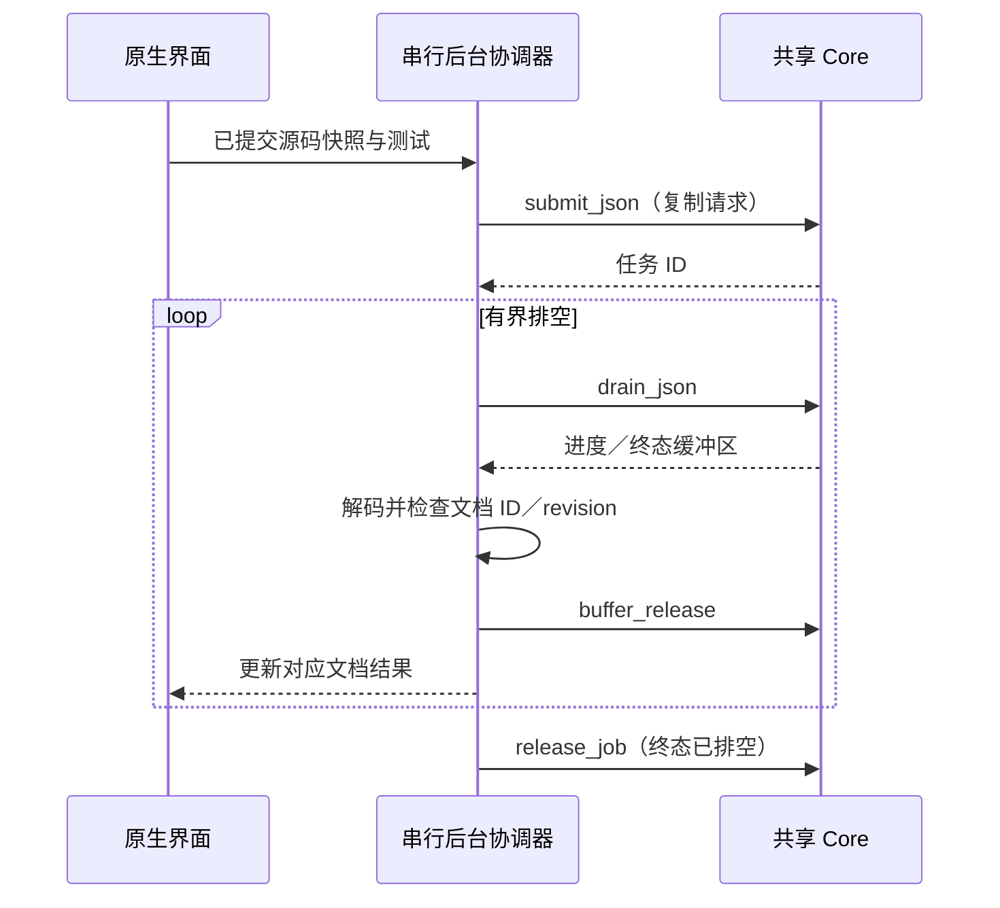

# 当前 Core 与 C ABI

本文描述已实现接口。完整里程碑仍见 [实施状态](status.md)；支持的调用语义不等于两端目标系统已经验收。

## 调用与线程

`core/include/cpn/api.h` 可由 C、C++ 和 Swift 导入。当前 ABI 为 1，创建时校验 `struct_size` 与 `abi_version`。引擎、任务和缓冲区都是整数句柄；STL、WinRT、AppKit 对象和异常不跨越边界。失败返回 `cpn_status`，可选的调用方 `cpn_error` 保存此调用的说明。



各公开操作支持线程安全访问，同一原生协调器应串行排空。`close` 和 `destroy` 会取消并等待固定工作线程，必须在后台调用；销毁前停止调用并协调客户端任务。取消已完成任务幂等，未知或已释放句柄返回错误。缓冲区由库分配，调用方只按长度读取并调用 `cpn_buffer_release`；缓冲区可在引擎销毁后释放，重复释放被拒绝。

## 有界任务与结果

默认 C ABI 配置为 2 个 worker、16 个任务槽、4 个未释放缓冲区、16 MiB 请求和每任务 8 MiB 保留输出。非零选项可覆盖默认值；最大分别为 8、64、16、64 MiB、64 MiB。C++ `JobRegistry` 的独立上限为 32 workers／256 任务，原生产品入口采用 C ABI 的更小上限。

槽覆盖复制中的请求、排队任务、运行任务及完成后尚未 `release_job` 的任务。进度按任务合并为最新一条，每个接受的任务恰好保留一条终态。C++ `poll` 不移除事件；精确序列号 `acknowledge` 不会删除后来产生的进度。C ABI 只在成功分配返回缓冲区后确认其中的事件，容量不足不会丢失终态。

每个 JSON 缓冲区最多 128 MiB，全部存活的 ABI 缓冲区合计最多 256 MiB。排空最多 128 条事件；大批次会收缩为可容纳的事件集合。客户端须释放缓冲区及已消费终态任务，再提交更多工作。结果保留原始 stdout／stderr 字节、实际采集总数和截断标记；文本显示的解码失败不能改变原始结果。

## 请求格式

请求、结果与事件信封的 `schema_version` 当前为 1。请求字段集中在 `core/src/services/json.cpp`，工具链字段集中在 `profile.cpp`。测试 `input` 必须显式提供；缺少或为 null 的 `expected` 表示无答案，空字符串表示答案为空。字节字段接受 UTF-8 字符串或严格 base64 对象。

```json
{
  "schema_version": 1,
  "source": {
    "document_id": "stable-document-id",
    "revision": 42,
    "text": "int main() { return 0; }",
    "original_path": null
  },
  "toolchain": {
    "schema_version": 1,
    "id": "cpp-clang",
    "language_id": "cpp",
    "source_filename": "main.cpp",
    "artifact_name": "solution",
    "build": {
      "executable": "clang++",
      "arguments": ["-std=c++20", "${source}", "-o", "${artifact}"]
    },
    "run": { "executable": "${artifact}", "arguments": [] }
  },
  "tests": [
    { "id": "sample-1", "input": "", "expected": "", "enabled": true }
  ],
  "comparison": "trailing"
}
```

`comparison` 支持 `strict`、`trailing` 和 `byte`；前两者采用已实现的 CP Editor 换行／行尾空白规则。`max_retained_output_bytes` 可降低本次预算，不能突破引擎限额。请求最多 4096 个测试，文档 ID 最多 4096 字节，测试 ID 最多 1024 字节，JSON 嵌套最多 64 层。重复字段／测试 ID、非整数版本或 revision、无效 UTF-8 和 NUL 路径被拒绝。

工具链文档最多 1 MiB，严格拒绝重复／未知字段和数字截断。可选 `build_limits`、`run_limits`、`inherit_environment`、`environment`、`variables` 见 `resources/profiles`。`${source}`、`${artifact}`、`${source_dir}`、`${job_dir}` 及显式变量逐参数展开，执行器直接接收 executable 和 argv，不隐式拼接 shell。

`JobEvent` 状态为 `Queued`、`Building`、`Running`、`Checking`、`Completed`、`Cancelled` 或 `Failed`。终态包含 `result`，其中保留 `document_id`、`revision`、`source_digest`、`profile_id`、编译状态和按稳定测试 ID 标记的结果。解答 AC／WA／CE 仍表示任务正常完成了处理；基础设施错误与取消具有独立分类。UI 必须按源码身份判断结果是否仍适用于当前文档。

## 外部 checker 与共享测试解析

批量请求可增加版本 1 `external_checker` 对象；有答案且解答正常结束时运行独立 checker，其输出纳入同一批次预算。每个结果保留独立 `checker.process`，超时／崩溃等为 `CheckerError`，不改变解答进程结果。配置、退出码协议和限额见 [外部 checker](external-checker.md)。`parse_test_cases` 供 CLI 等入口共享严格测试字段、base64 与数量检查。

## 会话接口

`cpn_engine_session_load` 接收 UTF-8 恢复文件路径，返回含 `status`、`session`、`disk_digest` 与 `detail` 的版本 1 JSON。`cpn_engine_session_save_json` 接收恢复／备份／锁路径、完整会话和上次读取的磁盘摘要，返回文件替换状态。两者使用相同的 ABI 缓冲区释放规则，应在后台协调器中调用；保存受引擎关闭取消信号控制。

保存前预留 64 KiB 返回缓冲区配额；容量不足不会先写文件再隐藏结果。调用成功的 `CPN_OK` 表示有可解码响应，是否保存成功须继续检查响应 `status` 和 `recovery_replaced`。`DurabilityUnknown` 表示原子替换已经发生但持久化未能确认，不能按普通“未保存”重试。

恢复格式、限额、请求示例和合作锁／外部写入限制见 [会话恢复](session.md)。会话保存请求仍受引擎 `max_request_bytes` 约束。

## Companion 解码器

C++ 接口 `parse_companion_payload(std::string_view, CompanionBounds)` 位于 `cpn/companion.hpp`，返回不含 UI 或网络类型的 `CompanionCandidate`。解码器验证已知字段、原始 UTF-8、所有层级重复键及内容预算，保留完整原始 payload 和未知元数据；空答案保持存在。交互／文件／regex／未知 testType 带有普通 stdio 不兼容理由，不能被后续导入界面静默作为普通题目运行。

该接口已进入 `cpn_services` 和单一 Core 归档，没有文件、网络或进程副作用。当前尚无对应 C ABI、HTTP 监听器、稳定导入 ID 或原生导入 UI，详细字段、边界和后续接纳流程见 [Companion 文档](companion.md)。

## 当前限制

- 原生进程后端支持进程组／Windows Job Object、并发三管道、墙钟超时、取消、输出限制和最终排空。未实现内存硬限额；启动期限是软期限，不能中断阻塞的原生进程创建调用。
- 比较循环分批响应取消；内存分配和释放仍同步，不是硬实时保证。
- 每个任务创建独立 workspace，源码快照和产物自动清理。文件写入同目录临时文件后原子替换；POSIX 替换成功后目录持久化失败通过 `AtomicWriteError.destination_replaced` 区分。
- 尚未包含 Companion 监听／收件箱／导入 ABI、LSP、格式化、压力／交互测试和发布接口；这些按完整实施计划继续推进。
