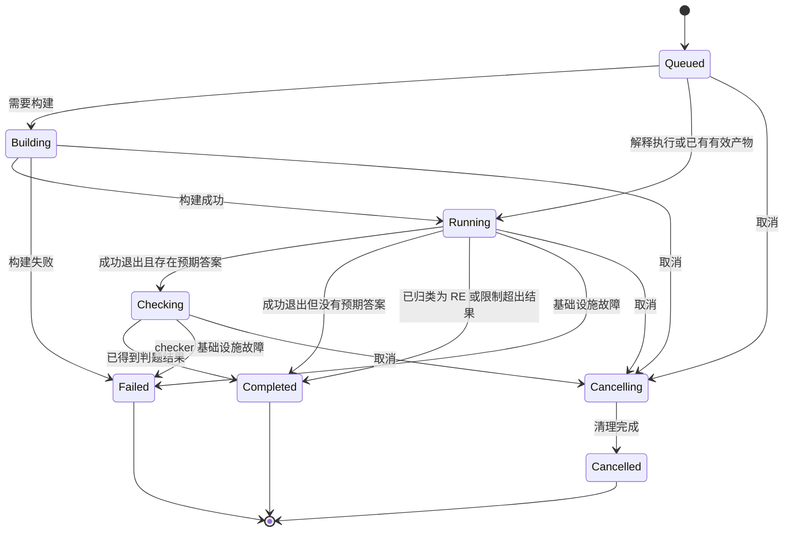

# Core 接口契约

状态：拟议的实现契约。下文的类型与操作名称是规范标识符，并非现有 API。实现时，公共字段名、枚举值与映射统一定义在 `contracts/` 中，由各语言绑定使用或生成。

## 领域数据

| 数据类型 | 必须满足的语义 |
| --- | --- |
| `DocumentId`, `ProblemId`, `TestCaseId`, `JobId`, `ArtifactId` | 稳定的不透明 ID，不依赖标签页／样例索引或文件系统名称 |
| `SourceSnapshot` | 文档 ID、单调递增版本号、UTF-8 编码的已提交文本、内容摘要、源码 URI／路径、原始包含目录、编码／换行符元数据，以及语言配置 ID |
| `ToolchainProfile` | 可执行程序／参数向量方案、编译型／解释型构建阶段、构建产物／运行规则、环境与工作目录策略；语言配置可扩展 |
| `TestCase` | ID、输入字节数据产物、可选的预期输出产物、启用标志和来源追溯信息；空输入与明确为空的预期输出均有效 |
| `CheckerProfile` | 比较模式及兼容版本，或外部 checker 的构建／运行方案，以及接受的退出码映射与限制 |
| `ExecutionLimits` | 启动截止时间、实际执行时长截止时间、可选的 CPU／内存策略、各输出流及合计输出字节上限、取消宽限期与排空截止时间 |
| `RunRequest` | 快照、已解析的工具链／checker／配置版本、不可变的已选测试数据及限制 |
| `ProcessResult` | 启动失败，或退出状态／信号；终止原因、实际经过时长、可获取的资源测量值，以及受容量限制的 stdout／stderr 产物 |
| `CheckResult` | 判题结果、结构化原因、checker 诊断信息及可选的不匹配范围；独立于进程状态 |
| `JobEvent` | 任务 ID、文档／版本、可选的测试 ID、序列号、阶段和带类型的载荷 |

预期输出是否存在，与其字节长度是两个不同概念。进程成功退出但没有预期答案时，结果为 `Unchecked`；明确为空的预期答案仍须比较。导入旧版空答案时，依据来源配置中的空输出检查选项消除歧义，并在迁移报告中记录采用的解释。不能因为 stdin 是空字符串就跳过运行。

每次构建使用一次捕获的源码版本，其中包括未保存文本。将该快照写入任务独占的目录，不覆盖用户的源码文件。保留原始包含目录语义，并在诊断信息中保留源码来源。单份源码快照不会自动冻结其头文件／文件依赖：初期应尽可能记录外部依赖，依赖变化时使构建复用失效。不能声称构建已具备完全隔离、可复现的封闭性。

初期每个 Run All 任务只构建一次，在任务内为选中的各测试复用所得产物。跨任务构建缓存应推迟到缓存键能够覆盖源码、编译器身份／版本、参数／环境策略及依赖摘要之后。并发任务不得共享可写构建产物或样例文件名。

## 执行生命周期

图中表示单个测试的处理流程；任务还拥有一次共享构建，并汇总各测试结果。`Completed` 表示流程已产生最终结果，包括 WA 或已归类的限制超出结果，不代表 Accepted。`Failed` 表示编排／构建／checker 失败。协调器在其执行器上串行处理状态转换，原生 UI 线程只负责呈现这些状态。

- 每个已接受的任务恰好发出一个终态事件。取消操作是幂等的；终态事件之后到达的请求不再产生影响。
- 每个选中的测试都得到终态结果，包括因编译失败而被取消／未运行的测试。执行期间删除或调整 UI 测试顺序，不会使已有结果关联到另一个测试。
- 活动任务收到并确认取消请求后，转入 `Cancelling`。随后到达的子进程退出通知只完成清理，不得覆盖已确认的取消原因。退出／超时／取消的先后顺序由协调器线性化处理，并由竞态测试覆盖。
- 可配置的调度器限制并发编译器／解答程序／checker、排队工作，以及已完成但尚未消费的任务数量。接受任务时预留终态记录容量；消费者产生背压时，拒绝或暂停后续提交。UI 事件按有界批次传递，进度／输出预览可以合并；终态记录须保留到成功排空／确认，不能丢弃。消费者停滞不得导致终态事件无限积累。
- 关闭会话／文档时解除视图订阅，并按配置取消相关任务。应用退出时，先排空／取消服务、关闭管道、回收子进程并释放句柄，再释放引擎。

编译结果与测试判题结果保持独立：源码错误导致编译器非零退出时，返回带诊断信息的编译失败；找不到可执行程序／进程启动错误属于基础设施故障。两者都不能归类为解答程序的 WA 或 RE。

## 进程抽象接口

`ProcessHost` 使用结构化 `ProcessSpec` 启动进程，其中包含可执行程序、参数向量、当前目录、环境策略、stdin 来源与限制。终端专用的 shell 操作是独立能力。用户脚本可以有意调用 shell，但编译器／解答程序／checker／LSP 的执行不应隐式拼接 shell 命令。

异步写入 stdin，同时持续读取并排空 stdout／stderr，避免大输入或已满的 stderr 管道导致子进程死锁。批量运行在输入 EOF 时关闭 stdin。保留原始字节，包括 NUL 和无效 UTF-8；按照明确的配置／编码策略解码预览。解码器不得在数据块边界错误地切分多字节文本。

进程宿主通过明确的进程启动握手报告子进程启动。在启动阶段使用单调时钟实施启动超时。允许执行时，另行启动基于单调时钟的实际执行时长截止时间（Windows 为恢复子进程执行时；macOS 为最早可获得的进程启动观测时），并记录平台的测量精度。管道排空／后代进程清理由独立且有界的排空截止时间约束。这里记录的是本地运行器时间，不等同于在线评测机的 CPU 时间。不得沿用原版定时器与耗时测量起点不一致的行为。

达到截止时间或输出上限时，只记录一次终止原因，然后终止受管理的子进程集合。排空／丢弃后续字节时，不得超过已配置的保留输出上限。子进程即使仍持有继承的管道，也不得使任务或 UI 无限等待。一致地记录各流总量、截断／超限标志及最终字节；最终排空阶段与流式读取阶段都须实施容量上限。

Windows 使用明确的 Unicode 路径、UTF-16 原生参数及经过测试的 MSVC 风格引号转义；macOS 使用已验证的 UTF-8 路径转换／参数数组和进程组。保留退出码、POSIX 信号和强制终止之间的区别。两端宿主都必须公开后代进程管理与资源限制执行能力；进程组不等同于安全沙箱，也不能保证控制已脱离管理的后代进程。

内存限制是可选能力，必须有明确的执行策略。记录所请求的限制是实际执行、仅测量，还是不受支持。只有资源限制后端提供证据时才能产生 MLE；仅配置一个数值并不充分。不能默认声称 Windows、macOS 和在线评测机具有相同的隔离能力。

## 判题结果与 checker 策略

拟议的测试结果包括 `Accepted`、`WrongAnswer`、`TimeLimitExceeded`、`RuntimeError`、`OutputLimitExceeded`、`Unchecked`、`Cancelled`、`NotRun` 和 `CheckerError`；支持内存限制后端时，可额外提供 `MemoryLimitExceeded`。操作失败还应携带结构化错误。UI 文本／颜色／图标映射由使用原生资源的展示层负责。

| 条件 | 分类 |
| --- | --- |
| 解答程序启动失败 | 基础设施错误；不猜测为 RE |
| 解答程序非零退出或收到信号，且没有其他已记录的终止原因 | RE |
| 已记录解答程序执行截止时间超限 | TLE |
| 已记录解答程序输出上限超限 | OLE；不能截断后再按完整输出来比较 |
| 解答程序正常退出，但缺少预期答案 | Unchecked |
| 正常退出，且完成受支持的比较 | AC 或 WA |
| checker 编译／启动失败、超时、崩溃、未知退出码或 testlib `_fail` | CheckerError |
| 用户取消 | Cancelled，不能归为 TLE |

保留两种 CP Editor 兼容策略：

1. **CP Editor Strict：** 将 CRLF 和 CR 统一为 LF，再比较解码后的字符串。它与用户明确选择的可选字节精确 checker 是不同策略。
2. **CP Editor IgnoreTrailingSpaces：** 统一换行符，去除末尾仅含空白的行和每行末尾的 Unicode 空白，保留行首／行内空白。兼容配置依据已审查的 Qt 测试样本固定空白定义；替换为 ASCII 裁剪属于语义变化。

文本比较不会修改原始进程输出产物。对于文本策略，无效编码输出须产生明确的比较编码错误；原始输出仍可供查看，或用于字节比较／checker 策略。原版去除 NUL 的行为将明确移除，并在源码审查中记录。

外部 testlib／自定义 checker 按顺序接收 `input`、`actual output`、`expected output` 文件路径，文件位于任务独占的存储中。checker 自身的编译／执行／输出限制独立于解答程序限制。声明对应协议的返回码映射：testlib 0 为 AC，1／2 及有文档定义的拒绝码为 WA，3（`_fail`）为 CheckerError。分数／部分得分必须由明确支持的评分适配器处理；不能把不受支持的评分结果默认归为 WA。checker 超时或崩溃产生一个最终 CheckerError，并释放等待中的测试。

## C ABI 与原生客户端

拟议 ABI 包括 `cpn_abi_version`、引擎创建／销毁、异步提交／取消，以及有界的事件排空操作。公开不透明的引擎／任务／订阅句柄、固定宽度标量、枚举／错误码和带长度的 UTF-8／字节缓冲区。结构体携带大小／版本以支持演进。STL 对象、平台对象或异常均不得跨越该边界。

- 创建操作返回调用方拥有的句柄。销毁前，客户端须停止提交，等待事件任务结束并排空，再取消／回收剩余工作；销毁返回后不再交付回调。
- 提交操作在返回前按照明确的所有权规则复制／保留请求数据；成功提交后，调用方可以释放临时 Swift 缓冲区。
- 事件批次与输出缓冲区在通过匹配的 ABI 释放函数释放前，由库拥有。不得使用调用方分配器释放库分配的内存。
- 由单个串行 Swift actor／Windows 协调器排空事件。任何回调都不得同步重入引擎锁，也不得从进程线程交付 UI 更新。
- 接受请求前报告 ABI 不兼容。定义线程安全的取消操作，并通过结构化错误拒绝无效／过期句柄。内部异常在 ABI 边界转换为错误结果。
- Windows 可以通过轻量 C++ 外观接口调用同一服务；它与 C ABI 共享请求语义及一致性测试样本，不重复实现判题逻辑。

在所选 Xcode 工具链和所有权规则通过同样的测试后，直接 Swift-C++ 互操作可以作为未来的内部优化。无需向 Swift 公开依赖 STL 的公共 API。

## 语言服务与格式化

LSP 是基于进程传输的共享服务，处理 JSON-RPC 消息分帧、请求 ID、取消、初始化／关闭状态及带版本的文档变更。原生适配器呈现结果。遵循服务端文本同步能力并协商位置编码；UTF-16 是 LSP 规定的后备编码。构造文件 URI 时，应正确处理路径／百分号编码和 Windows 盘符，不能直接拼接 `file://` 与路径。

按文档／版本维护行索引，支持 UTF-8 字节、UTF-16 代码单元及协商后的 LSP 位置。AppKit 选区和旧版 `QTextCursor` 位置使用 UTF-16；Swift 字素数量不能替代它们。诊断／格式化／补全编辑只应用到匹配的版本，拒绝切断编码字符，并在关闭或编辑后丢弃过期响应。诊断未携带版本时，只能将其关联到明确无歧义的服务端／文档同步状态；有歧义的过期批次不予展示。

格式化器接收快照，返回经过验证的编辑事务。原生适配器在同一版本上将其作为一次撤销操作应用，并遵守输入法组合文本与选区语义。继续输入期间发生格式化时，必须通过明确的冲突逻辑失败或重新基于新版本计算，不能覆盖更新后的内容。较重的服务采用惰性初始化，并根据实测的大文件策略禁用或降级。

## 导入与持久化

`CompanionService` 在可配置且兼容 Companion 的端口上，提供回环地址 HTTP POST `/`。接受有界导入任务前，验证请求方法／内容类型、请求字节数、字符串／测试数量限制及字段类型。保留未知元数据和声明的限制单位；内部执行限制使用明确的单位。只有验证通过且入队成功后才返回接受响应，并以事务方式持久化成功导入的数据。回环导入不得触发编译器、checker、shell 或提交操作。

通过可扩展且带版本的映射保留 `name`、`group`、URL、测试、交互元数据、输入／输出模式、语言元数据及批次标识。测试的预期输出可以为空。使用批次 ID 分组，并逐项去重；对未完成批次设置边界，使其状态可见、可恢复，而非无限等待。不要假设所有评测平台、题目或语言使用相同字段集合。包含不受支持的交互／文件／评分模式的导入仍可存储，但须明确标记不受支持的能力；批量运行器不能将其作为普通 stdin／stdout 题目运行。

原生持久化采用带版本的 UTF-8 JSON 存储可移植会话／配置数据，并单独保存输出产物。可移植记录包含文档／题目／测试 ID、路径、未保存文本、保存点／磁盘冲突元数据，以及配置引用。视图数据位于平台／版本命名空间中；尽可能恢复带类型的源码锚点，不把 Qt 滚动条像素坐标直接当作原生滚动位置。未保存的恢复内容优先于自动重新加载已被外部修改的文件。

采用同目录原子替换，明确刷新／提交语义，保留此前有效的备份并验证数据结构。加载／验证恢复候选数据时，不销毁当前会话；保留损坏／不可读取的来源文件以便诊断。替代状态安全保存前，不覆盖已保留的恢复会话。拒绝不受支持的未来主版本数据格式，不截断数据。由 UI 线程之外的有界写入器保存恢复变更，退出时刷新；大型产物单独保存并应用保留限制。

旧版导入器处理 CP Editor 会话 JSON 和 **QSettings INI**，包括别名及 QVariant 编码。`src/Settings/settings.json` 是上游生成器输入，不是用户配置文件。依据已审查的数据结构及实际导出测试样本生成／映射迁移字段；保留原文件、生成迁移报告，绝不猜测不受支持的二进制 QVariant 值。必要时使用独立、可选的 Qt 链接导出工具，使产品／运行时 Core 仍不依赖 Qt。MVP 的旧版导入是单向操作；原生写入不承诺与 CP Editor 双向兼容。
