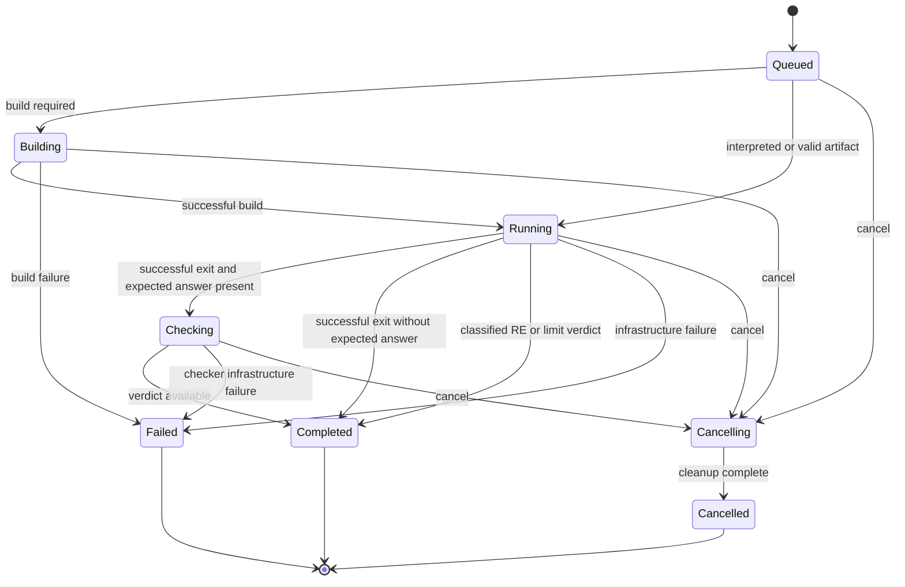

# Core contracts

Status: proposed implementation contract. Types and operation names below are specification identifiers, not existing APIs. Public field names, enum values and mappings will be defined once in `contracts/` when implemented and consumed/generated by each binding.

## Domain values

| Value | Required semantics |
| --- | --- |
| `DocumentId`, `ProblemId`, `TestCaseId`, `JobId`, `ArtifactId` | Stable opaque IDs independent of tab/sample indexes or filesystem names |
| `SourceSnapshot` | Document ID, monotonic revision, UTF-8 committed text, content digest, source URI/path, original include directory, encoding/EOL metadata and language profile ID |
| `ToolchainProfile` | Executable/argument-vector plans, compiled/interpreted build stages, artifact/run rules, environment and working-directory policy; extensible language configuration |
| `TestCase` | ID, input byte artifact, optional expected-output artifact, enabled flag and provenance; empty input and expected empty output are valid |
| `CheckerProfile` | Comparison mode and compatibility version, or external checker build/run plan plus accepted exit-code mapping and limits |
| `ExecutionLimits` | Spawn deadline, execution wall deadline, optional CPU/memory policy, per-stream and combined output byte caps, cancellation grace and drain deadline |
| `RunRequest` | Snapshot, resolved toolchain/checker/config revisions, immutable selected testcase data and limits |
| `ProcessResult` | Start failure or exit status/signal, termination reason, elapsed wall time, available resource measurements and capped stdout/stderr artifacts |
| `CheckResult` | Verdict, structured reason, checker diagnostics and optional mismatch ranges; separate from process status |
| `JobEvent` | Job ID, document/revision, optional testcase ID, sequence number, phase and typed payload |

Presence of expected output is distinct from its byte length. A successful process without an expected answer is `Unchecked`; an explicitly empty expected answer is checked. Imported legacy empty answers use the source's empty-output-checking option to resolve this ambiguity and record the decision in the migration report. Running empty stdin must not be skipped because it is an empty string.

A build uses one captured revision, including unsaved text. Materialize it into a job-owned directory without overwriting the user's source file. Preserve the original include-directory semantics and source provenance in diagnostics. Header/file dependencies are not automatically frozen by a single-source snapshot: initially record external dependencies where possible and invalidate build reuse when they change. Do not claim hermetic builds.

Start with one build per Run All job. Within that job reuse the resulting artifact across selected cases. Defer a cross-job build cache until the key includes source, compiler identity/version, argument/environment policy and dependency digests. Concurrent jobs must never share writable build artifacts or sample filenames.

## Execution lifecycle

The diagram represents one case's pipeline; the job also owns one shared build and aggregates per-case results. `Completed` means the pipeline produced a final outcome, including WA or a classified limit verdict; it does not mean Accepted. `Failed` means orchestration/build/checker failure. The coordinator serializes transitions on its executor; native UI threads only project them.

- Every accepted job emits exactly one terminal event. Cancellation is idempotent; a request arriving after a terminal event has no effect.
- Every selected case gets a terminal result, including cases cancelled/not run because compilation failed. Deleting or reordering a UI case during execution does not redirect an existing result to a different case.
- A cancel acknowledged while a job is active transitions to `Cancelling`. Later child exit notifications complete cleanup without replacing the acknowledged cancellation reason. Exit/timeout/cancel ordering is linearized by the coordinator and covered by race tests.
- A configured scheduler bounds concurrent compilers/solutions/checkers, queued work and completed-but-undrained jobs. Reserve terminal-record capacity when accepting a job; reject or pause further submissions under consumer backpressure. UI event batches are bounded and coalesced for progress/output previews; terminal records persist until successful drain/acknowledgment and cannot be dropped. A stalled consumer cannot cause unbounded terminal-event accumulation.
- Session/document close detaches the view subscription and cancels the configured jobs. Application shutdown drains/cancels services, closes pipes, reaps children and disposes handles before releasing the engine.

Keep compilation outcome separate from testcase verdicts: nonzero compilation caused by source errors is compilation failure with diagnostics; a missing executable/spawn error is infrastructure failure. Neither becomes a solution WA or RE.

## Process port

`ProcessHost` starts a structured `ProcessSpec` containing executable, argument vector, current directory, environment policy, stdin source and limits. A terminal-specific shell operation is a separate capability. User scripts can deliberately invoke a shell, but compiler/solution/checker/LSP execution does not implicitly concatenate a shell command.

Use asynchronous stdin writes and simultaneously drain stdout/stderr so a large input or full stderr pipe cannot deadlock a child. Close stdin at EOF for batch runs. Retain raw bytes, including NUL and invalid UTF-8; decode previews with an explicit profile/encoding policy. Decoder chunk boundaries must not split multibyte text incorrectly.

The host reports child startup using an explicit process-start handshake. Apply a monotonic spawn timeout while launching. Start a separate monotonic wall deadline when execution is allowed (Windows child resume; earliest available macOS spawn observation), recording the platform's measurement precision. Include pipe-drain/descendant cleanup under a separate bounded drain deadline. Resource time is local runner time, rather than an online judge's CPU measurement. Do not inherit the old timer/elapsed-time inconsistency.

When a deadline or output cap is reached, record the reason once and terminate the managed child set. Drain/discard bytes without exceeding configured retained-output limits. A child that leaves inherited pipes open must not keep the job or UI waiting indefinitely. Store per-stream totals, truncation/limit flags and final bytes consistently; enforce caps on final drain as well as streaming reads.

Windows uses explicit Unicode paths and UTF-16 native arguments with tested MSVC-style quoting; macOS uses validated UTF-8 path conversion/argument arrays and process groups. Preserve exit code versus POSIX signal versus forced termination. Both hosts must expose descendant-management and resource-enforcement capabilities; a process group is not equivalent to a security sandbox or guaranteed control of detached descendants.

Memory limits are optional capabilities with an explicit enforcement policy. Record whether a requested limit is actually enforced, measured only, or unsupported. Only emit MLE when an enforcement backend supplies evidence; a configured number alone is insufficient. Never silently claim equivalent Windows/macOS/online-judge isolation.

## Verdict and checker policy

Proposed testcase outcomes are `Accepted`, `WrongAnswer`, `TimeLimitExceeded`, `RuntimeError`, `OutputLimitExceeded`, optionally `MemoryLimitExceeded`, `Unchecked`, `Cancelled`, `NotRun`, and `CheckerError`. Operation failures also contain structured errors. UI text/color/icon mapping belongs to native resource-backed presentation.

| Condition | Classification |
| --- | --- |
| Solution spawn failure | Infrastructure error; no guessed RE |
| Solution nonzero exit or signal, without another recorded termination cause | RE |
| Recorded solution execution deadline | TLE |
| Recorded solution output cap | OLE; do not truncate then compare as if complete |
| Normal solution exit, expected answer absent | Unchecked |
| Normal exit and supported successful comparison | AC or WA |
| Checker compile/start failure, timeout, crash, unknown exit or testlib `_fail` | CheckerError |
| User cancellation | Cancelled, never TLE |

Retain two CP Editor compatibility policies:

1. **CP Editor Strict:** normalize CRLF and CR to LF, then compare decoded strings. This is separate from an optional explicitly selected byte-exact checker.
2. **CP Editor IgnoreTrailingSpaces:** normalize EOL, remove terminal whitespace-only lines and per-line trailing Unicode whitespace, retaining leading/interior whitespace. The compatibility profile pins the whitespace definition to audited Qt fixtures; replacing it with ASCII trimming is a semantic change.

Raw process artifacts remain unchanged by text comparison. Invalid encoded output causes an explicit comparison encoding error for text policies; it is available for inspection or a byte/checker policy. Legacy NUL stripping is deliberately removed and documented in the audit.

External testlib/custom checkers receive `input`, `actual output`, `expected output` file paths in that order, inside job-owned storage. Their own compile/execution/output limits are independent of solution limits. Declare protocol-specific return-code mapping: testlib 0 is AC, 1/2 and documented rejection codes are WA, 3 (`_fail`) is CheckerError. Points/partial scoring require an explicit supported scoring adapter; do not silently turn unsupported scoring into WA. Checker timeouts or crashes produce one final CheckerError and release pending cases.

## C ABI and native clients

The proposed ABI uses `cpn_abi_version`, engine create/destroy, asynchronous submit/cancel and bounded event-drain operations. Expose opaque engine/job/subscription handles, fixed-width scalar values, enum/error codes, and counted UTF-8/byte buffers. Structures carry a size/version for evolution. No STL object, platform object or exception crosses this boundary.

- Creation returns an owned handle. Destruction requires the client to stop submission and join/drain its event task, then cancel/reap remaining work; no callbacks are delivered after return.
- Submission copies/retains request data by an explicitly defined ownership rule before returning; the caller may release temporary Swift buffers after successful submission.
- Event batches and output buffers are library-owned until released through matching ABI release functions. Never free a library allocation with a caller's allocator.
- Use event draining from a single serial Swift actor/Windows coordinator. No callback can synchronously reenter an engine lock or deliver UI updates from a process thread.
- Report ABI incompatibility before accepting requests. Define thread-safe cancellation and reject invalid/stale handles through structured errors. Internal exceptions are translated at the ABI boundary.
- Windows may call a thin C++ facade using the same services; it shares request semantics and conformance fixtures with the C ABI, without duplicating judging logic.

Direct Swift-C++ interop is a future internal optimization after the selected Xcode toolchain and ownership rules pass the same tests. It is unnecessary to expose public STL-dependent APIs to Swift.

## Language services and formatting

LSP is a shared service over a process transport with JSON-RPC framing, request IDs, cancellation, initialize/shutdown state and versioned document changes. Native adapters render its results. Respect server text-sync capabilities and negotiate position encoding; UTF-16 is the fallback defined by LSP. Build file URIs with proper path/percent encoding and Windows drive handling, rather than concatenating `file://` and a path.

Maintain a document/revision line index for UTF-8 bytes, UTF-16 units and negotiated LSP positions. AppKit selections and legacy `QTextCursor` positions use UTF-16; Swift grapheme counts do not substitute for them. Apply only revision-matching diagnostic/format/completion edits, reject encoded-character splits, and discard stale responses after a close or edit. When diagnostics omit a version, only associate them with an unambiguous server/document synchronization state; suppress ambiguous stale batches.

A formatter consumes a snapshot and returns a validated edit transaction. The native adapter applies it to the same revision as one undo operation, respecting marked text and selection semantics. Formatting during continued typing must fail/rebase through explicit conflict logic rather than replacing newer content. Heavy services are initialized lazily and disabled/degraded by measured large-file policy.

## Import and persistence

`CompanionService` hosts loopback HTTP POST `/` on a configurable Companion-compatible port. Validate method/content type, request bytes, string/test-count limits and field types before accepting a bounded import task. Preserve unknown metadata and declared limit units; internal execution limits use explicit units. Return acceptance only after validation/queue acceptance, and persist successful import transactionally. Loopback import never triggers compiler, checker, shell or submission execution.

Preserve `name`, `group`, URL, tests, interactive metadata, input/output modes, language metadata and batch identity through an extensible versioned mapping. Expected test output may be empty. Use batch IDs for grouping and per-item deduplication; bounded incomplete batches are visible/recoverable without waiting forever. Do not assume all judges, problems or languages use the same field set. Imports indicating unsupported interactive/file/scoring modes are stored with a clear unsupported capability result; the batch runner must not run them as ordinary stdin/stdout problems.

Native persistence is versioned UTF-8 JSON for portable session/config data plus separate output artifacts. Portable records include document/problem/test IDs, paths, unsaved text, savepoint/disk conflict metadata and profile references. View data lives in platform/version namespaces; recover a typed source anchor when possible, without copying Qt pixel scrollbar coordinates into native scroll positions. Unsaved recovery content has priority over silently reloading an externally changed file.

Use same-directory atomic replacement with flush/commit semantics, previous valid backups and schema validation. Load/validate a recovery candidate without destroying the current session; preserve a corrupt/unreadable source for diagnosis. Never overwrite a preserved recovery session until replacement state is safely saved. Reject unsupported future major schema versions without truncating data. Store recovery changes on an off-thread bounded writer with a shutdown flush; keep large artifacts separately and apply retention limits.

The legacy importer handles CP Editor session JSON and **QSettings INI**, including aliases and QVariant encodings. `src/Settings/settings.json` is upstream's generator input, not a user configuration file. Generate/map migration fields from audited schemas and real export fixtures; preserve original files, emit a migration report, and never guess unsupported binary QVariant values. If necessary use a separate, optional Qt-linked export utility so the product/runtime Core remain Qt-free. Legacy import is one-way in the MVP; native writes do not promise round-trip compatibility with CP Editor.
