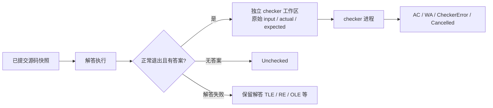

# 外部 checker 与 testlib 二元判题

共享 Core 已支持外部 checker；C++ `BatchRequest.external_checker`、批量 JSON/C ABI 和 CLI 使用同一配置语义。macOS 原生界面已接入 checker 配置、独立诊断和会话持久化；Windows 原生配置仍待接入，运行证据待目标机采集。

## 执行与结果

每个启用测试先执行解答。只有解答正常退出 0 且测试有 `expected` 时才启动 checker；缺答案保留 `Unchecked`，空答案仍运行 checker。配置了外部 checker 时，它决定该测试的 AC／WA；`comparison` 仅用于没有配置外部 checker 的内置比较。

checker 拥有独立临时工作区，按原始字节写入 input、actual、expected 三份文件，以结构化 executable／argv 启动，stdin 为空。参数逐项、单次展开 `${input}`、`${actual}`、`${expected}`、`${job_dir}`、`${source_dir}`；替换结果不会再次作为模板解析。不拼接 shell。工作区自动清理，源文件目录仅作为显式可选参数值，不保存 checker 临时文件。



默认退出码 0 为 AC、1／2 为 WA，对应 testlib 的 OK／WA／PE 二元处理。其他码，包括 FAIL 3 和评分码 7，均为 `CheckerError`。配置可明确指定其他互不重叠的二元映射，例如将 7 列入 AC；Core 不解析 stdout 分数、不凭诊断文本猜测结果。完整评分判题仍未实现。

checker 的超时、信号／异常结束、输出超限、创建／I/O 失败和未映射退出码均为 `CheckerError`，不能改成解答的 TLE／RE／OLE。取消使用 `Cancelled`。每条测试结果保留解答 `process`，以及独立的 `checker` 对象（verdict、process_attempted、process、detail）；原始 stdout／stderr 使用 base64 序列化，包含总采集数和截断标记。

## 版本 1 配置

以下配置要求 checker 已编译为可从 PATH 发现的程序；也可填写明确的可执行文件路径。编译 checker 本身的工作流尚待接入。

```json
{
  "schema_version": 1,
  "command": {
    "executable": "checker",
    "arguments": ["${input}", "${actual}", "${expected}"]
  },
  "limits": {
    "spawn_timeout_ms": 5000,
    "wall_timeout_ms": 2000,
    "terminate_grace_ms": 100,
    "drain_timeout_ms": 500,
    "stdout_bytes": 1048576,
    "stderr_bytes": 1048576,
    "combined_bytes": 2097152
  },
  "accepted_exit_codes": [0],
  "wrong_answer_exit_codes": [1, 2],
  "inherit_environment": true,
  "environment": []
}
```

在批量请求内使用 `external_checker` 字段提供此对象，null 或缺失表示内置比较。C++ 的对应类型为 `ExternalCheckerSpec`，JSON 入口为 `parse_external_checker_spec`。配置文件最多 1 MiB，命令／环境总字节最多 64 KiB，参数最多 128 个；退出码必须是 0–255 的不同整数，AC 集合非空、AC／WA 集合不相交。重复／未知字段、浮点版本／限额、非法占位符、NUL／无效 UTF-8 参数和重复环境键均拒绝。

默认 checker 输入限额为 input 16 MiB、actual 8 MiB、expected 16 MiB，三者合计 32 MiB，路径最多 32768 字节。C++ 可提供 `ExternalCheckerBounds`。checker stdout／stderr 与编译、解答输出共享批次保留预算；剩余空间为 0 时只允许不输出的 checker。超量执行器端口输出也会防御截断，保留总数并改为输出超限，不能通过整数下溢突破预算。

当前进程能力不支持内存硬限额和硬启动期限；JSON 不接受未实现的 `memory_bytes`。这是本地程序运行器，不是安全沙箱；POSIX 进程组无法保证清理主动脱离进程组的程序。

## macOS 原生接入

原生测试面板的 **Configure Checker…** 编辑版本 1 JSON，Apply 先校验全部候选，成功后才更新有效配置；关闭 **External Checker** 保留配置。带内容的 `sheet(item:)` 草稿由独立窗口拥有编辑状态，首次打开显示当前正文，Escape 取消丢弃未应用文本。工具链配置使用同一呈现组件。界面和错误文案位于英文原生资源中。

每次 Run All 按值复制 checker 配置；结果将解答状态与 checker 的 verdict、进程是否尝试、终止原因、退出码／signal、系统错误、耗时、采集字节和截断分别显示。NUL、控制字节或无效 UTF-8 输出以有界十六进制预览显示，原始输出 `Data` 保留。没有 expected 时仍为 Unchecked，expected 为空时实际运行 checker。

独立版本化偏好保存开关和配置 JSON 的原始字符串。偏好总容量和单偏好 64 KiB 限额在 Apply 前校验；未知版本保持原样，包含 v1 与未来版本共存的情况。原生配置、会话存储和验证入口见 [macOS 说明](../apps/macos/README.md)。

## CLI

仓库根目录构建 Core 后，在 PowerShell 7 中运行：

```powershell
./out/core/dev/cpn-cli --profile ./resources/profiles/cpp-clang.json --source ./tests/fixtures/editor/unicode.cpp --tests ./tests/fixtures/editor/samples.json --checker ./checker.json
```

将示例配置保存为 `checker.json` 并选择本机实际工具链。Windows 使用验证脚本生成的 `out/windows/<Platform>/<Configuration>/core` 产物路径，Visual Studio 多配置生成器还带 Configuration 子目录。这里的命令没有替用户安装编译器或编译 checker。

CLI 测试文件为 JSON 数组，复用 `parse_test_cases` 严格解析，最多 4096 个测试／64 MiB；input 必须提供，支持 UTF-8 字符串或 base64 对象，空答案与缺答案保持区别。未知参数、缺值、重复选项及无效配置拒绝。AC／Unchecked 返回 0，WA／CheckerError／取消等返回 1，参数／配置／基础设施及编译错误返回 2。

## 验证范围

macOS 普通与完整严格警告 ASan/UBSan 的 12 项 CTest 通过。真实 helper 覆盖三个文件的 NUL／0xFF、Unicode 参数和可执行路径、AC／WA／空答案／无答案、checker 超时／异常／输出超限、默认评分码错误分类、独立结果序列化、C ABI 任务释放与取消。受控执行器测试覆盖协作取消、I/O 失败和超量输出预算。CLI 实际验证了 raw 字节、严格 schema、参数错误和原有三个 C++ 样例。Windows 编译与原生 UI 尚未完成相应验收。

### 2026-11-17T01:46:38+08:00 — macOS 原生验收

完整 41 项 Swift／原生／真实 Core 测试通过。根 agent 在独立 out 恢复文件中通过实际按钮验证原始字节 checker AC、比较 checker WA、默认退出 7 的独立 CheckerError／0.5 输出、无答案 Unchecked、非法浮点版本拒绝；退出重启后关闭状态和配置完整恢复。修复后的首次 checker／toolchain 配置窗口实际显示正文，取消保持原件，重新启用后判题链路再次通过。磁盘独立核对配置原始字节、文档 ID／revision、源码摘要和 NUL／0xFF 样例一致；应用打包启动及严格 codesign 校验通过。此证据来自 macOS 27.0.1 arm64，最低 macOS、Windows 系统 IME／UU 和性能矩阵仍待验收。
