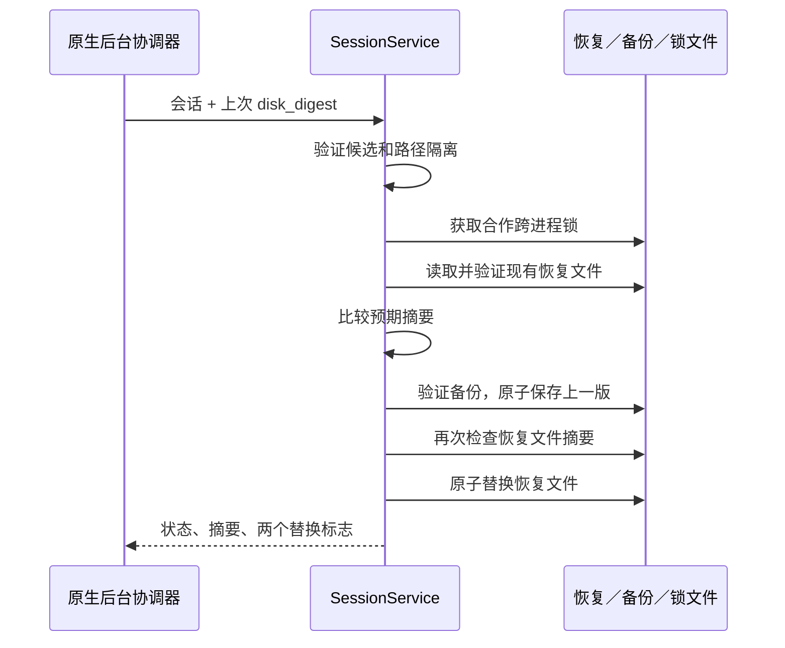

# 会话恢复与文件事务

本文记录已实现的共享会话服务。原生应用接入状态见 [实施状态](status.md)，完整设计契约见 [Core 契约](core-contracts.md)。恢复数据与用户源文件、编译产物分开存放；加载恢复文件不会读取或覆盖其中记录的源文件路径。

## 数据归属

工作区保存稳定的 `workspace_id`、`revision`、所选文档 ID 和文档列表。每个文档保存稳定 ID、revision、完整已提交 UTF-8 正文及 SHA-256、可选原路径、语言与工具链引用、保存点和测试。源码正文允许 NUL；测试保存原始字节，不能用替换字符掩盖解码错误。预期输出为 null 表示没有答案，空字符串表示答案为空。

ID 是不透明的 UTF-8 字节串，Core 不要求 UUID，也不做 Unicode 规范化。revision 是非负 64 位整数，Core 不会替原生客户端增加或回绕它。原生客户端必须处理版本耗尽，并以相同的原始身份关联结果。

`save_point` 保存当时的源码摘要、revision 和可选磁盘字节摘要。它必须关联有路径的文档，保存点版本不能大于当前版本；版本相同时源码摘要必须匹配。当前正文可以与保存点不同，以恢复尚未保存的编辑。

原生选区、编辑器选择和工作区配置通过 `editor_preferences` 保存。每项包含 `namespace_id`、`schema_version` 和 `object_json`。最后一项是有界 JSON 对象的原样字符串：Core 验证语法和限额，具体原生模块解释自己的命名空间与版本。未知命名空间和未来偏好版本可保留；不能因此重置或丢弃用户配置。工具链本身不在领域模型内展开，可由拥有该命名空间的原生模块保存完整配置及引用。

## 版本 1 格式

以下例子的正文为空，因此示例摘要是空字节的 SHA-256。`source_digest` 总由序列化器按真实正文生成。

```json
{
  "schema_version": 1,
  "workspace_id": "workspace-1",
  "revision": 1,
  "selected_document_id": "document-1",
  "documents": [{
    "document_id": "document-1",
    "revision": 0,
    "source_text": "",
    "source_digest": "e3b0c44298fc1c149afbf4c8996fb92427ae41e4649b934ca495991b7852b855",
    "original_path": null,
    "language_id": null,
    "toolchain_profile_id": null,
    "save_point": null,
    "tests": [{"id": "sample-1", "input": "", "expected": null, "enabled": true}],
    "editor_preferences": []
  }],
  "editor_preferences": [{
    "namespace_id": "example.native.editor",
    "schema_version": 1,
    "object_json": "{\"selectedEditor\":\"codeeditorview\"}"
  }]
}
```

非 UTF-8 测试字节使用 `{ "encoding": "base64", "data": "AP8=" }` 等严格 base64 对象，往返保留 NUL 与 0xFF。会话解析拒绝重复／未知字段、重复文档或测试 ID、摘要不匹配、无效 UTF-8、NUL 路径、浮点 revision、负数和超出限额的内容。未来的整体会话版本返回 `UnsupportedSchema`，原文件不会被改写。

默认限额：会话 JSON 64 MiB／64 层，128 个文档，每个文档最多 4096 个测试、总共最多 16384 个测试；单源码 16 MiB、单测试字段 4 MiB、正文与测试合计 32 MiB。每个偏好拥有者最多 16 个命名空间，单偏好 64 KiB／16 层，偏好合计 4 MiB。ID 最多 1024 字节、路径最多 32768 字节。C++ 可显式提供 `SessionBounds`；C ABI 保存还受引擎请求预算约束。

## 保存与冲突



三个路径必须互不别名，且不能与候选或既有会话中的源文件别名。恢复、备份和锁位置只能是普通文件或尚不存在的位置；不把断裂 symlink 当成缺失。已有恢复／备份损坏或不支持的版本会阻止覆盖，便于显式恢复／导出。

POSIX 使用 `flock`，Windows 使用 `LockFileEx`。锁文件保留，释放句柄结束锁，不在释放时删除文件而生成两套锁身份。默认等待 5 秒，支持超时和取消。使用同一持久锁路径的协作实例互斥；绕过锁的外部写入仍可能竞争最后的 rename。这是乐观摘要校验加合作锁，不是操作系统 CAS。

保存请求如下，`session` 为上面的完整对象。null 的预期摘要仅允许恢复文件尚不存在；已有文件必须使用加载后得到的摘要。

```json
{
  "schema_version": 1,
  "paths": {
    "recovery_file": "/absolute/application-support/workspace.json",
    "backup_file": "/absolute/application-support/workspace.backup.json",
    "lock_file": "/absolute/application-support/workspace.lock"
  },
  "session": {},
  "expected_disk_digest": null,
  "lock_timeout_ms": 5000
}
```

此处 `session: {}` 仅表示替换位置，实际调用必须提供有效会话。C ABI 的锁超时范围为 0–60000 毫秒。保存请求的外层和 paths 对象同样拒绝未知字段，拼错字段不能被静默忽略。目录由原生宿主在用户数据位置准备，不能存进源代码目录或应用只读包中。

| 操作 | 状态 | 客户端处理 |
| --- | --- | --- |
| 加载 | `Loaded`／`Missing` | 原子应用已验证候选，或创建新工作区 |
| 加载 | `Invalid`／`UnsupportedSchema`／`IOFailed` | 保留原件，报告错误或选择备份；不能静默覆盖 |
| 保存 | `Saved` | 按返回摘要推进本地保存 token |
| 保存 | `Conflict` | 不覆盖，重新加载或保存到新恢复位置 |
| 保存 | `InvalidSession`／`InvalidExisting` | 保留文件，修正候选或显式处理损坏数据 |
| 保存 | `LockUnavailable`／`Cancelled`／`IOFailed` | 检查两个替换标志，再决定重试或退出 |
| 保存 | `DurabilityUnknown` | 替换已发生，持久化未确认；不能当作完全未写入 |

返回的 `recovery_replaced` 与 `backup_replaced` 区分备份／恢复的提交时点；只有恢复已替换时才按其摘要推进 token。原子写入失败前后的差异由 `AtomicWriteError.destination_replaced` 表达。此服务保存恢复文件，不负责原生源文件的 NSFileCoordinator／Win32 外部修改冲突、权限授权和保存菜单流程。

## 已执行验证

macOS 普通与完整严格警告 ASan/UBSan 构建的 13 个 CTest 入口通过。会话与 ABI 测试覆盖未保存正文、稳定 ID／revision、原生未知偏好、NUL／0xFF、空／缺答案、损坏保留、两实例同 token 竞争、备份和恢复替换前后故障、缓冲区容量不足及取消。独立真实子进程验证跨进程排他锁与释放。

macOS 原生会话接入阶段：30 项 Swift 模型／真实编辑器／Core ABI 测试和真实应用重启恢复、源文件冲突保护、另存及恢复后判题通过；详情见 [macOS 说明](../apps/macos/README.md)。Windows 会话 UI、独立 SessionWorker、严格 RecoveryModel、SourceStore、关闭屏障及 MAX 最终事务已接入源码；macOS 主机的 13 组真实 C ABI 便携测试与独立复审通过。Windows 原生编译、TextChanging／Scintilla、输入法和完整恢复行为仍需 CI／目标主机验证。
